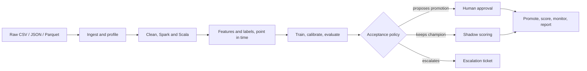

# TRIAD

A governed, agentic analytics platform. It takes raw e-commerce tables, builds a customer churn
model from them, and refuses to publish anything a person has not approved or a measurement does
not support.

The interesting part is not the model. It is that **every step leaves evidence**: a routing
decision with the rule that produced it, a hash-chained audit entry, a generated Scala job with
the gates it passed, a promotion that needs a second person, and a report in which no digit
appears unless a fact sheet entry backs it.



## Quick start

Everything runs in Docker. Nothing is installed on the host.

```bash
# 1. Start the platform
docker compose -f docker/compose.yaml up -d postgres mlflow api orchestrator frontend

# 2. Create the accounts (one per role). Choose a password; it is never written to a file.
docker compose -f docker/compose.yaml --profile tools run --rm -T \
    -e TRIAD_SEED_PASSWORD=<choose one> dev python scripts/seed_demo.py

# 3. Check the environment: 9 smoke checks, one skipped by design
docker compose -f docker/compose.yaml --profile tools run --rm -T dev \
    python -m pytest tests/smoke -q

# 4. Run the whole loop end to end, with generated data
docker compose -f docker/compose.yaml --profile tools run --rm -T dev \
    python scripts/run_demo.py --customers 400 --months 24
```

Then open <http://localhost:5173> and sign in as `admin@triad.test`.

The demo takes about fourteen minutes on the reference environment and finishes with a run in
`PUBLISHED` or `ESCALATED`. Both are correct outcomes: a challenger that does not beat the
champion with confidence is kept as a shadow model rather than promoted, and that is the
acceptance policy working.

| Service | URL | What it is |
| --- | --- | --- |
| Frontend | <http://localhost:5173> | Eleven pages: the eight the PRD names, plus monitoring, experiments and the audit trail |
| API | <http://localhost:8010/docs> | OpenAPI, 40 endpoints |
| MLflow | <http://localhost:5500> | Experiment tracking and the model registry |
| Prometheus metrics | <http://localhost:8010/metrics> | 12 metric families, read from the database per scrape |

## What is in the repository

| Path | What lives there |
| --- | --- |
| `agents/` | The orchestration: routing, code generation and its gates, the tool registry, the policy-checked graph, the worker |
| `backend/` | FastAPI service, SQLAlchemy models' API views, Alembic migrations |
| `dataeng/` | Ingestion, immutable versioning, profiling |
| `scala_spark/` | The Spark jobs, as templates and generated Scala |
| `python_ml/` | Splits, candidates, training, calibration, evaluation, the registry client |
| `triad_core/` | What every layer shares: models, storage, audit chain, policy engine, error taxonomy |
| `frontend/` | React 19 + Vite, no UI or chart library |
| `experiments/` | The ten PRD experiments and every result they have written |
| `docs/` | Everything below |
| `tests/` | 467 Python tests, plus smoke, integration, security and e2e suites |
| `scripts/` | `run_demo.py`, `replay_run.py`, `seed_demo.py`, `run_experiment.py` and other entry points |

## Documentation

| Document | For |
| --- | --- |
| [Setup guide](docs/setup.md) | Getting a working environment, and what to do when it will not start |
| [Architecture](docs/architecture/README.md) | Layers, data flow, where each decision is made |
| [Agent design](docs/agent-design.md) | The agents, their tools, permissions, policies and budgets |
| [API reference](docs/api/README.md) | Endpoints, authentication, error format, worked examples |
| [Database schema](docs/database-schema.md) | Twenty-one tables, their relationships and what each one is for |
| [Data dictionary](docs/data-dictionary.md) | Source tables, the 42-feature catalogue, the label, the contracts |
| [Model cards](docs/model-cards.md) | What a card contains, where each version's card lives, how to read one |
| [User guide](docs/user-guide/README.md) | The eight pages and what each answers |
| [Deployment](docs/runbooks/deployment.md) | Compose files, environment variables, secrets, backups |
| [Troubleshooting](docs/runbooks/troubleshooting.md) | The error taxonomy, the playbook, handling an escalation |
| [Limitations and ethics](docs/limitations-and-ethics.md) | What this does not do, and what it must not be used for |
| [Experiments](docs/implementation/EXPERIMENTS.md) | All ten, with what each measured and what it did not |
| [Requirements traceability](docs/implementation/REQUIREMENTS_TRACEABILITY.md) | Every PRD requirement against the evidence, including the ones not met |
| [Implementation status](docs/implementation/IMPLEMENTATION_STATUS.md) | Where the work stands; read this first when resuming |
| [Decision records](docs/adr/) | Architecture decisions, in context-decision-alternatives-consequences form |

## The governance rules, in one place

These are enforced in code, not documented as intentions, and each has a test that fails if the
enforcement is removed:

- **An agent cannot promote a model.** Only `ModelRegistry.promote` moves an alias, and it
  refuses without an approval id. No tool that moves an alias is registered at all.
- **An approver cannot be the requester.** Separation of duties, checked in the service and
  again at the API.
- **A report cannot contain a number nobody measured.** The claim check runs before
  publication; a report that fails it is not written.
- **The policy engine fails closed.** A missing or unparseable policy file denies every gated
  action rather than allowing it.
- **The audit trail detects tampering.** One hash chain per run plus a system chain, appended
  under an advisory lock, verifiable at `GET /api/v1/audit-logs/verify`.
- **Nothing samples randomly across time.** Splits are temporal with a gap rule of one label
  horizon, and a violation raises rather than warns.

## Testing

```bash
docker compose -f docker/compose.yaml --profile tools run --rm -T dev python -m pytest tests/unit -q
docker compose -f docker/compose.yaml --profile tools run --rm -T dev python -m ruff check .
docker compose -f docker/compose.yaml exec -T frontend npm run build
cd scala_spark && sbt test      # 21 ScalaTest cases
```

## A note on the numbers in these documents

Every measurement quoted anywhere in `docs/` was read back from something the system wrote — a
`result.json`, a database row, a run summary. Where a measurement was not taken, the documents
say so rather than carrying an estimate. Three experiment results have been deleted as false
after the fact rather than kept; they are described in the experiment log with what they
actually measured.
