# Case Study: Agentic Data Science Programming: Autonomous Python–Scala–Spark Ecosystems for Intelligent Analytics

17-09-2026 · Prepared by Dadhania Prit Shaileshbhai (Reg. No. 26MML0026)

## Title page and document control

This PRD specifies **TRIAD**, a governed, closed-loop agentic analytics platform that works across Python, Scala and Apache Spark. E-commerce customer churn prediction is the worked example throughout.

| Field | Detail |
| --- | --- |
| Case study | Agentic Data Science Programming: Autonomous Python–Scala–Spark Ecosystems for Intelligent Analytics |
| Document | Product Requirements Document (PRD), version 1.0, draft for faculty review |
| Proposed system name | TRIAD: Tri-engine Reasoning for Intelligent, Autonomous Data science |
| Worked example | E-commerce customer churn prediction |
| Prepared by | Dadhania Prit Shaileshbhai, Reg. No. 26MML0026 |
| Programme | M.Tech, Artificial Intelligence and Machine Learning, VIT Vellore |
| Course | Programming for Data Science (MACSE502), 2026 Fall Semester |
| Nature | Pre-implementation specification. It contains requirements, decisions, assumptions, targets and examples, but no measured results |

### How to read this document

Every statement carries one of the labels below, so a reader can tell a commitment from a guess.

| Label | Meaning | Binding? |
| --- | --- | --- |
| Requirement | Mandatory behaviour, written with "shall" and an ID (FR-, NFR-) | Yes |
| Design decision (DD) | The chosen approach and its rationale; changed only through a recorded decision | Yes, for the MVP |
| Assumption (ASM) | Believed true but not verified; listed in section 0 | No |
| Target (TGT) | An engineering objective to be tested by an experiment; not a result | No |
| Example (EX) | An illustrative value; fictional unless a source is linked | No |
| Measured result | None exist yet; they belong in the evaluation report (section 57) | — |

- **Priority** uses MoSCoW: Must (MVP), Should, Could. "Won't" items are listed as out of scope in section 5.
- **Ownership words** in tables name who does the work: Python, Scala, Spark, LLM agent, deterministic service, or human.
- **Normative verbs:** "shall" is mandatory, "should" is recommended, "may" is optional.

### Revision history

| Version | Date | Change |
| --- | --- | --- |
| 1.0 | 17-09-2026 | First complete draft covering all 59 sections |

## 0. Assumptions, Technology Conflicts and Resolutions

TRIAD targets Spark 4.1.x on JDK 17, Scala 2.13 and Python 3.11, and keeps every autonomous action inside written policy limits. The tables below record the assumptions and the reasoning behind each choice.

### 0.1 Architectural assumptions

| ID | Assumption | If it proves false |
| --- | --- | --- |
| ASM-01 | A university team of 3–5 members builds the prototype in one semester (about 16 weeks). | Cut scope from the bottom of the backlog (section 52), never from governance or testing. |
| ASM-02 | Workstations have at least 8 cores and 32 GB RAM; a small multi-node Spark cluster is available for scale experiments. | The 100 GB and 1 TB tiers stay design-only (section 31). |
| ASM-03 | Source data arrives in batches as CSV, JSON or Parquet files, or as database extracts. | The streaming connector (FR-008) becomes a Must. |
| ASM-04 | An LLM with tool calling and JSON output is reachable through an adapter, hosted or local. | The pipeline still runs in template-only mode, with less adaptive repair (section 44). |
| ASM-05 | E-commerce churn is non-contractual, so churn is defined operationally: no completed order in the 90 days after a cutoff date. | A changed definition needs approval (section 30) and starts a new model lineage. |
| ASM-06 | No real customer data is used; public datasets and a seeded synthetic generator stand in for production volumes. | Privacy controls in section 29 become mandatory before real data is loaded. |
| ASM-07 | Customer-level feature tables are small enough to train on one ML node. | The distributed training path (routing rule LR-06) becomes the default. |
| ASM-08 | One organisation uses the system, with several users and roles. | Multi-tenancy moves forward from section 50. |
| ASM-09 | "Deployment" means pointing the registry alias `champion` at a model version used by batch scoring. | Real-time serving adds latency requirements and a serving layer. |
| ASM-10 | The platform recommends; people decide and act. It never contacts customers or edits accounts. | Out of scope by design (section 5). |
| ASM-11 | Customer attributes are read as they stood at each cutoff date; attributes with only current values are excluded from features. | Attribute leakage would inflate metrics (section 17). |
| ASM-12 | The Spark cluster that runs agent-generated code is isolated from any production system. | Sandbox controls (section 22) must extend to every executor. |
| ASM-13 | Timestamps are stored in UTC; APIs use ISO 8601; reports show DD-MM-YYYY. | — |
| ASM-14 | Money stays in the source currency, with no conversion. | Currency normalisation becomes a cleaning rule. |
| ASM-15 | Only publicly accessible datasets are used, with the attribution their publishers require (section 43). | Swap the dataset; only schema mappings change. |

### 0.2 Technology conflicts and resolutions

| ID | Conflict | Design decision (DD) | Rationale |
| --- | --- | --- | --- |
| CR-01 | The brief suggests Spark 3.x, but the active line is 4.x (4.2.0, 4.1.3 and 4.0.4 all shipped in July 2026). | Pin **Spark 4.1.x** at its latest patch. Treat 4.2.x as a planned upgrade once dependencies confirm support. | 4.1 has three patch releases behind it; 4.2.0 is two months old, and ecosystem libraries usually trail a new minor. |
| CR-02 | Scala 2.12, 2.13 or Scala 3. | **Scala 2.13**, at the exact patch the Spark build uses. | Spark 4 ships only for Scala 2.13, and applications must match Spark's Scala version. |
| CR-03 | Which Java version. | **JDK 17** for build, driver and executors. | Spark 4.1 supports Java 17 and 21; one JDK avoids class-version errors. |
| CR-04 | Which Python version. | **Python 3.11**; 3.12 allowed if every pinned wheel exists. | Spark 4.1 needs Python 3.10 or newer. |
| CR-05 | Why generate Scala when PySpark DataFrame code compiles to the same optimised plan? | Routing policy in section 13: Scala for compiled, reusable jobs and any logic that would need a Python UDF; PySpark for read-only profiling. | Pure DataFrame code performs the same in both. Scala adds typed Datasets, JVM-native custom logic and a compiler that checks generated code for free. |
| CR-06 | pandas or Spark for the ML dataset. | Parquet hand-off with a size guard (LR-06). | Large Spark data is never collected onto one machine. |
| CR-07 | Single-node training (scikit-learn, XGBoost) or distributed (Spark MLlib, XGBoost on Spark). | Single-node by default on compact features; distributed only when the guard trips. | Faster iteration; the fallback covers scale. |
| CR-08 | LangGraph for agent control, or Airflow as scheduler. | LangGraph runs each run's control loop; a light scheduler plus a storage poller handles triggers. Airflow is a production extension. | Two orchestrators add cost without MVP value. |
| CR-09 | Celery, Redis or Kafka versus a database queue. | PostgreSQL queue using `FOR UPDATE SKIP LOCKED`, with LISTEN/NOTIFY for events. | One fewer service, and queue changes commit with run state. |
| CR-10 | Feast, Delta Lake or Iceberg versus plain Parquet. | Write-once, versioned Parquet folders with a manifest and a metadata row. Table formats come later. | Table formats must match the Spark version; append-only snapshots don't need them yet. |
| CR-11 | Great Expectations or Deequ versus in-house checks. | Declarative YAML rules compiled into Spark SQL aggregates. | No library-to-Spark-4 compatibility risk, and rules stay readable. |
| CR-12 | A vector database for agent memory. | None in the MVP; fix memory lives in PostgreSQL (FR-062); pgvector is optional. | Lookup by error fingerprint needs no embeddings. |
| CR-13 | Next.js, a React SPA or Streamlit. | **React + Vite + TypeScript** single-page app over the REST API. | No server rendering is needed, and role checks stay in the API. |
| CR-14 | MLflow stages or aliases. | **Aliases** `champion` and `challenger`, plus version tags for review status. | MLflow deprecated stages in 2.9.0; an alias can be reassigned, so rollback is one call. |
| CR-15 | Free-form LLM code versus fixed templates. | **Template-first generation**: agents fill declared slots in tested skeletons. | A smaller error surface; I/O, logging and metrics are never generated. |
| CR-16 | "Fully autonomous" versus governed. | **Bounded autonomy** with policy-as-configuration (section 30). | High-impact actions need a named human. |
| CR-17 | MinIO versus other self-hosted object storage. | MVP uses a shared volume behind a storage interface. For S3-compatible self-hosting, evaluate SeaweedFS or Garage; in the cloud, use the provider's store. | The MinIO community repository entered maintenance mode on 3 December 2025 and was archived on 13 February 2026. |
| CR-18 | Classic PySpark versus Spark Connect. | Classic PySpark inside the ML worker for the MVP; Spark Connect is optional. | One fewer server to run; Connect helps only if Python workers must avoid a JVM. |
| CR-19 | Spark 4 turns ANSI SQL mode on by default, so bad casts now raise errors. | Keep ANSI mode on. Generated code uses `try_cast` plus quarantine instead of switching the setting off. | Silent nulls hide bad data; explicit handling keeps row accounting honest. |

### 0.3 Verified version baseline

| Component | Verified fact | Source |
| --- | --- | --- |
| Apache Spark releases | 4.2.0 on 14 July 2026; 4.1.3 and 4.0.4 on 15 July 2026; 3.5.9 on 16 July 2026 | [Spark downloads](https://spark.apache.org/downloads.html) |
| Spark 4 builds | Pre-built with Scala 2.13; Scala 2.12 support dropped | [Spark downloads](https://spark.apache.org/downloads.html) |
| Spark 4.1 runtime | Java 17/21, Scala 2.13, Python 3.10+; Scala apps must match Spark's Scala version | [Spark 4.1.2 overview](https://spark.apache.org/docs/4.1.2/) |
| Spark SQL defaults | ANSI mode on by default since 4.0 | [Spark SQL migration guide](https://spark.apache.org/docs/4.0.2/sql-migration-guide.html) |
| MLflow registry | Stages deprecated since 2.9.0; aliases such as `champion` replace them | [MLflow registry workflows](https://mlflow.org/docs/latest/ml/model-registry/workflow) |
| MinIO community edition | Maintenance mode 3 December 2025; repository archived 13 February 2026 | [TuxCare on MinIO archival](https://tuxcare.com/blog/minio-els/) |

### 0.4 Open questions

| ID | Question | Owner | Needed by |
| --- | --- | --- | --- |
| OQ-01 | Is a 90-day churn horizon right, or should it be 60 days to suit shorter datasets? | Business analyst and faculty | Phase 3 |
| OQ-02 | Which LLM will the team use, hosted or local, and what is the per-run budget? | Project team | Phase 5 |
| OQ-03 | Is a multi-machine Spark cluster available for the 100 GB experiment? | Project team and lab administrator | Phase 8 |
| OQ-04 | Must the final PRD also be submitted as a Word or PDF file? | Faculty | Phase 9 |
| OQ-05 | Should the upgrade to Spark 4.2.x happen once XGBoost's Spark integration is confirmed? | Project team | Phase 1 |

## 1. Executive Summary

TRIAD turns a raw e-commerce data drop into a reviewed churn model, customer risk scores and a management report. Agents do the routine engineering; people approve the consequential steps.

The platform runs a closed loop. Agents observe new data, plan the work, generate and validate code, run it on Spark, evaluate models, repair failures and report, all inside written policy limits. Deterministic services check every agent output before anything runs.

In the worked example, millions of daily order and interaction records are cleaned and aggregated by Scala Spark jobs into one row per customer per snapshot date. Python then trains logistic regression, random forest and XGBoost candidates, selects and explains the best, and requests approval before it replaces the current model.

| Aspect | Summary |
| --- | --- |
| Problem | Hand-built churn pipelines are slow to build, break when data changes, span several languages and are hard to audit |
| Approach | An agent-orchestrated loop with deterministic verifiers and human approval gates |
| Why agentic | Agents make bounded choices from observed evidence: which cleaning rule, which engine, which model family, which repair |
| Why three engines | Spark scales the heavy data work; Scala gives compiled, type-checked Spark jobs; Python brings ML, statistics and agent frameworks |
| Primary users | Data engineers, data scientists, ML engineers, business analysts and administrators |
| MVP outcome | One governed end-to-end churn run on public data, with injected failures either recovered or escalated |
| Not claimed | Unsupervised production autonomy, or any measured result before the experiments in section 33 run |

### Technical significance

- **A verified closed loop.** Every generated artifact passes static checks, compilation, fixture tests, a sample dry run and a data contract before full execution.
- **The compiler as a verifier.** Scala's type checker catches a class of LLM mistakes before any cluster time is spent.
- **Explicit language routing.** Deterministic rules decide what runs in Python, in Scala or on Spark, and every decision is logged.
- **Leakage-safe churn modelling.** Features use only data before each cutoff date, and a gap rule separates training, validation and test snapshots.
- **Governance as configuration.** A versioned policy file sets what agents may do alone, what needs approval and what is forbidden.

### Expected outcomes

The MVP targets less hand-written pipeline code than a non-agentic Spark and Python baseline, recovery of most injected recoverable faults within bounded retries, and approval gating for every high-impact action. Section 34 turns these into measurable success criteria; none are results yet.

## 2. Problem Statement

Churn analytics at e-commerce scale fails less on algorithms than on the engineering around them. Joining, cleaning, windowing, retraining and explaining data that changes every day consumes most of the effort.

### 2.1 Problems with conventional pipelines

| Problem | How it shows up in churn work | Consequence |
| --- | --- | --- |
| Manual data engineering | Engineers hand-write joins across orders, returns, sessions and support tickets | Weeks pass before the first model |
| Repeated ETL code | RFM and window logic is re-coded for each dataset and snapshot | Feature definitions drift apart |
| Large-scale processing | Raw events outgrow a single pandas process | Crashes, or sampling that hides small segments |
| Hard model selection | Teams default to one familiar algorithm | Accuracy and calibration gains are missed |
| Manual retraining | Retraining waits for someone to notice decay | Stale scores steer retention spending |
| Late-visible degradation | Churn labels arrive 90 days after scoring, so decay surfaces late | Losses accumulate before anyone reacts |
| Fragmented environments | PySpark, Scala jobs and ML libraries drift to incompatible versions | "Works on my machine" failures |
| Human dependency | A failed nightly job waits for an engineer | Reporting windows are missed |
| Weak reproducibility | Data, code and parameters are not versioned together | Results cannot be recreated for audit |
| Monitoring gaps | Data drift, model drift and business impact are not linked | Failures stay silent |
| Documentation burden | Model notes and reports are written by hand | Documents fall out of date |
| Slow experimentation | Every trial needs code changes and a full rerun | Few alternatives are explored |

### 2.2 Formal problem statement

An organisation needs to turn fast-changing, high-volume customer data into reliable churn predictions without hand-building and supervising multi-language pipelines. Every automated decision must stay verifiable and reproducible, and high-impact actions must stay under human control.

### 2.3 Proposed solution

- An agent layer plans and generates pipeline code from tested templates, routed to Python, Scala or Spark by explicit rules.
- Deterministic verifiers check code and data before and after every execution.
- A bounded repair loop diagnoses failures, fixes what policy allows and escalates the rest with evidence.
- An ML layer selects, tunes, calibrates and explains models, then compares each challenger with the current champion.
- A governance layer enforces approval gates and records every action in an append-only audit trail.

### 2.4 Before and after

| Aspect | Conventional pipeline | TRIAD |
| --- | --- | --- |
| Pipeline code | Hand-written for each dataset | Generated from tested templates and validated before running |
| Failure handling | Waits for an engineer | Classified, repaired within budget, or escalated with evidence |
| Model choice | One fixed algorithm | Rule-based shortlist, tuned, then compared with the champion |
| Retraining | Ad hoc | Triggered by thresholds, drift, data volume or schedule |
| Governance | Informal | Policy file, approval gates and an append-only audit trail |
| Documentation | Written by hand | Generated from stored metrics, with every number checked |

## 3. Project Vision

TRIAD makes routine data science self-running but never unsupervised. It does the repetitive engineering, proves each step, and asks before anything irreversible.

The system is not "an LLM that writes Spark code". It is a closed control loop in which LLM agents propose, deterministic services verify, engines execute and humans approve.

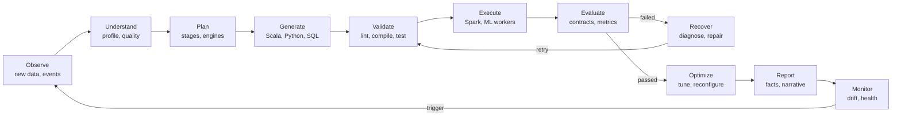

Each pass through the loop is one pipeline run; monitoring decides when the next pass starts.

### 3.1 Who does what in each stage

| Stage | What happens | Performed by | Churn example |
| --- | --- | --- | --- |
| Observe | Detect new files, schedule ticks, drift alerts | Deterministic service | A new day of order lines lands in the raw folder |
| Understand | Profile schema, nulls, duplicates, distributions; summarise issues | Spark computes; LLM agent summarises | 3% of lines lack a customer ID; cancellations appear as negative quantities |
| Plan | Choose stages, engines, join strategies and budgets | LLM agent within routing rules | Broadcast the small product table; build monthly snapshots |
| Generate | Fill template slots with Scala, Python or SQL | LLM agent | Scala window aggregations for recency, frequency and monetary value |
| Validate | Lint, policy scan, compile, fixture tests, dry run, contract check | Deterministic service | The compiler rejects a Double-versus-BigDecimal mismatch |
| Execute | Run jobs on Spark or ML workers in the sandbox | Spark, Scala, Python | Feature job runs across executors |
| Evaluate | Check output contracts and model metrics against policy | Deterministic service | PR-AUC is compared with the prevalence floor and the champion |
| Recover | Classify the failure, apply a playbook fix or regenerate, then retry | Deterministic first, LLM second | Executor out-of-memory handled by raising shuffle partitions |
| Optimize | Tune hyperparameters and Spark settings within budget | Python (Optuna) and LLM suggestions | 30 tuning trials for XGBoost |
| Report | Render charts from stored metrics; draft narrative; verify every number | Deterministic renderer, LLM narrative, claim checker | At-risk segment report for managers |
| Monitor | Track drift, run health and matured-label performance | Deterministic service | Population stability of top features after each scoring run |
| Approve (gate) | Promote a model, allow destructive cleaning or schema changes | Human | ML engineer approves the new champion |

### 3.2 Horizons

| Horizon | Scope | Status |
| --- | --- | --- |
| H1: semester MVP | One governed churn pipeline, end to end, on public and synthetic data | Goal of this project |
| H2: production extension | Cloud Spark, SSO, table formats, streaming ingestion, full monitoring stack | Designed, not built |
| H3: long-term aspiration | Several analytics use cases sharing agents, templates and fix memory | Aspiration only |

### 3.3 Design principles

- **Deterministic where possible, agentic where valuable.** An LLM is used only where judgement beats a rule.
- **Verify before trust.** No generated artifact runs at scale before it passes every gate.
- **Bounded autonomy.** Every loop has an attempt, time and cost ceiling enforced outside the agent.
- **Everything versioned.** Data, code, configuration, prompts, models and policies all carry versions.
- **Move computation to the data.** Heavy work stays on Spark; only compact tables reach Python.
- **Observable by default.** Every action leaves a log line, a metric and an audit record.
- **Humans own irreversible decisions.** Promotion, deletion and definition changes need a named approver.

## 4. Goals and Objectives

The project commits to eight primary objectives, each with a measurable indicator and a target that an experiment in section 33 will test. All targets are engineering objectives, not results.

### 4.1 Primary objectives

| ID | Objective | Indicator | Target (TGT) | Tested by |
| --- | --- | --- | --- | --- |
| PO-01 | Automate the end-to-end analytics workflow | Scripted runs that finish ingestion-to-report with no human action except policy approvals | At least 9 of 10 runs on the reference dataset | EXP-1, EXP-2 |
| PO-02 | Process large datasets with Spark | Largest input a feature job completes on the lab cluster | At least 100 million events | EXP-2, EXP-3 |
| PO-03 | Route work dynamically across Python and Scala | Stages with a logged routing decision citing a rule ID | 100% of stages | ATC-01, TC-052 |
| PO-04 | Automate model selection | Candidate families evaluated with recorded selection evidence | At least 3 families plus a dummy baseline, reproducible from logs | EXP-1, AT-07 |
| PO-05 | Correct errors autonomously | Injected recoverable faults fixed within the retry budget | At least 70% | EXP-4, EXP-6, EXP-8 |
| PO-06 | Retrain autonomously | Retraining triggers that fire correctly in drift and threshold tests | 100% of scripted trigger cases | EXP-7 |
| PO-07 | Produce reproducible reports | Replayed runs that reproduce stored outputs and metrics | Identical for deterministic stages; documented tolerance otherwise | AT-12 |
| PO-08 | Keep autonomy governed | High-impact actions attempted without approval that are blocked | 100% | EXP-10, ATC-17 |

### 4.2 Secondary objectives

| ID | Objective | Indicator |
| --- | --- | --- |
| SO-01 | Reduce coding effort | Hand-written pipeline lines and engineer hours versus Baseline 3 (section 32) |
| SO-02 | Improve scalability | Speed-up when Spark workers double on the 100 GB tier |
| SO-03 | Improve reproducibility | Share of runs with a complete manifest of versions and hashes |
| SO-04 | Reduce human intervention | Manual actions per run, excluding required approvals |
| SO-05 | Improve observability | Share of stages with duration, retry and resource metrics exported |
| SO-06 | Make decisions auditable | Share of agent actions with a decision record linked to evidence |

### 4.3 Goals versus aspirations

| Delivered in this project | Aspiration beyond it |
| --- | --- |
| Batch churn pipeline with approval-gated promotion | Continuous, streaming churn scoring |
| Rule-first repair with LLM fallback | Learned repair policies trained on past incidents |
| Rule-based Spark tuning suggestions | Self-optimising cluster configuration |
| Correlational explanations of churn drivers | Causal uplift models that pick the best retention action |
| One use case | A shared agent platform for many analytics use cases |

### 4.4 Non-goals

- Claiming full production autonomy; approvals remain part of the design.
- Beating state-of-the-art churn accuracy; the contribution is the governed workflow.
- Replacing data engineers; the system removes repetitive work and keeps experts in charge of exceptions.

## 5. Scope

The MVP covers one governed batch pipeline for binary churn classification, from file ingestion to approved model and management report. Anything irreversible, customer-facing or real-time is outside it.

### 5.1 In scope

| Capability | MVP depth | Notes |
| --- | --- | --- |
| Structured data ingestion | Full | CSV, JSON and Parquet upload plus folder watching |
| Semi-structured data | Partial | Nested JSON flattened by declared rules |
| Relational sources | Partial | One PostgreSQL source through JDBC |
| Automated profiling | Full | Spark-computed statistics with an LLM summary |
| Data quality validation | Full | YAML rules compiled to Spark SQL |
| Data cleaning | Full | Rule library with quarantine; destructive steps need approval |
| Spark processing | Full | Standalone cluster in containers; local mode for small inputs |
| Scala Spark jobs | Full | Clean, label and feature jobs generated from templates |
| Python ML pipelines | Full | scikit-learn and XGBoost with Optuna tuning |
| Autonomous model selection | Full | Rule-based shortlist, evidence-based ranking |
| Model evaluation | Full | Imbalance-aware metrics, calibration and segment checks |
| Retraining | Full | Threshold, drift, volume and schedule triggers |
| Error handling | Full | Taxonomy, playbooks, LLM repair, bounded retries |
| Report generation | Full | HTML reports with claim verification; PDF optional |
| Dashboard visualisation | Core pages | Dashboard, pipeline, model, predictions and approvals first |
| Agent monitoring | Full | Decision records, budgets and timelines |
| Execution logs | Full | Structured JSON logs with run and stage IDs |
| Human approvals | Full | Promotion, destructive cleaning, schema and definition changes |
| Batch prediction | Full | Official and shadow prediction sets |
| Streaming extensibility | Interface only | Connector contract designed, not built |

### 5.2 Out of scope

| Item | Reason |
| --- | --- |
| Fully autonomous irreversible production actions | Irreversible changes always need a human (section 30) |
| Real-world financial or medical decisions | Regulatory and ethical risk outside an academic prototype |
| Training foundation models from scratch | Cost, and no benefit to the churn use case |
| Unlimited cloud infrastructure | Budgets and resource quotas apply to every run |
| Direct changes to customer accounts or sending offers | The system recommends; people act (ASM-10) |
| Autonomous deletion of production datasets | Forbidden to agents; manual administrator procedure only |
| Real-time streaming ingestion and online inference | Future extension (section 50) |
| Real customer personal data | Public and synthetic data only (ASM-06) |
| Multi-tenant hosting | Single organisation assumed (ASM-08) |
| Causal uplift modelling | The MVP explains associations, not causes |

### 5.3 Boundaries

- **Task types:** binary classification is validated; the design leaves room for regression and multiclass without validating them.
- **Data tiers:** 10 GB is validated in the MVP, 100 GB is a stretch goal, and 1 TB or more is a design target only (section 31).
- **Languages:** generated code is limited to Scala, Python and Spark SQL, inside approved templates.

## 6. Target Users and Personas

Five human roles use TRIAD, and the agents act as a sixth, system-level actor with narrower rights than any person.

| Persona | Goals | Inputs | Actions | Outputs | Permissions | Interface needs |
| --- | --- | --- | --- | --- | --- | --- |
| Data Scientist | Find the best churn model quickly and understand its drivers | Feature sets, experiment history, business definitions | Start runs, adjust search spaces, inspect candidates, review explanations | Selected models, model cards, analysis notes | Start or cancel runs; view code, logs and identified predictions | Candidate comparison, charts, SHAP views, experiment diff |
| Data Engineer | Keep ingestion and Spark jobs correct, fast and cheap | Source files, schemas, contracts, cluster metrics | Register sources, review cleaning plans, approve schema mappings, tune jobs | Dataset versions, contracts, approved templates | Manage datasets; approve destructive cleaning and schema changes for owned datasets | Profiles, schema diffs, Spark stage metrics, generated-code diffs |
| ML Engineer | Promote only models that are better and safe; keep scoring healthy | Evaluation reports, drift reports, champion history | Approve or reject promotion, roll back, set retraining policy | Champion changes, deployment records | Approve promotion (never their own request); roll back models | Evidence bundle, confidence intervals, segment checks, rollback control |
| Business Analyst | Know who is at risk, why, and what it may cost | Predictions, segment definitions, business rules | Filter at-risk customers, read reports, export lists, propose definition changes | Retention target lists, management briefings | View identified predictions and reports; export with audit | Plain-language report, provenance badges, segment filters |
| System Administrator | Keep the platform secure, available and within budget | Health metrics, alerts, audit logs | Manage users and roles, budgets, policies and connections | Configured, monitored platform | Full administrative rights; policy changes go through review | Health dashboard, audit search, budget meters |
| AI agent (system actor) | Finish its assigned task within policy and budget | Task specification, context bundle, tool results | Calls only registered tools with validated arguments | Plans, code artifacts, decision records | Service identity scoped to the run; no approval rights; cannot edit policies | Tool registry, state API, prompt templates |

### 6.1 How the agent actor differs

- Agents never hold a person's credentials; each run gets a scoped service identity.
- Agents may propose any action, but the policy engine decides whether it runs, waits for approval or is refused.
- Agent outputs are summaries, code and structured decisions; hidden reasoning is neither requested nor stored.

## 7. Use Cases

Twenty use cases cover the loop from new data to monitored model. Each names who acts, what starts it, the normal path, the alternatives, the failures and how success is judged.

### UC-01 Upload or detect new data

| Field | Detail |
| --- | --- |
| Actor | Data Engineer (upload); Data Discovery Agent and scheduler (detection) |
| Trigger | A user upload, a new file under a watched folder, or a scheduled database extract |
| Preconditions | The source is registered with a connector and an optional contract; storage is reachable; the user may write datasets |
| Inputs | CSV, JSON or Parquet files, or a JDBC query; source metadata (entity type, owner) |
| Main flow | (1) The poller lists files newer than the last watermark. (2) It computes a SHA-256 checksum, size and format. (3) The agent matches the file to a registered dataset by path pattern and schema signature. (4) The file is copied to an immutable versioned folder. (5) A dataset version is recorded and an event is emitted. (6) If the dataset's auto-run policy allows, a run is queued (UC-20). |
| Alternative flow | An unknown source gets a proposed mapping that a Data Engineer must confirm. An identical checksum is marked duplicate and starts nothing. |
| Exception flow | Corrupt files go to quarantine with an alert. A file still growing is re-checked until its size is stable. Storage errors retry with backoff, then alert the administrator. |
| Outputs | Dataset version record, ingestion event, audit entry |
| Postconditions | Raw data is immutable and addressable by version ID |
| Success criteria | New files are registered within one polling interval (TGT: 5 minutes); identical checksums never create a second version |

### UC-02 Profile a dataset automatically

| Field | Detail |
| --- | --- |
| Actor | Data Profiling Agent; profiling service on Spark |
| Trigger | A new dataset version, or a user request |
| Preconditions | The version is registered and Spark is available |
| Inputs | Dataset version ID; profiling settings such as sample fraction and quantiles |
| Main flow | (1) Spark reads the data with the contract schema or an inferred one. (2) It computes per-column type, null rate, approximate distinct count, min, max, mean, standard deviation, approximate quantiles and top values. (3) It computes row count, key duplicates and full-row duplicates. (4) It flags outliers with the interquartile-range rule. (5) It compares against the previous version: schema diff and population stability. (6) The agent writes a summary and an issue list, each issue linked to its metric. |
| Alternative flow | Very large data is profiled on a stratified sample, while cheap exact counts (rows, nulls) still use all data. |
| Exception flow | Mixed-type columns are re-read as strings for a type-coercion analysis. Job failures follow the repair loop (section 20). |
| Outputs | Profile document, quality score, issue list, schema diff |
| Postconditions | The run reaches PROFILED |
| Success criteria | Every column is profiled; exact metrics reproduce exactly; approximate ones stay within their stated error |

### UC-03 Clean data automatically

| Field | Detail |
| --- | --- |
| Actor | Data Cleaning Agent; Scala job on Spark; Data Engineer when approval is needed |
| Trigger | Profile issues exceed quality thresholds |
| Preconditions | The run is PROFILED and a cleaning policy exists |
| Inputs | Profile, issue list, data contract, cleaning rule library |
| Main flow | (1) The agent maps each issue to a library rule, such as exact de-duplication or cast-with-quarantine. (2) It orders the rules and estimates their impact from the profile. (3) The policy engine checks the estimate against limits. (4) The plan compiles into a Scala job and runs. (5) Invalid rows go to quarantine, never deleted. (6) The data is re-profiled to confirm the issues are gone. |
| Alternative flow | A Data Engineer edits the plan before it runs. Domain rules override naive ones: negative quantities on cancellation invoices become returns, not errors. |
| Exception flow | A plan affecting more than 5% of rows (EX default) pauses for approval. Issues that survive two cleaning passes are escalated. |
| Outputs | Cleaned dataset version, quarantine set, cleaning report with per-rule counts |
| Postconditions | Blocking issues are resolved |
| Success criteria | Row accounting holds: input rows equal output plus quarantined plus removed duplicates |

### UC-04 Generate a Spark transformation plan

| Field | Detail |
| --- | --- |
| Actor | Spark Planning Agent |
| Trigger | Clean data and a feature specification are ready |
| Preconditions | Profiles include sizes and key cardinalities; cluster quotas are known |
| Inputs | Profiles, feature catalog, cluster resource profile, statistics from past runs |
| Main flow | (1) Build the logical flow: sources, joins, windows, aggregations, outputs. (2) Choose join strategies, such as broadcasting the small product table. (3) Set partitioning and shuffle partitions. (4) Decide what to cache. (5) Apply the routing rules to each step. (6) Request resources within quota. (7) Emit a plan document with decision records. |
| Alternative flow | Inputs below the small-data threshold run the same job in Spark local mode. |
| Exception flow | A referenced column is missing: return to contract resolution. Quota is insufficient: escalate. |
| Outputs | Execution plan with a readable summary |
| Postconditions | The run reaches PLANNED |
| Success criteria | Every referenced column exists; the resource request is within quota |

### UC-05 Generate a Scala Spark job

| Field | Detail |
| --- | --- |
| Actor | Code Generation Agent; build service (sbt) |
| Trigger | A validated plan |
| Preconditions | Template project, schema case classes and coding rules are available |
| Inputs | Plan document, template, schema, forbidden-API list |
| Main flow | (1) Select the template, for example the feature job. (2) Generate code only inside the template's declared slots. (3) Run formatting and the forbidden-API scan. (4) Compile incrementally. (5) Run unit tests on fixture data with a local SparkSession. (6) Package a thin JAR with Spark marked as provided. (7) Store source and JAR with content hashes. |
| Alternative flow | If the template already covers the plan, parameters are filled with no LLM call. |
| Exception flow | Compile errors enter the repair loop (up to 3 attempts). Forbidden APIs trigger regeneration with the violation list. The same error twice escalates. |
| Outputs | JAR, source, test report, code artifact record |
| Postconditions | The run reaches VALIDATED after the dry run in UC-06 |
| Success criteria | The job compiles, passes fixture tests and meets the output contract |

### UC-06 Execute distributed processing

| Field | Detail |
| --- | --- |
| Actor | Execution Agent (deterministic executor with LLM diagnosis) |
| Trigger | A validated artifact |
| Preconditions | Artifact, configuration and input versions are recorded |
| Inputs | JAR or script, resource profile, dataset versions |
| Main flow | (1) Dry-run on a sample in the sandbox and check the output contract. (2) Submit the full job with a run-scoped application name. (3) Poll Spark's monitoring API for stages, failed tasks, shuffle and spill. (4) Validate the output contract. (5) Commit outputs and register the feature-set version. (6) Record duration and resource metrics. |
| Alternative flow | A soft time limit notifies the owner; a hard limit stops the job and starts diagnosis. |
| Exception flow | Executor loss, out-of-memory or skew follows section 20. A contract violation fails the stage for diagnosis. |
| Outputs | Feature Parquet, execution record, Spark event log |
| Postconditions | The run reaches FEATURES\_READY |
| Success criteria | Contract passes; metrics are recorded for every stage |

### UC-07 Generate the ML pipeline

| Field | Detail |
| --- | --- |
| Actor | Code Generation Agent (Python); ML Model Selection Agent |
| Trigger | A feature-set version is registered |
| Preconditions | Feature metadata carries types and leakage tags |
| Inputs | Feature schema, target definition, split policy |
| Main flow | (1) Choose model-specific preprocessing from templates. (2) Build the time-based split by snapshot date. (3) Generate the training script from a template. (4) Lint and scan it. (5) Run leakage checks. |
| Alternative flow | A user-supplied pipeline configuration replaces generated preprocessing. |
| Exception flow | A leakage check fails: the offending feature is removed and the decision recorded; repeated failure escalates. |
| Outputs | Pipeline configuration and code artifact |
| Postconditions | Training can start |
| Success criteria | The pipeline runs on a fixture sample and every leakage check passes |

### UC-08 Select candidate models

| Field | Detail |
| --- | --- |
| Actor | ML Model Selection Agent |
| Trigger | The ML pipeline is ready |
| Preconditions | Task type and class balance are known |
| Inputs | Row and feature counts, feature types, time and interpretability constraints |
| Main flow | (1) The rule table proposes a dummy baseline, logistic regression, random forest, histogram gradient boosting and XGBoost. (2) The agent may reorder or drop families within the registry, with a written justification. (3) Search spaces and budgets are assigned. |
| Alternative flow | A neural network is added only when its justification rule is met (section 17). |
| Exception flow | A family outside the registry is refused and logged. |
| Outputs | Candidate list with budgets |
| Postconditions | Training tasks are queued |
| Success criteria | At least three real families plus the dummy baseline |

### UC-09 Train models

| Field | Detail |
| --- | --- |
| Actor | Training Agent (deterministic runner) |
| Trigger | Candidate list ready |
| Preconditions | Training set written; size guard evaluated |
| Inputs | Training set, candidate configurations, seeds |
| Main flow | (1) Train each candidate with a fixed seed. (2) Log parameters, metrics and artifacts to MLflow. (3) Enforce the time budget per candidate. |
| Alternative flow | If the size guard trips, use the distributed trainer. |
| Exception flow | A convergence warning triggers scaling or more iterations; a persistent failure drops the candidate if two or more remain. |
| Outputs | MLflow runs |
| Postconditions | The run reaches TRAINING complete |
| Success criteria | Every surviving candidate has a logged run |

### UC-10 Evaluate models

| Field | Detail |
| --- | --- |
| Actor | Evaluation Agent (deterministic metrics, LLM summary) |
| Trigger | Training complete |
| Preconditions | The validation snapshot is untouched by training |
| Inputs | Models, validation and test snapshots |
| Main flow | (1) Compute PR-AUC, ROC-AUC, log loss, Brier score, calibration error and lift on validation. (2) Compute segment metrics. (3) Bootstrap confidence intervals. (4) Compute SHAP on a sample for the leading model. (5) Summarise in plain language. |
| Alternative flow | Metrics on the test snapshot are computed once, only for the final selection. |
| Exception flow | Missing classes in a segment mark that segment "insufficient data". |
| Outputs | Evaluation report |
| Postconditions | The run reaches EVALUATED |
| Success criteria | All metrics are stored with their split and segment |

### UC-11 Detect poor performance

| Field | Detail |
| --- | --- |
| Actor | Evaluation Agent and policy engine |
| Trigger | Evaluation completes, or matured-label metrics arrive from monitoring |
| Preconditions | An acceptance policy is configured |
| Inputs | Metrics, baselines, champion metrics |
| Main flow | (1) Compare against absolute floors, baselines and the champion. (2) Check calibration and segment gaps. (3) Emit reason codes such as PR\_AUC\_BELOW\_FLOOR or MISCALIBRATED. |
| Alternative flow | Warnings that don't block, such as a small segment gap, are recorded for the report. |
| Exception flow | Suspiciously high scores raise a leakage alarm and block selection. |
| Outputs | Reason codes and verdict |
| Postconditions | The run moves to OPTIMIZING or SELECTED |
| Success criteria | Every verdict cites the rule and metric behind it |

### UC-12 Retrain automatically

| Field | Detail |
| --- | --- |
| Actor | Training Agent, Optimization Agent, retraining controller |
| Trigger | Reason codes, drift, data-volume or schedule triggers |
| Preconditions | Cooldown period has passed; data quality is acceptable |
| Inputs | Trigger evidence, latest data window |
| Main flow | (1) Pick a remedy by reason code: calibrate, tune, try another family, or retrain on a recent window. (2) Run within budget. (3) Re-evaluate. (4) Loop at most twice. |
| Alternative flow | Drift without matured labels retrains on the newest labelled window only. |
| Exception flow | Still failing after the limit: FAILED\_QUALITY and escalation with a diagnostic report. |
| Outputs | New candidate models |
| Postconditions | A challenger exists or the run is escalated |
| Success criteria | Loop count never exceeds the limit |

### UC-13 Optimise hyperparameters

| Field | Detail |
| --- | --- |
| Actor | Optimization Agent (Optuna) |
| Trigger | Top families chosen after screening |
| Preconditions | Search spaces defined per family |
| Inputs | Training and validation snapshots, budgets |
| Main flow | (1) Run a seeded TPE sampler with median pruning. (2) Optimise validation PR-AUC with a training-time penalty. (3) Stop at the trial or time budget. (4) Record every trial. |
| Alternative flow | Parallel trials share an Optuna study stored in PostgreSQL. |
| Exception flow | Failed trials are recorded and skipped. |
| Outputs | Best parameters per family |
| Postconditions | Tuned candidates are ready |
| Success criteria | Tuning gain, or its absence, is documented |

### UC-14 Select the best model

| Field | Detail |
| --- | --- |
| Actor | Evaluation Agent and policy engine; ML Engineer reviews |
| Trigger | Tuned candidates evaluated |
| Preconditions | Hard constraints are configured |
| Inputs | Candidate metrics, constraints, champion metrics |
| Main flow | (1) Drop candidates failing hard constraints. (2) Rank the rest by validation PR-AUC. (3) Prefer the simpler model within a small margin. (4) Score the winner once on the test snapshot. (5) Compare it with the champion on the same snapshot with bootstrap intervals. (6) Register it with alias `challenger` and write a model card. |
| Alternative flow | With no champion yet, the first model always needs approval. |
| Exception flow | No candidate passes: escalate. |
| Outputs | Selected model version and model card |
| Postconditions | The run reaches SELECTED |
| Success criteria | Selection is reproducible from stored metrics |

### UC-15 Generate predictions

| Field | Detail |
| --- | --- |
| Actor | Prediction service |
| Trigger | A scoring snapshot is built, or a challenger needs shadow scores |
| Preconditions | A champion or challenger exists; the feature schema matches the model signature |
| Inputs | Scoring features for today's cutoff, model alias |
| Main flow | (1) Load the model by alias. (2) Score in pandas or through a Spark UDF depending on size. (3) Assign risk bands and top reasons. (4) Write full scores to Parquet and a summary to PostgreSQL, stamped with versions. |
| Alternative flow | Shadow predictions are stored separately and never published as official. |
| Exception flow | A signature mismatch aborts scoring with an alert. |
| Outputs | Prediction set |
| Postconditions | The dashboard can show scores |
| Success criteria | Every row carries model and feature-set versions |

### UC-16 Generate a management report

| Field | Detail |
| --- | --- |
| Actor | Reporting Agent and report renderer; Business Analyst reads |
| Trigger | Scoring complete, or a draft needed for an approval |
| Preconditions | Metrics are stored with IDs |
| Inputs | Fact sheet of metric IDs and values, charts, segment tables |
| Main flow | (1) Render charts from stored data. (2) The agent drafts the narrative using fact placeholders only. (3) The claim checker verifies every number and flags causal wording. (4) Sections are labelled by provenance. (5) Export to HTML, with PDF optional. |
| Alternative flow | Analysts request a segment-specific version. |
| Exception flow | Two failed claim checks fall back to a template-only narrative. |
| Outputs | Technical and business reports |
| Postconditions | Report is available in the UI |
| Success criteria | No unverified number appears in any report |

### UC-17 Trigger human approval

| Field | Detail |
| --- | --- |
| Actor | Governance Agent (policy engine); approvers |
| Trigger | Any action whose policy requires approval |
| Preconditions | Approver roles are assigned |
| Inputs | Action, evidence bundle |
| Main flow | (1) Create the approval request with evidence. (2) Notify approvers in the app. (3) Pause the run. (4) The approver decides with a mandatory comment. (5) The run resumes or takes the rejection path. |
| Alternative flow | Several approvers are required for policy overrides. |
| Exception flow | Requests expire after 72 hours (EX) and count as rejected; a requester cannot approve their own promotion. |
| Outputs | Approval record |
| Postconditions | The decision is audited |
| Success criteria | No gated action runs without a recorded approval |

### UC-18 Deploy an approved model

| Field | Detail |
| --- | --- |
| Actor | Deployment service; ML Engineer |
| Trigger | Promotion approved |
| Preconditions | Approval recorded by someone other than the requester |
| Inputs | Model version, previous champion |
| Main flow | (1) Record the current champion. (2) Move the `champion` alias. (3) Smoke-score a sample and check the score distribution. (4) Publish official predictions. |
| Alternative flow | An ML Engineer can roll back manually at any time. |
| Exception flow | A failed smoke test rolls the alias back automatically, a pre-approved safe action, and raises an alert. |
| Outputs | Deployment record |
| Postconditions | The run reaches DEPLOYED, then PUBLISHED |
| Success criteria | Rollback restores the previous version in one step |

### UC-19 Monitor the pipeline

| Field | Detail |
| --- | --- |
| Actor | Monitoring service; System Administrator; ML Engineer |
| Trigger | Continuous, plus every scoring run |
| Preconditions | Metrics exporters and reference distributions exist |
| Inputs | Run metrics, logs, Spark metrics, prediction sets, matured labels |
| Main flow | (1) Collect run health and resource metrics. (2) Compute feature and score drift after each scoring run. (3) Compute real performance once labels mature, 90 days later. (4) Raise alerts by rule. |
| Alternative flow | Historical replay simulates label maturity for demos. |
| Exception flow | Missing metrics raise their own alert. |
| Outputs | Alerts, drift reports, health status |
| Postconditions | Retraining triggers are evaluated |
| Success criteria | Every alert links to its evidence |

### UC-20 Rerun the pipeline on new data

| Field | Detail |
| --- | --- |
| Actor | Scheduler, Data Discovery Agent, orchestrator |
| Trigger | A new dataset version plus the dataset's rerun policy |
| Preconditions | A previous successful run exists |
| Inputs | New and previous input versions |
| Main flow | (1) Hash inputs, code and configuration for each stage. (2) Reuse outputs whose hashes match. (3) Run only affected stages. (4) Decide whether to retrain or only rescore. |
| Alternative flow | Replay mode reruns stored artifacts with no LLM calls. |
| Exception flow | Changed schemas force full re-planning. |
| Outputs | New run |
| Postconditions | Predictions reflect the new data |
| Success criteria | Unchanged stages are skipped, with the reuse logged |

## 8. Functional Requirements

The catalogue holds 84 functional requirements: 65 Must, 16 Should and 3 Could. Each row reads as "The system shall provide *Requirement*: *Description*", and test IDs mirror requirement IDs, so FR-026 is verified by TC-026.

### 8.1 Data ingestion

| ID | Requirement | Priority | Description | Acceptance criteria |
| --- | --- | --- | --- | --- |
| FR-001 | CSV ingestion | Must | Configurable header, delimiter, quote and encoding; malformed lines captured with a corrupt-record column | A 1-million-row fixture loads with an exact row count; malformed lines reach quarantine with line references |
| FR-002 | JSON ingestion | Must | JSON Lines and multi-line JSON; nested fields flattened by declared rules | A nested fixture flattens to the documented schema |
| FR-003 | Parquet ingestion | Must | Schema read from file footers; partitions discovered | A partitioned fixture loads with partition columns present |
| FR-004 | Relational ingestion | Should | PostgreSQL through JDBC with partitioned parallel reads; credentials from the secret store | A 1-million-row table loads through at least 4 parallel partitions; no credential appears in logs |
| FR-005 | Storage watching | Must | Watched folders or S3-compatible prefixes polled; files registered only once their size is stable or a success marker exists | A new file is registered within one polling interval |
| FR-006 | Immutable dataset versioning | Must | Checksum, size, schema hash and source recorded; raw copies are write-once | An identical re-upload creates no version; a changed file creates one |
| FR-007 | Ingest contract validation | Must | Optional YAML contract of required columns, types and nullability; violations marked blocking or not | A missing required column stops the run with a reason code |
| FR-008 | Streaming-ready connector interface | Could | A streaming source can be added later without changing downstream contracts | Interface documented; a stub connector compiles |

### 8.2 Data profiling

| ID | Requirement | Priority | Description | Acceptance criteria |
| --- | --- | --- | --- | --- |
| FR-009 | Schema and semantic type inference | Must | Physical types plus semantic types: identifier, timestamp, currency, category, free text | At least 10 of 12 semantic types labelled correctly on the fixture (TGT) |
| FR-010 | Null analysis | Must | Null and empty-string rate per column | Exact match with a reference computation |
| FR-011 | Cardinality analysis | Must | Approximate distinct counts with configurable error; exact counts for small key sets | Results fall within the configured error bound |
| FR-012 | Distribution statistics | Must | Min, max, mean, standard deviation, approximate quantiles, sampled histograms, top values | All statistics stored per column and version |
| FR-013 | Outlier detection | Should | Interquartile-range and robust z-score flags with counts | Seeded outliers are flagged |
| FR-014 | Duplicate detection | Must | Key duplicates and full-row duplicates through a row hash | Seeded duplicates are counted exactly |
| FR-015 | Version comparison and quality score | Must | Schema diff, population stability against the previous version, weighted quality score | A renamed column and a shifted distribution both appear in the diff |

### 8.3 Data cleaning

| ID | Requirement | Priority | Description | Acceptance criteria |
| --- | --- | --- | --- | --- |
| FR-016 | Null handling | Must | Drop rows with null keys; impute others by median, mode or constant; add indicator columns | Rules apply only where the plan says; counts are reported |
| FR-017 | Duplicate removal | Must | Exact and key-based de-duplication with a deterministic tie-break | Re-running produces identical output |
| FR-018 | Invalid value quarantine | Must | Range and domain rules; failing rows move to quarantine with a reason code | No failing row is silently dropped |
| FR-019 | Safe type conversion | Must | `try_cast` semantics under ANSI mode; unparseable values counted and quarantined | A fixture with bad numbers finishes without a cast error |
| FR-020 | Text and unit normalisation | Should | Trimming, case folding, standard country codes and units | Normalised values match the reference lists |
| FR-021 | Category vocabulary management | Should | Versioned vocabularies; rare categories bucketed | Unseen categories map to "other" at scoring time |
| FR-022 | Anomaly detection | Should | Daily volume anomalies, distribution shifts, business-rule breaches such as non-positive prices | Seeded anomalies raise issues with evidence |
| FR-023 | Row accounting and cleaning report | Must | Input rows equal output plus quarantined plus removed duplicates, per rule | The equation holds on every run; a mismatch fails the stage |

### 8.4 Feature engineering

| ID | Requirement | Priority | Description | Acceptance criteria |
| --- | --- | --- | --- | --- |
| FR-024 | Automated feature suggestions | Should | The agent proposes catalog features the available columns support, with leakage risk | Every suggestion lists its required columns and formula |
| FR-025 | Domain-aware churn features | Must | RFM, order value, returns, discounts, category diversity, value proxy, support and engagement | Features compute when sources exist and are marked unavailable otherwise |
| FR-026 | Point-in-time correctness | Must | Features use only events strictly before the cutoff date | Adding future-dated sentinel events changes no feature value |
| FR-027 | Model-specific encoding and scaling | Must | Encoding and scaling live inside the ML pipeline, fitted on training data only | A test proves transformers never see validation rows during fitting |
| FR-028 | Temporal features | Must | Days since last order, inter-purchase statistics, trend ratios, seasonality flags | Values match a hand-computed fixture |
| FR-029 | Feature catalog metadata | Must | Name, definition, window, sources, owner, version and leakage tag per feature | Every output column has a catalog entry |
| FR-030 | Churn label generation | Must | Label 1 when an eligible customer has no completed order within the horizon after the cutoff; immature snapshots excluded | Labels match a hand-computed fixture |

### 8.5 Spark processing

| ID | Requirement | Priority | Description | Acceptance criteria |
| --- | --- | --- | --- | --- |
| FR-031 | Distributed transformations | Must | Heavy transformations use the DataFrame API or Spark SQL | No event-level step runs outside Spark |
| FR-032 | Join strategy selection | Must | Broadcast small dimensions below a threshold; sort-merge otherwise; adaptive execution handles skew | The physical plan shows the chosen strategy and a decision record exists |
| FR-033 | Grouped and windowed aggregation | Must | Aggregation at customer-day and customer-snapshot grain | Output has exactly one row per customer per snapshot |
| FR-034 | Output partitioning and file sizing | Must | Partitioned by snapshot date; target file sizes prevent many small files | No file falls below the configured minimum except the last in a partition |
| FR-035 | Caching decisions | Should | Reused intermediates cached and released after use | Both cache and release appear in the execution log |
| FR-036 | Execution metrics and shuffle analysis | Should | Stage durations, shuffle bytes, spill and task skew from Spark's monitoring API | Metrics are stored for every stage |
| FR-037 | Configuration optimisation loop | Should | Suggested setting changes apply to the next run only and are compared with the previous run | Every change has a before-and-after record |

### 8.6 Scala processing

| ID | Requirement | Priority | Description | Acceptance criteria |
| --- | --- | --- | --- | --- |
| FR-038 | Template-based Scala generation | Must | Generated code fills declared template slots only | Any change outside a slot fails validation |
| FR-039 | DataFrame and Spark SQL operations | Must | Built-in functions and typed columns preferred | The static scan finds no disallowed API |
| FR-040 | Typed Dataset operations | Should | Case classes for core entities; typed aggregators where built-ins fall short | A typed aggregator passes its unit test |
| FR-041 | Compilation and packaging | Must | Incremental sbt builds; Spark marked as provided; artifacts hashed | Identical source yields an identical hash |
| FR-042 | Job submission | Must | spark-submit from the sandbox with run-scoped names and resources | Every submission records its application ID |
| FR-043 | Structured error reporting | Must | Compiler errors parsed into file, line and message; runtime errors mapped to error classes | The repair agent receives structured errors, not just raw logs |

### 8.7 Python machine learning

| ID | Requirement | Priority | Description | Acceptance criteria |
| --- | --- | --- | --- | --- |
| FR-044 | Leak-free preprocessing | Must | scikit-learn pipelines with column transformers fitted on training data | Refitting on validation data is impossible by construction |
| FR-045 | Size-guarded feature matrix | Must | In-memory size estimated from Parquet metadata before loading | Oversized inputs switch to the distributed path |
| FR-046 | Candidate training | Must | Seeded training per candidate with MLflow logging | Each candidate has parameters, metrics and artifacts logged |
| FR-047 | Evaluation suite | Must | PR-AUC, ROC-AUC, precision, recall, F1, log loss, Brier, calibration error, lift, confusion matrix, segment metrics, bootstrap intervals | All metrics are stored per split and segment |
| FR-048 | Hyperparameter tuning | Must | Optuna studies with trial and time budgets and pruning | Budgets are never exceeded |
| FR-049 | Calibration and threshold selection | Should | Isotonic or sigmoid calibration; threshold chosen by capacity or F-beta on validation | Calibration error is reported before and after |
| FR-050 | Batch prediction | Must | Scores stamped with model and feature-set versions; risk bands assigned | Every prediction row carries both versions |
| FR-051 | Model explanations | Should | SHAP values on a sample, globally and per customer; coefficients for linear models | Top reasons are stored for each high-risk customer |

### 8.8 Agentic intelligence

| ID | Requirement | Priority | Description | Acceptance criteria |
| --- | --- | --- | --- | --- |
| FR-052 | Run planning | Must | A staged plan validated against schema and policy before execution | An invalid plan never reaches execution |
| FR-053 | Permissioned tool calls | Must | Registered tools only, with JSON-schema-validated arguments and per-tool permissions | A call to an unpermitted tool is refused and logged |
| FR-054 | Code generation | Must | Template-first generation of Scala, Python and SQL | Every artifact names its template and version |
| FR-055 | Validation gates | Must | Static checks, compilation, fixture tests, sample dry run, contract check | No artifact runs at full scale without passing every gate |
| FR-056 | Mediated execution | Must | Only the Execution Agent submits work, always through the sandbox | No other component can start a job |
| FR-057 | Structured feedback | Must | Errors, metrics and log excerpts return to agents as typed observations | Observations validate against their schema |
| FR-058 | Bounded retries and budgets | Must | Attempt, LLM-call, cost and time ceilings enforced by the orchestrator | A run stops at the first ceiling it reaches |
| FR-059 | Diagnosis and repair | Must | Playbook fixes first, LLM repair second, minimal diffs, full re-validation | Every repair is stored as a diff linked to its error |
| FR-060 | Decision records | Must | Decision, alternatives, evidence, policy rule and outcome; no hidden reasoning | Every agent action has a record |
| FR-061 | Human escalation | Must | Escalations carry context, attempts and suggested next steps; the run pauses | The escalation view shows every attempt |
| FR-062 | Fix memory | Could | Error fingerprints mapped to fixes that worked | A repeated fingerprint retrieves the earlier fix |
| FR-063 | Untrusted content handling | Must | Data values and logs fenced as data in prompts; personal data masked before any LLM call | Injection strings in data trigger no tool call; no raw identifier reaches the LLM |

### 8.9 Reporting

| ID | Requirement | Priority | Description | Acceptance criteria |
| --- | --- | --- | --- | --- |
| FR-064 | Metrics reporting | Must | Metric tables per run, model and segment | Values match the metrics store |
| FR-065 | Standard charts | Must | PR and ROC curves, calibration, lift, confusion matrix, importance, churn by segment, trends | Charts render from stored data only |
| FR-066 | Model comparison | Must | Candidates and champion side by side with confidence intervals | The comparison names the selection rule |
| FR-067 | Feature importance | Must | Global importance with the method named | Every importance chart carries a method label |
| FR-068 | Data quality report | Must | Profiles, issues, cleaning counts and quarantine summary | Row accounting is shown per rule |
| FR-069 | Execution timeline | Must | Stage durations and retries on a timeline | The timeline matches stage records |
| FR-070 | Agent decision log | Must | Searchable decision records per run | Each record links to its evidence |
| FR-071 | Business report with claim verification | Must | Narrative numbers come from fact placeholders; causal wording is flagged | A planted wrong number fails the check |
| FR-072 | Report export | Should | HTML and PDF export | Exports match the on-screen report |

### 8.10 Platform, orchestration and governance

| ID | Requirement | Priority | Description | Acceptance criteria |
| --- | --- | --- | --- | --- |
| FR-073 | Persisted run state machine | Must | Each state change committed before the next step starts | A restarted orchestrator resumes from the last committed state |
| FR-074 | Triggers and scheduling | Must | Data, schedule, drift and manual triggers | Each trigger type starts a run in tests |
| FR-075 | Approval workflow | Must | Evidence bundle, mandatory comment, expiry, separation of duties | Self-approval of a promotion is refused |
| FR-076 | Registry aliases and rollback | Must | MLflow aliases `champion` and `challenger`; one-step rollback | Rollback restores the previous champion |
| FR-077 | Experiment tracking | Must | Every training run logged with data and code versions | Any model traces back to its run and data |
| FR-078 | Tamper-evident audit log | Must | Append-only, hash-chained entries | Editing an entry breaks the chain check |
| FR-079 | Authentication and RBAC | Must | Token authentication; role checks on every endpoint | Each role's forbidden calls return 403 |
| FR-080 | Monitoring and alerting | Must | Run health, resource and budget metrics with alert rules | A seeded failure raises an alert |
| FR-081 | Drift detection | Should | Feature and score drift after every scoring run | A shifted feature raises a drift flag |
| FR-082 | Cancel and resume | Should | Cancel queued or running runs; resume escalated ones | A cancelled run releases its resources |
| FR-083 | Memoisation and incremental reruns | Should | Stage outputs reused when input, code and configuration hashes match | Unchanged stages are skipped and logged |
| FR-084 | Internal notifications | Could | In-app alerts, plus an optional webhook, for approvals and failures | Approvers see pending requests without refreshing |

## 9. Non-Functional Requirements

Forty-eight non-functional requirements set the quality bar. Every numeric value is a target (TGT) tied to a reference environment in section 31: Env-A is a single workstation, Env-B the lab cluster, Env-C a cloud extension.

| ID | Category | Requirement | Target or measure | Verified by |
| --- | --- | --- | --- | --- |
| NFR-PER-01 | Performance | Read API endpoints respond quickly under normal load | p95 at most 300 ms with 20 concurrent users, excluding exports | PT-01 |
| NFR-PER-02 | Performance | Profiling finishes in bounded time | 10 GB Parquet profiled in at most 10 minutes on Env-B | PT-02 |
| NFR-PER-03 | Performance | Feature jobs finish in bounded time | 100 million events to customer features in at most 30 minutes on Env-B | PT-03, EXP-2 |
| NFR-PER-04 | Performance | Model search finishes in bounded time | All candidates plus 30 trials each on at most 1 million rows in at most 60 minutes on a 16-core node | PT-04 |
| NFR-PER-05 | Performance | Batch scoring is fast | 1 million customers scored in at most 5 minutes on one node | PT-05 |
| NFR-PER-06 | Performance | Concurrent runs are supported | At least 3 concurrent runs on Env-B; extra runs queue in priority order | PT-06 |
| NFR-PER-07 | Performance | Agent planning is responsive | One planning step at most 60 seconds at p95, excluding queue time | PT-07 |
| NFR-PER-08 | Performance | Progress reaches the UI quickly | Stage changes visible within 5 seconds | AT-03 |
| NFR-SCA-01 | Scalability | Adding workers shortens feature jobs | At least 1.6 times faster when workers double from 2 to 4 on the 100 GB tier | EXP-3 |
| NFR-SCA-02 | Scalability | Data tiers are explicit | 10 GB validated; 100 GB stretch; 1 TB and above by design only | EXP-2, EXP-3 |
| NFR-SCA-03 | Scalability | No unbounded driver-side collection | Static scan blocks `collect()` and unguarded `toPandas()` on event data | ATC-04 |
| NFR-SCA-04 | Scalability | Services scale by replicas | API and orchestrator workers keep no local state | Integration test |
| NFR-SCA-05 | Scalability | Partitioning scales to billions of rows | Partition strategy documented and exercised on the synthetic generator | EXP-3 |
| NFR-REL-01 | Reliability | Transient failures retry | Exponential backoff, at most 3 attempts | TC-058 |
| NFR-REL-02 | Reliability | Runs survive orchestrator restarts | Resume from the last committed state with no repeated side effects | AT-11 |
| NFR-REL-03 | Reliability | Stages are idempotent | Outputs written to run-scoped staging paths and committed atomically | TC-073 |
| NFR-REL-04 | Reliability | Reference runs complete | At least 95% of scripted runs, excluding deliberately unrecoverable faults | EXP-1, EXP-2 |
| NFR-REL-05 | Reliability | Loops always terminate | Ceilings enforced by the orchestrator, never by the agent | ATC-10, ATC-14 |
| NFR-SEC-01 | Security | Users authenticate | Signed, expiring tokens; local passwords hashed with Argon2id | ST-01 |
| NFR-SEC-02 | Security | Roles are enforced server-side | Every endpoint checks the caller's role | ST-02 |
| NFR-SEC-03 | Security | Secrets never leak | No secret in code, prompts or logs; secret scanning in CI | ST-03 |
| NFR-SEC-04 | Security | Runs are isolated | Run-scoped storage prefixes and credentials | ST-04 |
| NFR-SEC-05 | Security | Data is encrypted | TLS for external traffic; encryption at rest in production | ST-05 |
| NFR-SEC-06 | Security | LLM context is minimal | Only schemas, statistics and masked samples are sent | ATC-13 |
| NFR-EXP-01 | Explainability | Agent actions are explainable | 100% of actions have a decision record with evidence | ATC-01 |
| NFR-EXP-02 | Explainability | Models are explainable | Global and per-customer explanations for every champion | TC-051 |
| NFR-EXP-03 | Explainability | Rationales stay short and factual | Summaries of at most 500 characters; no hidden reasoning stored | Review |
| NFR-EXP-04 | Explainability | Runs are reconstructable | Inputs, code, configuration, decisions and outputs traceable from a run ID | AT-12 |
| NFR-MNT-01 | Maintainability | Code is modular | Agents are pluggable graph nodes behind interfaces | Review |
| NFR-MNT-02 | Maintainability | Workflows are configuration-driven | YAML validated by schema before use | TC-052 |
| NFR-MNT-03 | Maintainability | Core logic is tested | At least 70% line coverage on deterministic modules | CI report |
| NFR-MNT-04 | Maintainability | Prompts are code | Prompt templates versioned and reviewed like source | Review |
| NFR-REP-01 | Reproducibility | Everything is versioned | Data hash, git commit, configuration hash, prompt version, LLM ID, seeds, lockfiles, image digests | AT-12 |
| NFR-REP-02 | Reproducibility | Replays match | Identical content for deterministic stages; documented tolerance for metrics | AT-12 |
| NFR-REP-03 | Reproducibility | LLM variation cannot break replays | Replay mode reuses stored artifacts and makes no LLM calls | ATC-18 |
| NFR-OBS-01 | Observability | Logs are structured | JSON logs carrying run, stage, agent and trace IDs | TC-080 |
| NFR-OBS-02 | Observability | Metrics are exported | Durations, failures, retries, LLM tokens and cost, Spark stage metrics | TC-080 |
| NFR-OBS-03 | Observability | Alerts fire | Failure, deadline breach, drift and budget alerts | AT-10 |
| NFR-CST-01 | Cost | LLM spend is capped | Per-run call and cost ceilings with a hard stop | ATC-14 |
| NFR-CST-02 | Cost | Compute is bounded | Executor count and memory within per-run quotas | PT-03 |
| NFR-CST-03 | Cost | Work is not repeated | Unchanged stages reused through memoisation | TC-083 |
| NFR-CST-04 | Cost | Generation is economical | At most 40 LLM calls in a nominal run (TGT) | EXP-1 |
| NFR-USA-01 | Usability | Progress is visible | Current state, elapsed time and estimate per stage | AT-03 |
| NFR-USA-02 | Usability | Errors are understandable | Plain summary, expandable detail and a suggested action | AT-09 |
| NFR-USA-03 | Usability | Approvals are self-contained | All evidence on one page | AT-08 |
| NFR-USA-04 | Usability | Key pages are accessible | WCAG 2.2 AA for dashboard, pipeline and approval pages | Accessibility audit |
| NFR-USA-05 | Usability | Onboarding is quick | A new user runs the demo in at most 10 minutes with the guide | Usability test |
| NFR-POR-01 | Portability | Runs anywhere Docker runs | Docker Compose on Linux, macOS and Windows with WSL2 | CI matrix |

## 10. System Architecture

TRIAD has twelve layers: a thin API over a deterministic orchestrator, agents that plan and generate, and three execution engines that do the work. Artifacts move between layers by reference (URI plus hash), never by value.

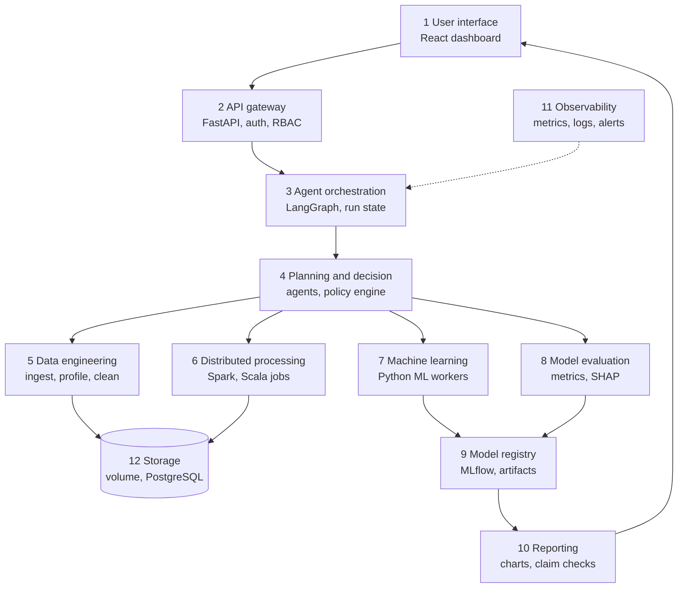

Requests flow down through the orchestrator; results flow back up through the registry and reports, while observability watches every layer.

### 10.1 Layer responsibilities

| Layer | Responsibility | MVP components | Production extension |
| --- | --- | --- | --- |
| 1. User interface | Dashboards, run control, approvals, reports | React + Vite + TypeScript SPA | Single sign-on, embedded BI |
| 2. API and backend | REST endpoints, authentication, validation, live events | FastAPI with Pydantic models; server-sent events | API gateway with rate limiting |
| 3. Agent orchestration | Run state machine, task queue, checkpoints, budgets | LangGraph with a PostgreSQL checkpointer; PostgreSQL task queue | More workers; external scheduler triggers |
| 4. Planning and decision | Agents, routing rules, policy engine | LLM adapter; YAML routing and governance policies | Model gateway with caching; dedicated policy service |
| 5. Data engineering | Ingestion, profiling, quality rules, cleaning plans | Python watchers; PySpark profiling; YAML rules compiled to Spark SQL | Streaming connectors; library-based quality checks |
| 6. Distributed processing | Scala jobs for cleaning, labels and features | Spark 4.1 standalone cluster in containers | Kubernetes or a managed Spark service |
| 7. Machine learning | Training, tuning, calibration, scoring | scikit-learn, XGBoost, Optuna | Distributed or GPU training |
| 8. Model evaluation | Metrics, calibration, segments, explanations | Python evaluation service with SHAP | Dedicated model-monitoring service |
| 9. Model registry and artifacts | Versions, aliases, lineage, generated code | MLflow on PostgreSQL with artifacts on the shared volume; git repository for generated code | Highly available registry; cloud artifact store |
| 10. Reporting and visualisation | Charts, narratives, exports | Jinja2 templates, charting library, claim checker | BI tool integration |
| 11. Monitoring and observability | Metrics, logs, alerts, traces | Prometheus, Grafana, JSON logs | Central log store, OpenTelemetry tracing |
| 12. Storage | Raw, clean, feature and prediction data; metadata | Shared volume with Parquet; PostgreSQL | S3-compatible object storage with Delta Lake or Iceberg |

### 10.2 Cross-cutting concerns

- **Security:** authentication at the API, role checks in every service, scoped credentials for sandboxes (section 29).
- **Configuration:** one versioned configuration tree validated at start-up; runs record the configuration hash.
- **Audit:** every state change and tool call writes an append-only audit entry (section 28).

### 10.3 Deployment view (MVP)

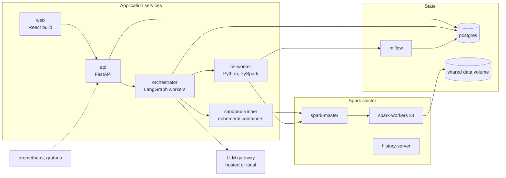

All services run under Docker Compose on one host or a few lab machines; only the sandbox runner may start containers, and the LLM gateway is reachable from the orchestrator alone.

### 10.4 Architectural decisions

| ID | Decision | Reason |
| --- | --- | --- |
| DD-01 | PostgreSQL is the single source of truth for run state, queue, approvals and audit | Transactions keep state and queue consistent |
| DD-02 | The macro-workflow is a fixed state machine; agents decide only inside stages | Predictable control flow, easier testing |
| DD-03 | Data moves by reference; only summaries enter LLM context | Scale and privacy |
| DD-04 | Generated code runs only through the sandbox runner | One enforcement point for isolation |
| DD-05 | The Spark cluster for agent code is separate from anything production-like | Executors also run generated code (ASM-12) |

## 11. Agent Architecture

Thirteen agents work under a deterministic orchestrator, and only three of them (Cleaning, Code Generation and Reporting) rely mainly on an LLM. Verification and governance deliberately use no LLM in their decision path, so the checker never shares the generator's failure modes.

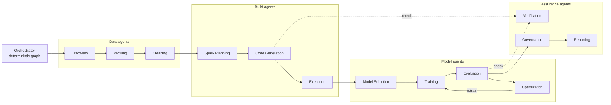

Work passes left to right through the agent groups; dotted edges are verification calls that must pass before work continues.

### 11.0 What is an agent and what is not

| Component | Type | LLM used for | Never does |
| --- | --- | --- | --- |
| Orchestrator | Deterministic graph and state machine | Nothing | Make content decisions |
| Data Discovery | Hybrid | Mapping unknown sources | Register an unknown source without confirmation |
| Data Profiling | Hybrid | Summarising and grouping issues | Change computed statistics |
| Data Cleaning | LLM-assisted | Choosing and ordering library rules | Delete rows or invent rules |
| Spark Planning | Hybrid | Composing the plan | Exceed quotas or bypass routing rules |
| Code Generation | LLM | Writing slot code and repairs | Add dependencies or edit non-slot code |
| Execution | Deterministic, with LLM diagnosis | Diagnosing unclassified errors | Run unvalidated code |
| ML Model Selection | Hybrid | Justifying shortlist changes | Use unregistered algorithms |
| Training | Deterministic | Nothing | Change the data split |
| Evaluation | Deterministic, with LLM summary | Plain-language summaries | Alter metrics or thresholds |
| Optimization | Deterministic optimiser, with LLM suggestions | Proposing search spaces and Spark settings | Apply settings outside the allowlist |
| Verification | Deterministic | Nothing | Pass anything on judgement |
| Reporting | LLM narrative, deterministic rendering | Narrative text | Type numbers directly |
| Governance | Deterministic policy engine | Summarising evidence for approvers | Approve anything |
| Spark, Scala jobs, Python ML | Execution engines | Nothing | Decide what to run |
| Scheduler and watchers | Deterministic services | Nothing | Start runs outside policy |

### 11.1 Data Discovery Agent

| Field | Specification |
| --- | --- |
| Purpose | Detect, verify and register new data |
| Inputs | Watched locations, dataset path patterns, file metadata |
| Outputs | Dataset versions, mapping proposals, ingestion events |
| Tools | `storage.list`, `storage.stat`, `storage.copy_immutable`, `catalog.register_version`, `policy.check` |
| Responsibilities | Checksum, de-duplicate, match to a dataset, register, queue runs per policy |
| Decision rules | Match by path pattern first, then by column-set similarity (EX threshold 0.9); unknown sources become proposals; identical checksums are duplicates |
| Failure handling | Unreadable file: quarantine and alert. Growing file: re-check later. Storage error: three backoff retries, then alert |
| Dependencies | Storage, catalog, scheduler |
| Human interaction | A Data Engineer confirms every new source mapping |

### 11.2 Data Profiling Agent

| Field | Specification |
| --- | --- |
| Purpose | Describe the data and find quality issues |
| Inputs | Dataset version, contract, previous profile |
| Outputs | Profile, quality score, issue list with evidence, schema diff |
| Tools | `spark.profile`, `dq.compile_rules`, `catalog.read_profile` |
| Responsibilities | Compute statistics, compare versions, grade issues, summarise |
| Decision rules | Severity comes from rules (any null key is blocking; non-key nulls above 20% warn, EX); the LLM may annotate but never downgrade a blocking issue |
| Failure handling | Job failure enters the repair loop; mixed types trigger a string read and coercion analysis |
| Dependencies | Spark, contracts |
| Human interaction | None by default; results are visible to Data Engineers |

### 11.3 Data Cleaning Agent

| Field | Specification |
| --- | --- |
| Purpose | Choose and order cleaning rules |
| Inputs | Issues, profile, rule library, contract, domain notes |
| Outputs | Cleaning plan with parameters and impact estimate; decision records |
| Tools | `policy.check`; code requests to the Code Generation Agent; runs through the Execution Agent |
| Responsibilities | Map issues to library rules, respect domain meaning, estimate impact, request approval when required |
| Decision rules | Library rules only; quarantine instead of delete; more than 5% of rows affected (EX) or any column drop needs approval |
| Failure handling | Conflicting rules escalate; issues surviving two passes escalate |
| Dependencies | Profiling, Code Generation, Execution, Governance agents |
| Human interaction | A Data Engineer approves destructive plans |

### 11.4 Spark Planning Agent

| Field | Specification |
| --- | --- |
| Purpose | Turn the feature specification into an efficient Spark plan |
| Inputs | Profiles (sizes, cardinalities, skew), feature catalog, cluster profile, past run metrics |
| Outputs | Plan: stages, joins, partitions, caching, routing decisions, resource request |
| Tools | `catalog.read_profile`, `policy.check`, `spark.explain` |
| Responsibilities | Build the logical flow, choose physical strategies, apply routing rules, size resources |
| Decision rules | Routing rules LR-01 to LR-10; broadcast tables below the configured threshold (EX 64 MB); shuffle partitions from input size at about 128 MB each (heuristic); cache only data reused twice or more |
| Failure handling | Missing column returns to contract resolution; quota shortfall escalates |
| Dependencies | Profiling Agent, feature catalog, cluster metrics |
| Human interaction | A Data Engineer may review the plan |

### 11.5 Code Generation Agent

| Field | Specification |
| --- | --- |
| Purpose | Produce Scala, Python and SQL for plan steps |
| Inputs | Plan step, template with slots, schema, forbidden-API list, earlier errors when repairing |
| Outputs | Code artifacts with metadata; minimal diffs for repairs |
| Tools | `template.fetch`, `lint.python`, `lint.scala_scan`, `build.compile_scala`, `test.run_fixtures`, `memory.lookup_fix` |
| Responsibilities | Generate, self-check, repair from structured feedback |
| Decision rules | Fill declared slots only; no new dependencies; built-in Spark functions before UDFs; `try_cast` for conversions |
| Failure handling | Up to 3 repairs per stage; the same error fingerprint twice escalates |
| Dependencies | Template library, Verification Agent |
| Human interaction | Optional diff review; mandatory review before code joins the template library |

### 11.6 Execution Agent

| Field | Specification |
| --- | --- |
| Purpose | Run artifacts safely and report what happened |
| Inputs | Validated artifact, resource profile, input versions |
| Outputs | Execution records, output references, metrics, structured errors |
| Tools | `sandbox.run`, `spark.submit`, `spark.status`, `storage.commit` |
| Responsibilities | Dry run, full run, monitoring, output commit |
| Decision rules | Dry run before full run; stop at the hard timeout; commit outputs only after the contract passes |
| Failure handling | Classify the error, apply a playbook, or hand code fixes to the Code Generation Agent; at most 2 infrastructure retries |
| Dependencies | Sandbox runner, Spark, Verification Agent |
| Human interaction | None unless escalated |

### 11.7 ML Model Selection Agent

| Field | Specification |
| --- | --- |
| Purpose | Choose candidate families and search spaces |
| Inputs | Task type, class balance, data sizes, feature types, constraints |
| Outputs | Candidate list, budgets, justification |
| Tools | `registry.list_families`, `policy.check` |
| Responsibilities | Shortlist, justify, assign budgets |
| Decision rules | Always include the dummy baseline and logistic regression; add random forest, histogram gradient boosting and XGBoost by default; a neural network only when its rule is met |
| Failure handling | No valid candidate escalates |
| Dependencies | Algorithm registry, acceptance policy |
| Human interaction | A Data Scientist may edit the shortlist |

### 11.8 Training Agent

| Field | Specification |
| --- | --- |
| Purpose | Train candidates reproducibly |
| Inputs | Training-set reference, candidate settings, seeds, budgets |
| Outputs | MLflow runs and model artifacts |
| Tools | `ml.train`, `registry.log` |
| Responsibilities | Train, log, enforce budgets |
| Decision rules | Size guard picks single-node or distributed training; a fixed time budget per candidate |
| Failure handling | Convergence issues get scaling or more iterations; exceptions drop the candidate if at least two remain |
| Dependencies | ML worker, MLflow |
| Human interaction | None |

### 11.9 Evaluation Agent

| Field | Specification |
| --- | --- |
| Purpose | Judge models against the acceptance policy |
| Inputs | Models, validation and test snapshots, champion metrics, policy |
| Outputs | Metrics, reason codes, evaluation report, model card draft |
| Tools | `ml.evaluate`, `ml.explain`, `policy.check` |
| Responsibilities | Compute metrics, apply policy, explain, summarise |
| Decision rules | Acceptance rules AP-1 to AP-8 (section 17); leakage alarm; test snapshot used once per selection cycle |
| Failure handling | Thin segments are marked "insufficient data"; a failed computation retries once, then escalates |
| Dependencies | Training Agent, policy engine |
| Human interaction | ML Engineers review the evidence |

### 11.10 Optimization Agent

| Field | Specification |
| --- | --- |
| Purpose | Improve models and Spark jobs within budget |
| Inputs | Reason codes, trial history, Spark stage metrics |
| Outputs | Tuned parameters, next-run Spark settings, decision records |
| Tools | `ml.tune`, `policy.check` |
| Responsibilities | Pick remedies, run searches, propose settings |
| Decision rules | Remedy chosen by reason code; Optuna budgets; Spark changes limited to an allowlist (shuffle partitions, broadcast threshold, executor memory within quota) |
| Failure handling | No gain is reported as such; an exhausted budget stops the search |
| Dependencies | Evaluation Agent, Training Agent |
| Human interaction | An administrator approves quota increases |

### 11.11 Verification Agent

| Field | Specification |
| --- | --- |
| Purpose | Check every artifact and output independently |
| Inputs | Code artifacts, outputs, contracts, reports |
| Outputs | Pass or fail verdicts with evidence |
| Tools | `lint.python`, `lint.scala_scan`, `build.compile_scala`, `test.run_fixtures`, `dq.run_contract`, `leakage.check`, `report.check_claims` |
| Responsibilities | Run every gate and report the result |
| Decision rules | All gates must pass; verdicts are binary; agents cannot override them |
| Failure handling | A tool error returns the verdict "error", which blocks progress |
| Dependencies | Toolchain, contracts |
| Human interaction | None; results are visible |

### 11.12 Reporting Agent

| Field | Specification |
| --- | --- |
| Purpose | Explain results to technical and business readers |
| Inputs | Fact sheet, charts, segment tables, decision records |
| Outputs | Technical and business reports |
| Tools | `report.render`, `report.check_claims` |
| Responsibilities | Draft narrative, label provenance, pass the claim check |
| Decision rules | Numbers only through fact placeholders; causal words flagged; recommendations labelled as AI suggestions |
| Failure handling | Two failed claim checks fall back to a template-only narrative |
| Dependencies | Metrics store, Verification Agent |
| Human interaction | Business Analysts read; reports stay internal in the MVP |

### 11.13 Governance Agent

| Field | Specification |
| --- | --- |
| Purpose | Decide whether an action may run, needs approval, or is forbidden |
| Inputs | Proposed action, policy file, evidence bundle, requester |
| Outputs | Decisions, approval requests, audit entries |
| Tools | `policy.check`, `approval.request`, `registry.set_alias`, `notify.internal` |
| Responsibilities | Enforce policy, manage approvals, apply approved promotions and pre-approved rollbacks |
| Decision rules | Policy file; separation of duties; expiry; rollback to the previous champion after a failed smoke test is pre-approved |
| Failure handling | An invalid policy file denies every gated action (fail closed) |
| Dependencies | Policy file, approvals table, MLflow |
| Human interaction | Approvers make every gated decision |

## 12. Agent Orchestration Model

A deterministic state machine drives every run. Agents act only inside a state, and each transition is committed to PostgreSQL before the next step starts.

### 12.1 Orchestration mechanics

| Concern | Design |
| --- | --- |
| Task creation | Each run expands into stage tasks (rows in `agent_tasks`) with a type, input references, an attempt counter and a budget share |
| Task queue | Workers claim rows with `FOR UPDATE SKIP LOCKED`, hold a lease with heartbeats, and a reaper re-queues tasks whose lease expired |
| State management | A typed run state holds the run ID, current state, input versions, artifact and metric references, budgets, attempt counters, error fingerprints, decision IDs and approval IDs; LangGraph checkpoints it after every node |
| Durability | A checkpoint does not restart a crashed worker by itself, so the reaper resumes the run from its last checkpoint using the same thread ID |
| Context management | Each agent call gets a bundle: task spec, summaries (never raw data), the most relevant recent tool results and any retrieved fixes, within a per-call token budget; untrusted text is fenced as data |
| Execution state | Task status is one of queued, leased, running, succeeded, failed, escalated or cancelled |
| Retries | Per-stage attempt counters, exponential backoff for transient errors, and a circuit breaker on repeated error fingerprints |
| Agent handoff | Typed messages validated against schemas; no free-text handoffs |
| Artifact passing | URIs plus content hashes; data never travels inside messages |
| Event triggers | An events table plus PostgreSQL LISTEN/NOTIFY carries `dataset.version.created`, `run.stage.completed`, `model.metric.degraded`, `drift.detected`, `approval.decided` and `schedule.tick` |
| Human pause | Approval nodes call LangGraph's `interrupt()`, which saves state through the checkpointer and waits; the decision resumes the same thread with `Command(resume=...)` |

LangGraph restarts an interrupted node from its beginning on resume, so approval nodes do nothing before the interrupt, and every side effect lives in the next node ([LangGraph interrupts](https://docs.langchain.com/oss/python/langgraph/interrupts)).

### 12.2 Main state machine

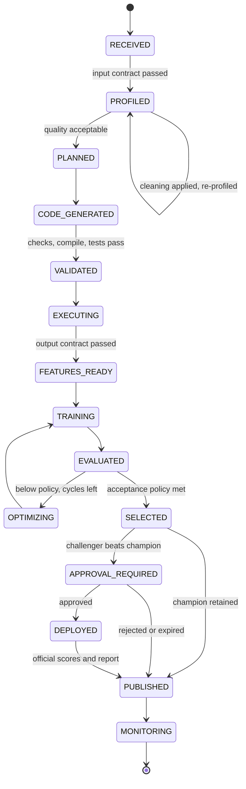

The challenger is shadow-scored and a draft report is written while the run sits in SELECTED, so approvers see real evidence before deciding.

### 12.3 Failure and escalation states

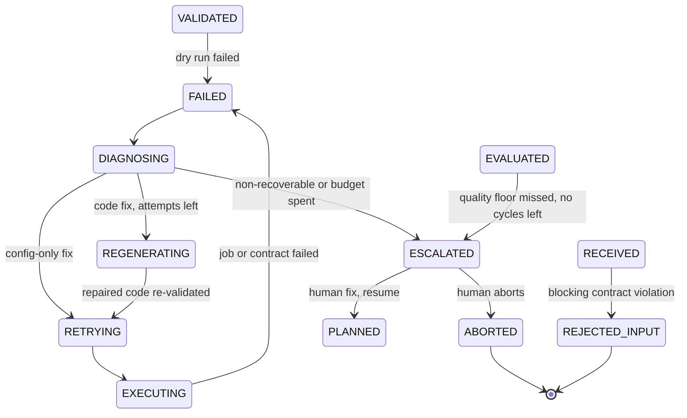

Any state can also move to CANCELLED on a user request; cancellation stops running jobs and releases their resources.

### 12.4 Transition guards

| Transition | Guard | Enforced by |
| --- | --- | --- |
| RECEIVED to PROFILED | Input contract passed | Verification Agent |
| PROFILED to PLANNED | Quality score at or above threshold and no blocking issue | Policy engine |
| CODE\_GENERATED to VALIDATED | Every validation gate passed | Verification Agent |
| EXECUTING to FEATURES\_READY | Output contract and row accounting passed | Verification Agent |
| EVALUATED to OPTIMIZING | Reason codes present and fewer than 2 cycles used | Orchestrator |
| EVALUATED to SELECTED | Acceptance rules AP-1 to AP-7 passed | Policy engine |
| SELECTED to APPROVAL\_REQUIRED | AP-8 passed, or no champion exists yet | Policy engine |
| APPROVAL\_REQUIRED to DEPLOYED | Approved by an eligible approver who is not the requester | Governance Agent |
| DIAGNOSING to REGENERATING or RETRYING | Attempts left, fingerprint not repeated, fix within policy | Orchestrator |
| Any state to ESCALATED | A budget ceiling was reached | Orchestrator |

### 12.5 Claiming a task

```sql
UPDATE agent_tasks
SET status = 'leased',
    lease_owner = $1,
    lease_expires_at = now() + interval '5 minutes'
WHERE id = (
  SELECT id
  FROM agent_tasks
  WHERE status = 'queued'
  ORDER BY priority DESC, created_at
  FOR UPDATE SKIP LOCKED
  LIMIT 1
)
RETURNING *;
```

### 12.6 Default budgets

| Budget | Default (EX) | On breach |
| --- | --- | --- |
| Code repair attempts per stage | 3 | ESCALATED |
| Infrastructure retries per stage | 2 | ESCALATED |
| Optimisation cycles per run | 2 | ESCALATED with a diagnostic report |
| LLM calls per run | 60 | Generation stops; run escalates |
| LLM cost per run | USD 3 | Generation stops; run escalates |
| Wall-clock time per run | 4 hours | Running jobs cancelled; run escalates |
| Identical error fingerprint | 2 in a row | ESCALATED immediately |
| Approval wait | 72 hours | Treated as rejected |

## 13. Python–Scala–Spark Responsibility Boundary

Spark is the distributed engine; Scala and Python are two client languages for it. DataFrame code in either language compiles to the same optimised plan, so the boundary follows what each language uniquely adds rather than raw speed.

- **Scala adds** compile-time type checks, typed Datasets, JVM-native custom logic without Python round trips, and versioned JARs that behave like production software.
- **Python adds** the ML and statistics ecosystem, the agent framework, the API and the reporting stack.
- **Spark adds** partitioned, fault-tolerant execution with an optimiser and adaptive query execution.

### 13.1 Responsibility matrix

| Task | Python | Scala | Spark engine |
| --- | --- | --- | --- |
| Agent orchestration and LLM calls | Primary | — | — |
| API, UI backend, scheduling | Primary | — | — |
| File detection and metadata | Primary | — | — |
| Profiling queries on large data | Primary (PySpark SQL, read-only) | — | Executes |
| Data quality rules | Primary (compiles YAML to SQL) | — | Executes |
| Cleaning and conforming at scale | — | Primary (compiled job) | Executes |
| Large joins, windows, aggregations | — | Primary | Executes |
| Per-row or per-group custom logic | Not allowed on event data | Primary (typed Dataset or aggregator) | Executes |
| Churn label generation | — | Primary | Executes |
| Ad-hoc exploration on samples | Primary | — | Optional |
| Compact feature matrix preparation | Primary (PyArrow, pandas) | — | — |
| Model training on compact data | Primary (scikit-learn, XGBoost) | — | — |
| Model training on large data | Primary (MLlib or XGBoost Spark API) | — | Executes |
| Hyperparameter tuning | Primary (Optuna) | — | — |
| Evaluation, statistics, SHAP | Primary | — | — |
| Batch scoring, large | Primary (MLflow Spark UDF) | — | Executes |
| Drift computation, large | Secondary | — | Executes histograms |
| Reports and charts | Primary | — | — |

### 13.2 How data crosses the boundary

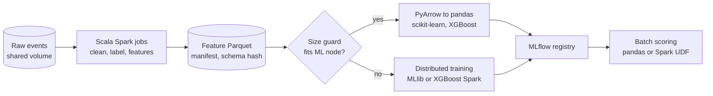

Parquet plus a manifest is the only hand-off; no language reads another's in-memory objects.

### 13.3 Language routing rules

| Rule | Condition | Route |
| --- | --- | --- |
| LR-01 | Transformation over event-level data above the size threshold (EX 5 million rows) | Spark |
| LR-02 | Transformation that forms a reusable pipeline stage: cleaning, labels, features | Scala job from a template |
| LR-03 | Logic that would need a UDF or procedural per-group processing | Scala typed Dataset or aggregator; Python UDFs blocked on event data |
| LR-04 | Read-only profiling and exploration | PySpark or Spark SQL from Python |
| LR-05 | Training, tuning, evaluation, explanation | Python |
| LR-06 | Spark-to-Python hand-off | Parquet; pandas only if the estimated in-memory size is at most 25% of ML worker RAM (EX), else distributed training |
| LR-07 | Inputs below the small-data threshold (EX 1 GB) | Same Spark job in local mode, not a separate pandas path |
| LR-08 | Scoring | In-process Python below the threshold; MLflow Spark UDF above it |
| LR-09 | `collect()` or `toPandas()` on unbounded data | Forbidden by static scan |
| LR-10 | Spark configuration changes | Per-job settings from the Optimization Agent's allowlist; cluster defaults never edited |

Sampling to fit a model on one node is allowed only with a recorded decision, and never for the final test evaluation.

### 13.4 One schema, two languages

A single YAML feature catalog is the source of truth. A deterministic generator turns it into Scala case classes for the jobs and a Python validation schema for the ML layer, so both sides change together. Each output folder carries a `_manifest.json` with schema, row count, content hash and catalog version, and Python refuses a folder whose schema hash differs from the catalog.

### 13.5 Type mapping

| Spark type | Scala type | Parquet storage | pandas via PyArrow | Rule |
| --- | --- | --- | --- | --- |
| LongType | Long | INT64 | int64, or float64 when nulls exist | Use nullable integer dtypes for IDs and counts |
| IntegerType | Int | INT32 | int32, or float64 when nulls exist | Same rule |
| DoubleType | Double | DOUBLE | float64 | — |
| DecimalType(18,2) | BigDecimal | DECIMAL | Python decimal objects | Aggregate as decimal; convert to double only inside the ML layer |
| StringType | String | BYTE\_ARRAY (UTF-8) | object or Arrow-backed string | — |
| BooleanType | Boolean | BOOLEAN | bool, or object when nulls exist | Use the nullable boolean dtype |
| DateType | java.sql.Date or java.time.LocalDate | INT32 (DATE) | Python date objects by default | Convert to datetime64 explicitly |
| TimestampType | java.sql.Timestamp or java.time.Instant | INT64 timestamp when pinned | Timezone-aware datetime64 | Pin `spark.sql.parquet.outputTimestampType` to `TIMESTAMP_MICROS`; store UTC |

### 13.6 Interoperability mechanisms

- **Parquet files** are the default contract between Scala jobs and Python.
- **Arrow transfer** (`spark.sql.execution.arrow.pyspark.enabled`) speeds up `toPandas()`, which is allowed only behind the size guard.
- **pandas API on Spark** is permitted where pandas-style code must run distributed, but the DataFrame API is preferred.
- **MLflow's Spark UDF** (`mlflow.pyfunc.spark_udf`) scores large customer sets with the registered model.
- **spark-submit** launches Scala JARs from the sandbox; PySpark stages run inside the ML worker's driver.

## 14. End-to-End Data Flow

Data moves through thirteen hand-offs from raw file to dashboard, and every hand-off writes a versioned artifact plus a lineage record. Heavy data stays on Spark until it has been reduced to one row per customer per snapshot.

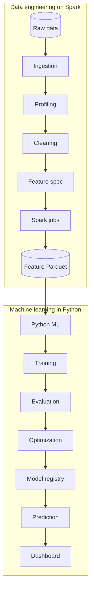

The top row runs on Spark; the bottom row runs in Python on compact data.

### 14.1 Hand-offs

| Step | Mechanism | Artifact produced | Metadata recorded |
| --- | --- | --- | --- |
| Raw data to ingestion | Storage poller or upload API | Immutable raw copy | Checksum, size, source, dataset version |
| Ingestion to profiling | PySpark SQL job | Profile document | Statistics, schema hash, quality score |
| Profiling to cleaning | Scala job built from the cleaning plan | Clean Parquet and quarantine set | Per-rule counts, row accounting |
| Cleaning to feature specification | Feature catalog plus planning agent | Plan document | Routing decisions, selected features |
| Feature specification to Spark processing | Scala label and feature jobs | Label and feature Parquet | Spark application ID, stage metrics, manifest |
| Spark processing to feature store | Atomic commit of a versioned folder | Feature-set version | Row count, content hash, catalog version |
| Feature store to Python ML | PyArrow read behind the size guard | Training, validation and test sets | Split specification, snapshot dates, class balance |
| Python ML to training | ML worker | MLflow runs | Parameters, seeds, library versions |
| Training to evaluation | Evaluation service | Metrics, curves, explanations | Metric IDs, intervals, segments |
| Evaluation to optimisation | Optuna study | Tuned parameters | Trials and best value |
| Optimisation to model registry | MLflow registration | Model version and alias | Signature, feature-set version, model card |
| Registry to prediction | Scoring job | Official or shadow prediction set | Model version, score date, set type |
| Prediction to dashboard | API queries | Views and exports | Audit entry for identified exports |

### 14.2 Storage layout

```text
/data/triad/
  raw/<dataset>/v=<n>/                          immutable source copies
  quarantine/<dataset>/v=<n>/run=<run_id>/      rejected rows with reason codes
  clean/<dataset>/v=<n>/                        conformed Parquet
  features/<feature_set>/fsv=<n>/snapshot_date=YYYY-MM-DD/
  labels/<label_def>/v=<n>/snapshot_date=YYYY-MM-DD/
  training_sets/<run_id>/{train,valid,test}/
  predictions/<model>/mv=<version>/score_date=YYYY-MM-DD/set={official,shadow}/
  artifacts/code/<content_hash>/
  reports/<run_id>/
  sandbox/<run_id>/                             scratch space, purged after 7 days (EX)
```

Writes go first to a run-scoped staging folder; a successful contract check renames the folder into place and records the version, so readers never see partial output.

### 14.3 Lineage

Each execution record stores its inputs (URI, version, hash), outputs, code artifact and configuration hash. Given a prediction row, an auditor can walk back to the model version, feature-set version, Spark job, cleaning rules and raw file that produced it. Export to the OpenLineage format is a future enhancement.

## 15. Detailed Data Pipeline

The churn pipeline has eleven stages, P0 to P10. It reduces order lines to one row per customer per day, then to one row per customer per monthly snapshot, before anything leaves Spark.

### 15.1 Source tables

| Source | Key | Other columns | Grain |
| --- | --- | --- | --- |
| customers | customer\_id | signup\_date, country, city, acquisition\_channel, loyalty\_tier (from a dated snapshot table), marketing\_opt\_in | One row per customer, or per validity period for changing attributes |
| transactions | order\_id, line\_id | customer\_id, order\_date (timestamp), product\_id, quantity, price (decimal), discount (decimal), promo\_code, payment\_method, channel, order\_status, return\_flag, currency | One row per order line |
| products | product\_id | category\_l1, category\_l2, brand, list\_price, launch\_date | One row per product |
| web\_sessions | session\_id | customer\_id (nullable), session\_start, session\_end, device\_type, channel, page\_views, product\_views, add\_to\_cart\_count, checkout\_started | One row per session |
| support\_tickets | ticket\_id | customer\_id, created\_at, resolved\_at, category, priority, csat\_score, status | One row per ticket |
| returns | return\_id | order\_id, line\_id, customer\_id, return\_date, quantity, refund\_amount, reason\_code | One row per returned line |
| promotions | promo\_code | promo\_type, discount\_value, start\_date, end\_date, channel | One row per promotion |

Sample transaction rows (EX, fictional):

| order\_id | line\_id | customer\_id | order\_date | product\_id | quantity | price | discount | payment\_method | return\_flag |
| --- | --- | --- | --- | --- | --- | --- | --- | --- | --- |
| O-100231 | 1 | C-10457 | 2026-08-03 14:22:05 | P-2291 | 2 | 499.00 | 50.00 | UPI | false |
| O-100231 | 2 | C-10457 | 2026-08-03 14:22:05 | P-0876 | 1 | 1299.00 | 0.00 | UPI | false |
| O-100298 | 1 | C-20918 | 2026-08-04 09:10:41 | P-2291 | 1 | 499.00 | 0.00 | Card | true |

Public datasets cover these tables only partly; section 43 maps each dataset to the schema, and missing tables come from the seeded synthetic generator, clearly labelled.

### 15.2 Pipeline stages

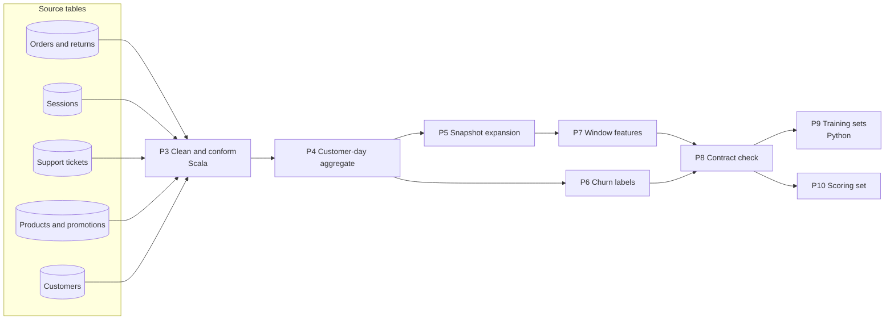

Stages P0 to P2 (landing, contract check, profiling) run before this view; P9 is the only Python stage.

| Stage | Engine | Input | Output | Key rules |
| --- | --- | --- | --- | --- |
| P0 Land and register | Python | New files | Raw dataset version | Checksum, write-once copy |
| P1 Contract check | Python compiling to Spark SQL | Raw tables | Verdict | customer\_id, order\_id, order\_date, quantity and price are required |
| P2 Profile | PySpark SQL | Raw tables | Profile | Nulls, duplicates, distributions, drift against the previous version |
| P3 Clean and conform | Scala | Raw tables | Clean tables, quarantine | Trim and `try_cast`; de-duplicate on (order\_id, line\_id); cancellation lines become returns; missing customer\_id is quarantined as NO\_CUSTOMER\_KEY; non-positive price is quarantined |
| P4 Customer-day aggregate | Scala | Clean lines, products (broadcast), sessions, tickets, returns | customer\_day | Orders, net revenue, discounted lines, categories, sessions, tickets and returns per customer per day |
| P5 Snapshot expansion | Scala | customer\_day | customer\_day by snapshot | Month-start cutoffs; each day feeds only the cutoffs within the largest window |
| P6 Labels | Scala | Eligible customers, order days | Labels | `churned_90d`; snapshots whose horizon passes the data end are dropped |
| P7 Window features | Scala | Expanded rows | Features | 30, 90, 180 and 365-day windows; only events before the cutoff |
| P8 Contract check | Verification Agent | Features, labels | Verdict | One row per customer per snapshot; value ranges; null limits; row accounting |
| P9 Training sets | Python | Features joined to labels | Train, validation and test sets | Temporal split with the gap rule (section 17) |
| P10 Scoring set | Scala | Latest data | Features at today's cutoff | Same code as P7, with no labels |

### 15.3 Why two aggregation levels

Computing features straight from order lines for every snapshot would rescan the largest table once per cutoff. Aggregating to customer-day first shrinks the data by orders of magnitude. Each customer-day row then feeds at most twelve monthly snapshots for a 365-day window, so the expansion stays bounded.

Snapshot cutoffs are the first day of each month, and features use only days strictly before the cutoff. First-of-month dates avoid month-end arithmetic problems, because adding months to a month-end date does not stay on the month end.

Heavy buyers, such as wholesale accounts, create skewed keys. Adaptive query execution splits skewed partitions first; salting the customer key is the fallback the Optimization Agent may propose.

### 15.4 Illustrative slot implementation

The code below shows what the Code Generation Agent is expected to produce inside the feature and label templates (EX; it will be compiled and tested in Phase 3).

```scala
package triad.jobs.generated

import org.apache.spark.sql.{Column, DataFrame}
import org.apache.spark.sql.functions._

// Slot code for FeatureJobTemplate (illustrative).
object ChurnFeatures {

  // Line grain to customer-day grain. Cancellations were already moved to returns.
  def customerDaily(lines: DataFrame, products: DataFrame): DataFrame =
    lines
      .join(broadcast(products.select("product_id", "category_l1")), Seq("product_id"), "left")
      .withColumn("day", to_date(col("order_date")))
      .groupBy(col("customer_id"), col("day"))
      .agg(
        countDistinct(col("order_id")).as("orders"),
        sum(col("quantity") * col("price") - coalesce(col("discount"), lit(0))).as("net_revenue"),
        sum(when(coalesce(col("discount"), lit(0)) > 0, 1).otherwise(0)).as("discounted_lines"),
        count(lit(1)).as("lines"),
        collect_set(col("category_l1")).as("categories"))

  // Each order day feeds every month-start cutoff T with day < T and T - day <= maxWindowDays.
  // Requires maxWindowDays >= 31 so the generated sequence is never empty.
  def expandToSnapshots(daily: DataFrame, maxWindowDays: Int, first: String, last: String): DataFrame =
    daily
      .withColumn("snapshot_date", explode(sequence(
        add_months(trunc(col("day"), "month"), 1),
        trunc(date_add(col("day"), maxWindowDays), "month"),
        expr("INTERVAL 1 MONTH"))))
      .where(col("snapshot_date").between(lit(first).cast("date"), lit(last).cast("date")))
      .withColumn("age_days", datediff(col("snapshot_date"), col("day")))

  private def within(days: Int, value: Column): Column =
    when(col("age_days") <= days, value).otherwise(lit(0))

  def windowFeatures(expanded: DataFrame): DataFrame =
    expanded
      .groupBy(col("customer_id"), col("snapshot_date"))
      .agg(
        min(col("age_days")).as("recency_days"),
        sum(within(30, col("orders"))).as("frequency_30d"),
        sum(within(90, col("orders"))).as("frequency_90d"),
        sum(col("orders")).as("frequency_365d"),
        sum(within(90, col("net_revenue"))).as("monetary_90d"),
        sum(col("net_revenue")).as("monetary_365d"),
        sum(col("discounted_lines")).as("discounted_lines_365d"),
        sum(col("lines")).as("lines_365d"),
        size(array_distinct(flatten(collect_list(col("categories"))))).as("category_count_365d"))
      .withColumn("aov_365d", expr("try_divide(monetary_365d, frequency_365d)"))
      .withColumn("discount_share_365d", expr("try_divide(discounted_lines_365d, lines_365d)"))

  // churned_90d = 1 when an eligible customer has no order in [T, T + horizon).
  def labels(eligible: DataFrame, orderDays: DataFrame, horizonDays: Int, dataEnd: String): DataFrame = {
    val e = eligible.alias("e")
    val o = orderDays.alias("o")
    e.join(o,
        col("e.customer_id") === col("o.customer_id") &&
          col("o.day") >= col("e.snapshot_date") &&
          col("o.day") < date_add(col("e.snapshot_date"), horizonDays),
        "left")
      .groupBy(col("e.customer_id").as("customer_id"), col("e.snapshot_date").as("snapshot_date"))
      .agg(max(when(col("o.day").isNotNull, 1).otherwise(0)).as("has_future_order"))
      .where(date_add(col("snapshot_date"), horizonDays) <= lit(dataEnd).cast("date"))
      .withColumn("churned_90d", lit(1) - col("has_future_order"))
      .drop("has_future_order")
  }
}
```

The label join keeps an equality on `customer_id`, so Spark can use a sort-merge join and apply the date range as a filter inside each customer's rows. Division uses `try_divide`, which returns null instead of failing under ANSI mode.

## 16. Churn Feature Engineering

The catalogue defines 42 features in six groups, every one computed as of a cutoff date T from events strictly before T. Features whose source table is missing are marked unavailable rather than faked; section 43 shows which dataset supplies which group.

### 16.1 Feature catalogue

| Feature | Group | Definition as of cutoff T | Source | Spark computation | Leakage guard |
| --- | --- | --- | --- | --- | --- |
| recency\_days | RFM | Days from the last completed order to T | transactions | Minimum age over order days in the expanded table | Order days before T only |
| frequency\_30d, \_90d, \_180d, \_365d | RFM | Distinct completed orders in each window | transactions | Windowed sums of daily order counts | Window ends the day before T |
| monetary\_90d, \_365d | RFM | Net revenue: quantity times price, minus discount | transactions | Windowed sums of daily net revenue | Same |
| aov\_365d | Purchase behaviour | monetary\_365d divided by frequency\_365d | Derived | `try_divide` | Inherits inputs' guard |
| items\_per\_order\_365d | Purchase behaviour | Units bought per order | transactions | Windowed sums, then division | Same |
| order\_count\_lifetime | Purchase behaviour | All completed orders before T | transactions | As-of lookup on running daily totals | Running total taken from the last day before T |
| clv\_proxy\_lifetime | Purchase behaviour | Cumulative net revenue before T (historical value, not predicted value) | transactions | As-of lookup on running totals | Same |
| return\_count\_365d | Purchase behaviour | Returned lines in the window | returns | Windowed counts dated by return date | Returns dated on or after T are excluded, even for earlier orders |
| return\_rate\_365d | Purchase behaviour | Returned units divided by bought units | returns, transactions | Windowed sums, `try_divide` | Same |
| discount\_share\_365d | Purchase behaviour | Share of order lines with a discount | transactions | Windowed sums | Window ends before T |
| promo\_order\_share\_365d | Purchase behaviour | Share of orders using a promotion code | transactions, promotions | Broadcast join to promotions, windowed sums | Promotions joined on order date, not today's table |
| category\_count\_365d | Purchase behaviour | Distinct top-level categories bought | transactions, products | Distinct over collected category sets | Product categories as of order date |
| preferred\_payment\_method | Purchase behaviour | Most frequent payment method | transactions | Count per method, then the maximum | Window ends before T |
| tickets\_90d, tickets\_365d | Customer service | Tickets created in the window | support\_tickets | Windowed counts | Created before T |
| complaint\_tickets\_90d | Customer service | Tickets in delivery, refund or quality categories | support\_tickets | Filtered windowed counts | Same |
| open\_tickets\_at\_cutoff | Customer service | Tickets created before T and not resolved before T | support\_tickets | Range filter per customer | A resolution after T still counts as open |
| avg\_resolution\_hours\_365d | Customer service | Mean hours to resolve | support\_tickets | Mean over tickets resolved before T | Unresolved-at-T tickets excluded |
| avg\_csat\_365d | Customer service | Mean satisfaction score | support\_tickets | Mean over scores recorded before T | Score timestamp must precede T |
| sessions\_30d, sessions\_90d | Engagement | Sessions started in the window | web\_sessions | Windowed counts | Session start before T |
| days\_since\_last\_session | Engagement | Days from the last session to T | web\_sessions | Minimum age over session days | Same |
| product\_views\_90d | Engagement | Product page views | web\_sessions | Windowed sums | Same |
| add\_to\_cart\_90d | Engagement | Add-to-cart events | web\_sessions | Windowed sums | Same |
| cart\_conversion\_90d | Engagement | Orders divided by add-to-cart events | Derived | `try_divide` | Inherits guards |
| app\_session\_share\_90d | Engagement | App sessions divided by all sessions | web\_sessions | Conditional windowed sums | Same |
| avg\_session\_minutes\_90d | Engagement | Mean session length | web\_sessions | Windowed mean | Sessions ending before T |
| tenure\_days | Temporal | Days from first order (or signup) to T | transactions, customers | Customer-level minimum, joined to snapshots | First order must precede T |
| inter\_purchase\_mean\_days\_365d | Temporal | Mean gap between consecutive order days | transactions | `lag` over order days per customer, then windowed mean | Gaps ending before T only |
| inter\_purchase\_std\_days\_365d | Temporal | Spread of those gaps | transactions | Windowed standard deviation | Same |
| overdue\_ratio | Temporal | recency\_days divided by inter\_purchase\_mean\_days\_365d | Derived | `try_divide` | Inherits guards |
| trend\_90\_vs\_prior\_90 | Temporal | Orders in the last 90 days minus orders in days 91 to 180 | transactions | Two windowed sums | Window ends before T |
| snapshot\_month | Temporal | Calendar month of T | Snapshot calendar | Month of the cutoff | Known at T |
| holiday\_season\_buyer | Temporal | Any order in the most recent holiday window before T (EX: October to December) | transactions | Conditional windowed flag | Same |
| acquisition\_channel | Profile | How the customer first arrived | customers | Broadcast join | Static attribute |
| country | Profile | Customer country | customers | Broadcast join | Static attribute |
| loyalty\_tier\_at\_cutoff | Profile | Tier valid on T | Dated customer snapshots | Validity-range join | Current-only tiers are excluded (ASM-11) |
| marketing\_opt\_in\_at\_cutoff | Profile | Consent flag valid on T | Dated customer snapshots | Validity-range join | Same |

Sensitive attributes such as gender or age are excluded by default and need governance approval to use (section 30). A separate value, `expected_value_90d` (monetary\_365d divided by 4), is computed for revenue-at-risk estimates in reports and is never a model input.

### 16.2 Feature hygiene rules

| Rule | Statement |
| --- | --- |
| H1 | Nothing dated on or after T contributes to a feature. |
| H2 | Identifiers are never features. |
| H3 | No column derived from the label window may exist in the feature table. |
| H4 | Features with more than 95% nulls or a single dominant value in training are dropped (EX thresholds). |
| H5 | For linear models, one of any pair correlated above 0.98 is dropped; money features get `log1p` and winsorising at the 1st and 99th percentiles learned from training data (EX). |
| H6 | Target encoding, if ever used, is computed out of fold. |
| H7 | Every feature has a catalogue entry with a leakage tag and an owner. |

### 16.3 How features reach Spark code

Each catalogue entry names a computation pattern: windowed sum, windowed distinct, as-of lookup, validity-range join or derived ratio. The Code Generation Agent writes one expression per entry inside the feature template, so a new feature is a catalogue change plus a generated expression, never a hand-written job.

Point-in-time correctness is tested by adding sentinel events dated on and after T to a fixture: no feature value may change (TC-026).

## 17. Machine Learning Requirements

Churn is framed as binary classification per customer per monthly cutoff, with a 90-day horizon and a strictly temporal split. Accuracy is never the selection metric; PR-AUC, calibration and lift are.

### 17.1 Problem definition

| Item | Definition |
| --- | --- |
| Problem type | Binary classification |
| Unit of prediction | One customer at one cutoff date T |
| Target | `churned_90d` = 1 when the customer places no completed order in the 90 days from T |
| Eligible population | Customers with at least one completed order in the 365 days before T |
| Positive class | Churn (1) |
| Label maturity | A snapshot is labelled only when T + 90 days falls within the data |
| Scoring | Features at today's cutoff; probabilities for the next 90 days |

In non-contractual retail the churn class may be the majority, so imbalance is measured on each dataset, never assumed.

### 17.2 Temporal split and the gap rule

Training uses several early cutoffs, validation one later cutoff, and test the latest labelled cutoff. The gap rule requires each later cutoff to be at least one horizon (90 days) after the previous group's last cutoff. Otherwise training labels would include purchases that fall inside the validation or test label windows.

Illustrative split for UCI Online Retail II (EX; dates confirmed during profiling):

| Split | Cutoffs | Why |
| --- | --- | --- |
| Train | 01-12-2010, 01-01-2011, 01-02-2011, 01-03-2011 | First cutoff with a full 365-day history; last one whose label window closes before validation |
| Validation | 01-06-2011 | At least 90 days after the last training cutoff |
| Test | 01-09-2011 | Latest cutoff whose 90-day window fits inside the data |

The code below enforces the rule and builds the preprocessing and candidates. It was checked against scikit-learn 1.8 on synthetic data; the XGBoost branch will be checked in the Phase 1 smoke test.

```python
import numpy as np
import pandas as pd
from sklearn.compose import ColumnTransformer
from sklearn.dummy import DummyClassifier
from sklearn.impute import SimpleImputer
from sklearn.linear_model import LogisticRegression
from sklearn.metrics import average_precision_score, brier_score_loss, roc_auc_score
from sklearn.pipeline import Pipeline
from sklearn.preprocessing import OneHotEncoder, StandardScaler
from xgboost import XGBClassifier

HORIZON = pd.Timedelta(days=90)


def temporal_split(df, train_until, valid_at, test_at):
    """Train on cutoffs up to train_until; validate and test on later single cutoffs."""
    if valid_at - train_until < HORIZON or test_at - valid_at < HORIZON:
        raise ValueError("gap rule violated: label windows would overlap")
    train = df[df.snapshot_date <= train_until]
    valid = df[df.snapshot_date == valid_at]
    test = df[df.snapshot_date == test_at]
    return train, valid, test


def encoder():
    # Dense output keeps numeric zeros explicit; XGBoost treats sparse gaps as missing.
    return OneHotEncoder(handle_unknown="infrequent_if_exist", min_frequency=20,
                         sparse_output=False)


def build_candidates(num_cols, cat_cols, pos_weight, seed=42):
    linear_prep = ColumnTransformer([
        ("num", Pipeline([("impute", SimpleImputer(strategy="median")),
                          ("scale", StandardScaler())]), num_cols),
        ("cat", encoder(), cat_cols),
    ])
    tree_prep = ColumnTransformer([
        ("num", "passthrough", num_cols),
        ("cat", encoder(), cat_cols),
    ])
    return {
        "dummy": Pipeline([("prep", tree_prep), ("clf", DummyClassifier(strategy="prior"))]),
        "logreg": Pipeline([("prep", linear_prep),
                            ("clf", LogisticRegression(max_iter=2000, class_weight="balanced"))]),
        "xgboost": Pipeline([("prep", tree_prep),
                             ("clf", XGBClassifier(tree_method="hist", eval_metric="aucpr",
                                                   scale_pos_weight=pos_weight,
                                                   random_state=seed, n_jobs=4))]),
    }


def evaluate(model, X, y):
    p = model.predict_proba(X)[:, 1]
    return {"pr_auc": average_precision_score(y, p),
            "roc_auc": roc_auc_score(y, p),
            "brier": brier_score_loss(y, p),
            "prevalence": float(np.mean(y))}
```

Fitting the preprocessing inside each pipeline means imputation and scaling statistics come from training rows only.

### 17.3 Candidate models

| Model | Role | Why it is included | Imbalance handling |
| --- | --- | --- | --- |
| Dummy (prior) | Floor | Its PR-AUC equals the churn rate, the "random" reference | None |
| Logistic regression | Baseline and parsimony reference | Interpretable, fast, well calibrated after scaling | `class_weight="balanced"` |
| Random forest | Non-linear candidate | Robust to outliers and interactions | Class weights |
| Histogram gradient boosting | Non-linear candidate | Handles missing values natively; fast on large tables | Class weights |
| XGBoost | Primary non-linear candidate | Strong on tabular data; tunable | `scale_pos_weight` |
| Multilayer perceptron | Conditional | Only if the rule in 17.4 is met | Class weights |

### 17.4 When a neural network is justified

A neural network enters the shortlist only when both conditions hold: the training set has at least 200,000 rows (EX), and the feature set includes high-dimensional inputs such as sequence or embedding features. Otherwise gradient-boosted trees are the stronger and cheaper default for tabular churn data, and the decision record says so.

### 17.5 Metrics

| Metric | What it shows | Use |
| --- | --- | --- |
| Accuracy | Share of correct labels | Reported only; misleading when one class dominates |
| Precision | Share of flagged customers who really churn | Retention budget efficiency |
| Recall | Share of churners who are flagged | Coverage of at-risk customers |
| F1 / F-beta | Balance of precision and recall | Threshold choice (beta 2 favours recall) |
| ROC-AUC | Ranking quality across thresholds | Secondary; can look optimistic under imbalance |
| PR-AUC (average precision) | Ranking quality focused on the churn class; its random baseline is the churn rate | **Primary selection metric** |
| Log loss | Penalises confident mistakes | Tuning diagnostic |
| Brier score and skill | Probability accuracy compared with a churn-rate-only forecast | Calibration acceptance |
| Expected calibration error | Gap between predicted and observed churn rates | Calibration acceptance |
| Confusion matrix | Counts at the operating threshold | Report |
| Lift at top 10% | Churn rate among the top decile divided by the overall rate | Business alignment with contact capacity |

### 17.6 Acceptance policy

| Rule | Condition (EX thresholds, configurable) |
| --- | --- |
| AP-1 | Validation PR-AUC is at least the churn rate plus 0.10 |
| AP-2 | A more complex model must beat logistic regression's PR-AUC by at least 0.01; otherwise logistic regression wins on parsimony |
| AP-3 | Validation ROC-AUC is at least 0.70 |
| AP-4 | Brier skill score is at least 0.10 against the churn-rate-only forecast |
| AP-5 | Expected calibration error is at most 0.05 after calibration |
| AP-6 | Recall gap across major segments (country group, tenure band) is at most 0.10 at the operating threshold |
| AP-7 | Training takes at most 30 minutes per family including tuning; the model file is at most 200 MB; 1 million rows score in at most 5 minutes |
| AP-8 | For promotion, the lower bound of the 95% bootstrap interval of PR-AUC (challenger minus champion) on the same test cutoff is above zero |
| Leakage alarm | Validation ROC-AUC of 0.98 or more blocks selection until a person reviews the features |

### 17.7 Class imbalance handling

- Measure the churn rate per cutoff and report it next to every metric.
- Use class weights or `scale_pos_weight` rather than resampling by default.
- If resampling is ever used, apply it inside training folds only, never before the split.
- Recalibrate probabilities after weighting, because weights distort them.
- Choose the operating threshold on validation data, never on test data.
- With fewer than 200 positive examples (EX), escalate as insufficient data.

### 17.8 Leakage prevention checklist

- Temporal split with the gap rule; no random shuffling across cutoffs.
- Point-in-time features (H1) verified with sentinel events.
- Preprocessing fitted inside pipelines on training rows only.
- No identifiers, and no lifetime totals computed over the full dataset.
- A label-permutation test: with shuffled labels, PR-AUC must fall to about the churn rate.
- The leakage alarm in 17.6.
- The test cutoff is used once per selection cycle; after two cycles a newer cutoff becomes the test set when one exists.

### 17.9 Threshold selection

The default threshold marks the top-scoring customers up to the retention team's weekly contact capacity (EX: top 15%). When no capacity is set, the threshold maximises F2 on validation data. The chosen threshold is stored with the model version.

### 17.10 Model card

Every registered version carries a model card with: intended use and limits, churn definition and horizon, training cutoffs, feature-set version, candidate comparison, metrics with intervals, calibration plot, segment results, top global drivers with their method, known limitations, and the approval record.

## 18. Autonomous Model Selection

Selection is a fixed five-stage procedure: screen, tune, calibrate, test once, compare with the champion. The agent chooses within that procedure and must cite the metric and rule behind every choice; it never picks a model by preference.

### 18.1 Selection rules

| Rule | How TRIAD applies it |
| --- | --- |
| 1. Detect the problem type | Read from the pipeline configuration; auto-detection (label cardinality and type) only proposes, and a person confirms |
| 2. Identify the target | Taken from the label definition that TRIAD itself generates; guessed targets need confirmation |
| 3. Check class balance | Measured per cutoff; drives weighting, metric choice and the insufficient-data check |
| 4. Consider data size | Rows and features decide single-node or distributed training and the neural-network rule |
| 5. Consider feature types | Numeric, categorical and text columns select preprocessing templates |
| 6. Choose the metric | PR-AUC as primary for churn; secondary metrics are reported, not optimised |
| 7. Train candidates | Only families in the algorithm registry, each with a budget |
| 8. Compare results | Same features, same validation cutoff, same metric code |
| 9. Select the best | Hard constraints first, then ranking, then parsimony |
| 10. Explain the choice | A decision record plus the model card |

### 18.2 Selection stages

| Stage | What happens | Data used |
| --- | --- | --- |
| A. Screen | Every candidate trains with default settings; hard-constraint failures are rejected with reasons | Training cutoffs, validation cutoff |
| B. Tune | The top two families get Optuna studies within budget | Same |
| C. Calibrate | Isotonic or sigmoid calibration on a slice held out from the training cutoffs | Calibration slice |
| D. Test once | The winner is scored once on the test cutoff | Test cutoff |
| E. Compare | Bootstrap comparison with the champion on the same test cutoff | Test cutoff |

### 18.3 Constraints

| Constraint | Rule |
| --- | --- |
| Minimum performance | AP-1, AP-3 and AP-4 (section 17.6) |
| Parsimony | AP-2 |
| Calibration | AP-5 |
| Fairness across segments | AP-6 |
| Maximum training time and model size | AP-7 |
| Maximum resource cost | At most 16 CPU-hours for the whole search (EX) |
| Reproducibility | Retraining with the same seed, data and versions reproduces validation PR-AUC within 0.001 (EX) |
| Promotion evidence | AP-8 |

### 18.4 Selection procedure

```text
function SELECT_MODEL(candidates, train, calib, valid, test, champion, policy):
    screened = []
    for c in candidates:
        m = fit_and_score(c, train, valid)
        if violates_hard_constraints(m, policy):        # AP-3, AP-4, AP-7, leakage alarm
            record_decision(c, "rejected", reasons(m, policy))
            continue
        screened.append((c, m))

    finalists = top_families(screened, k = 2)
    tuned = [optuna_tune(f, train, valid, policy.budget) for f in finalists]
    ranked = sort(screened + tuned, key = pr_auc, descending)

    best = ranked[0]
    logreg = find(ranked, "logreg")
    if best is not logreg and best.pr_auc - logreg.pr_auc < policy.parsimony_margin:   # AP-2
        best = logreg
    if best.pr_auc < valid.churn_rate + policy.min_lift:                             # AP-1
        return ESCALATE("no candidate clears the performance floor")

    best = calibrate(best, calib)                                                    # AP-5
    if not segment_checks_pass(best, valid, policy):                                 # AP-6
        return ESCALATE("segment recall gap too large")

    result = score_once(best, test)
    register(best, alias = "challenger", model_card = draft_card(best, result))
    if champion is None:
        return PROPOSE_PROMOTION(best, result, reason = "no champion yet")

    delta = bootstrap_difference(best, champion, test, metric = "pr_auc")           # AP-8
    if delta.lower_95 > 0:
        return PROPOSE_PROMOTION(best, result, delta)
    return KEEP_CHAMPION(best, result, delta)
```

Every return value becomes a decision record, and PROPOSE\_PROMOTION always goes through the approval gate in section 30.

### 18.5 Example decision record (EX)

```json
{
  "decision_id": "dr-0417",
  "run_id": "run-2026-10-05-001",
  "agent": "evaluation_agent",
  "decision_type": "model_selection",
  "decision": "select tuned xgboost as challenger",
  "alternatives": ["logreg", "hist_gradient_boosting", "random_forest"],
  "evidence": {
    "valid_pr_auc": {"xgboost": 0.68, "hist_gradient_boosting": 0.66, "logreg": 0.61},
    "valid_churn_rate": 0.41,
    "ece_after_calibration": 0.02,
    "random_forest": "rejected by AP-7: model file above 200 MB"
  },
  "policy_rules": ["AP-1", "AP-2", "AP-5", "AP-7"],
  "summary": "Tuned XGBoost beats logistic regression by 0.07 PR-AUC, above the 0.01 parsimony margin, and is calibrated within tolerance.",
  "outcome": "applied",
  "timestamp": "2026-10-05T11:42:13Z"
}
```

The summary states evidence and rules only; the agent's intermediate reasoning is not requested or stored.

## 19. Retraining Logic

Nine triggers can start retraining, but a new model replaces the champion only after it wins on the same test cutoff and a person approves. Because churn labels mature 90 days after scoring, drift signals act as early warnings while real performance is checked later.

### 19.1 Triggers

| ID | Trigger | Signal | Threshold (EX) | Action | Approval |
| --- | --- | --- | --- | --- | --- |
| RT-1 | Metric below threshold | PR-AUC on the newest matured cutoff | Below AP-1 floor, or 0.05 below the value at deployment | Retrain and compare | For promotion |
| RT-2 | Data drift | Population stability index (PSI) per feature against training | Above 0.25 on any top-10 feature, or above 0.10 on three or more | Investigate, then retrain | For promotion |
| RT-3 | Prediction drift | PSI of the score distribution; change in high-risk share | PSI above 0.20, or high-risk share changes by more than half | Investigate, then retrain | For promotion |
| RT-4 | Concept drift | PR-AUC trend over three matured cutoffs | Declining on all three | Retrain on a recent window | For promotion |
| RT-5 | New data volume | Labelled rows added since last training | At least 20% more | Retrain | For promotion |
| RT-6 | Schedule | Calendar | Monthly | Retrain | For promotion |
| RT-7 | Feature change | Feature catalogue version bump | Any | Mandatory retrain; new model signature | For promotion |
| RT-8 | Schema change | Upstream change to a used column | Any breaking change | Adapt pipeline, then retrain | Schema change and promotion |
| RT-9 | Business rule change | Churn definition or horizon edited | Any | New label version and new model lineage | Definition change and promotion |

A cooldown of 7 days (EX) prevents a noisy signal from retraining repeatedly.

### 19.2 Measuring drift

PSI compares the share of rows in each bin now (a) against the share at training time (e), using ten bins cut at training deciles:

```text
PSI = sum over bins of (a_i - e_i) * ln(a_i / e_i)
```

Empty bins get a small epsilon so the logarithm stays defined. The 0.10 and 0.25 cut-offs are common rules of thumb, not universal laws, so they are configurable per feature. Kolmogorov–Smirnov tests for numeric features and chi-square tests for categorical ones are reported alongside. On large data, Spark computes the bin counts and Python computes the index.

### 19.3 Retraining process

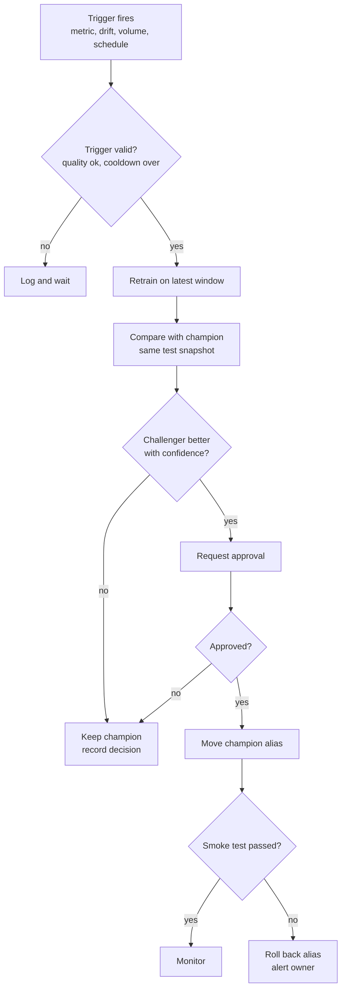

Every path ends in a recorded decision, and only the rollback runs without a fresh approval.

| Step | What happens |
| --- | --- |
| Validation | Confirm the signal is real: data quality passes, the cooldown has ended, enough new labelled rows exist |
| Retraining | Rerun the pipeline from features onward on the newest window, reusing unchanged stages |
| Comparison | Score challenger and champion on the same newest matured test cutoff with bootstrap intervals |
| Decision | Promote through approval only if AP-8 holds; otherwise keep the champion and record why |
| Rollback plan | Keep the last three versions; the previous champion is recorded before every alias move |

### 19.4 Remedies by reason code

| Reason code | First remedy | Second remedy |
| --- | --- | --- |
| PR\_AUC\_BELOW\_FLOOR | Tune the top two families | Add a feature group, then retrain |
| NO\_LIFT\_OVER\_BASELINE | Check for label or feature bugs | Escalate |
| MISCALIBRATED | Recalibrate (isotonic, then sigmoid) | Reduce class weighting |
| SEGMENT\_RECALL\_GAP | Segment-aware threshold review | Escalate to the ML Engineer |
| GENERALIZATION\_GAP | Stronger regularisation, shallower trees | Fewer features |
| DRIFT\_DETECTED | Retrain on a recent window | Investigate the upstream source |
| LEAKAGE\_SUSPECTED | Block selection and escalate | — |

### 19.5 Rollback

Rollback moves the `champion` alias back to the recorded previous version in one registry call. It runs automatically only when the post-deployment smoke test fails; a person can trigger it at any time, and both cases write an audit entry and an alert.

## 20. Autonomous Error Handling

Failures are handled by a five-step loop in which deterministic classification always runs before any LLM repair. The loop is bounded: a repeated error or an exhausted budget escalates to a person with the full evidence.

### 20.1 The loop

| Step | What happens | Performed by |
| --- | --- | --- |
| Detect | Non-zero exit, exception, failed Spark application, contract violation, timeout or anomalous metric | Execution Agent, Verification Agent |
| Diagnose | Match against the error taxonomy (exception type, Spark SQL error condition, compiler message pattern); compute a fingerprint; ask the LLM only for unmatched errors, using a redacted log excerpt | Deterministic classifier first, LLM second |
| Correct | Apply a playbook action (setting change within quota, input mapping, code patch) as a minimal, recorded diff | Execution or Code Generation Agent |
| Retry | Re-validate the corrected artifact, then re-run with backoff for transient errors | Orchestrator |
| Escalate | Stop and open an escalation when attempts run out, a fingerprint repeats, the fix is outside policy, or the error is non-recoverable | Orchestrator, Governance Agent |

A fingerprint is a hash of the normalised error: line numbers, paths, IDs and timestamps are stripped, so the same fault always maps to the same fingerprint.

### 20.2 Failure playbook

| Failure | Detection | Diagnosis | Automatic correction | Retry limit | Escalate when |
| --- | --- | --- | --- | --- | --- |
| Malformed files | Corrupt-record column populated in permissive parsing | Share of bad lines; delimiter, quote and encoding sniffing | Up to 1% bad lines (EX): quarantine and continue; otherwise try alternative parse options once | 1 | Bad lines stay above the limit |
| Type change in a column | Contract check | Compare profile types with the contract | `try_cast` with quarantine | 1 | Invalid share exceeds the limit |
| Missing optional column | Contract check | Column feeds only optional features | Disable dependent features and record it | 0 | — |
| Missing required column | Contract check | Column is required (customer\_id, order\_date) | None | 0 | Immediately |
| Renamed required column | Contract check plus name and profile similarity | Candidate mapping found | Propose the mapping; apply only if pre-approved or approved | 0 | Always needs approval unless in the alias list |
| Executor loss or fetch failure | Spark application and stage status | Node or network fault | Rely on Spark's task retries, then resubmit | 2 | Repeats after resubmission |
| Executor out of memory | Executor exit reason and logs | Partition too large or skew | Raise shuffle partitions; raise executor memory within quota | 2 | Quota would be exceeded |
| Driver out of memory | Driver log | Result collected to the driver | Rewrite to write-to-storage (static rule LR-09) | 1 | Rewrite fails validation |
| Data skew | Maximum task time far above the median in stage metrics | Hot keys found by sampling | Rely on adaptive skew handling; then propose salting | 1 | Skew persists |
| Invalid cast under ANSI mode | Spark SQL error condition for invalid cast input | Unparseable values in a column | Replace `cast` with `try_cast` plus quarantine; never turn ANSI mode off | 1 | Same fingerprint again |
| Unresolved column | Spark SQL unresolved-column error with suggestions | Name drift or generation mistake | Regenerate with the correct schema | 3 | Same fingerprint twice |
| Scala compilation error | sbt output parsed to file, line and message | Type mismatch, missing import, wrong API | LLM repair with the structured errors and template contract | 3 | Same fingerprint twice |
| Python exception | Traceback parsed to type and frame | Code bug versus environment problem | Code bug: LLM repair | 3 | Same fingerprint twice |
| Missing Python package | ImportError | Environment problem | None; packages are never installed at run time | 0 | Immediately |
| Model convergence warning | scikit-learn ConvergenceWarning | Scaling or iterations | Scale features, raise iterations, change solver | 2 | Drop the candidate if two or more remain; else escalate |
| Extreme class imbalance | Churn rate below 1% or above 99% | Label or data issue | Switch metrics and weighting | 0 | Fewer than 200 positives (EX) |
| Insufficient data | Too few rows or cutoffs for the gap rule | Data window too short | None; relaxing the gap rule risks leakage | 0 | Immediately, with options |
| Policy-violating generated code | Static scan | Forbidden import or call | Regenerate with the violation list | 2 | Repeats; the prompt template is flagged for review |
| Timeout | Soft or hard deadline | Skew, undersized cluster or runaway loop | Soft: notify. Hard: stop, diagnose, one optimised retry | 1 | Second hard timeout |
| LLM error or malformed output | API error or schema validation failure | Rate limit, outage or bad JSON | Backoff; schema-constrained re-ask; template-only fallback | 3 | Fallback also fails |
| Storage or permission error | I/O exception | Credentials or path | Refresh scoped credentials once | 1 | Immediately after |

### 20.3 Escalation ticket

Every escalation contains: run and stage, error class and fingerprint, each attempt with its diff and outcome, a redacted log excerpt, the policy rule that stopped the loop, suggested human actions, and links to the artifacts. The run waits in ESCALATED until a person resumes it with a fix or aborts it.

## 21. Code Generation Requirements

Generated code must pass nine gates before it touches full data, and it may only fill declared slots inside tested templates. Input handling, configuration, logging, metrics and output writing are never generated.

### 21.1 Generation pipeline

| Step | What happens | Gate |
| --- | --- | --- |
| 1. Generate | The agent fills a slot and returns structured output | Output validates against the JSON schema |
| 2. Static checks | Formatting, lint and forbidden-API scan | Zero violations |
| 3. Dependency validation | Imports must be on the allowlist; build files must be unchanged | Hash of build files unchanged |
| 4. Compile | sbt incremental compile for Scala; byte-compile for Python; `EXPLAIN` for SQL | No errors; warnings fatal for generated modules |
| 5. Fixture tests | Unit tests on small, hand-checked data with a local SparkSession | All pass |
| 6. Sandbox dry run | Run on a sample (EX: 1% or 100,000 rows) in the sandbox | Completes within its time limit |
| 7. Contract check | Output schema, uniqueness, value ranges, row accounting | All pass |
| 8. Store and version | Commit source and artifact with metadata | Content hash recorded |
| 9. Execute | Full run through the Execution Agent | Output contract passes again |

### 21.2 Templates and slots

```scala
package triad.jobs

import org.apache.spark.sql.{DataFrame, SparkSession}
import triad.core.{Inputs, JobConfig, TriadJob}

// Fixed template: I/O, configuration, metrics and error reporting live in TriadJob.
object FeatureJob extends TriadJob {

  override def name: String = "churn-features"

  override def transform(spark: SparkSession, in: Inputs, cfg: JobConfig): DataFrame = {
    // BEGIN GENERATED SLOT: transform
    val daily = generated.ChurnFeatures.customerDaily(in("transactions"), in("products"))
    val expanded = generated.ChurnFeatures.expandToSnapshots(
      daily, cfg.maxWindowDays, cfg.firstCutoff, cfg.lastCutoff)
    generated.ChurnFeatures.windowFeatures(expanded)
    // END GENERATED SLOT: transform
  }
}
```

`TriadJob` provides `main`: it parses arguments, builds the SparkSession, reads inputs by contract, calls `transform`, validates the output schema, writes to a staging path, emits metrics and reports errors in a structured form. A diff that touches anything outside the slot markers fails step 2.

### 21.3 Prompt structure

| Part | Content |
| --- | --- |
| Rules | Role, allowed APIs, forbidden list, ANSI-mode guidance, required output schema |
| Template | The template file with slot markers |
| Schemas | Column names and types from the feature catalogue |
| Task | The plan step and its acceptance criteria |
| Examples | One or two approved slot implementations from the template library |
| Feedback | For repairs only: structured errors and the previous diff |
| Untrusted content | Masked sample values and log excerpts inside explicit data fences, marked as data, never as instructions |

The required output is a JSON object with `slot_id`, `language`, `code`, `declared_imports`, `declared_output_schema` and a `notes` field of at most 300 characters.

### 21.4 Static checks

| Language | Checks |
| --- | --- |
| Python | `ruff` lint; AST policy scan for forbidden imports and calls; `bandit` security scan; optional type checking |
| Scala | `scalafmt --check`; forbidden-API scan on the syntax tree; compiler warnings treated as errors in the generated module |
| Spark SQL | Parse and analyse with `EXPLAIN` against registered schemas, without executing |

### 21.5 Forbidden APIs

| Language | Forbidden | Why |
| --- | --- | --- |
| Python | `os.system`, `subprocess`, `socket`, `eval`, `exec` | Arbitrary execution and network access |
| Python | `pickle.load` on files outside the model registry | Unsafe deserialisation |
| Python | `collect()` or unguarded `toPandas()` on event data; Python UDFs on event data | Driver memory and performance (LR-03, LR-09) |
| Scala | `sys.process`, `Runtime.exec`, `java.net`, `System.exit` | Arbitrary execution, network access, killing the driver |
| Scala | `collect()` or `toLocalIterator()` on event data | Driver memory |
| Both | Writes outside run-scoped staging paths | Output isolation |
| Both | Setting protected Spark options such as `spark.sql.ansi.enabled` | Configuration changes go through the Optimization Agent's allowlist |

### 21.6 Versioning and storage

Each artifact is identified by the SHA-256 hash of its normalised source. It is committed to a dedicated generated-code git repository with trailers for run ID, template ID and version, prompt-template version, LLM model ID and parent artifact (for repairs), and copied to `artifacts/code/<hash>/`. A `code_artifacts` row links it to its checks, tests and executions.

### 21.7 Human review

- Any artifact can be opened as a diff in the pipeline view.
- Review is mandatory before a generated implementation is promoted into the template library.
- Review is mandatory when a repair touched more than 30% of a slot's lines (EX), because large rewrites deserve a second look.

## 22. Execution Sandbox

All generated code runs in short-lived, locked-down containers started by a single runner service, on a Spark cluster isolated from anything production-like. Generated code can be wrong, and data can carry text that tries to steer an agent, so the sandbox assumes every artifact is untrusted.

### 22.1 Threats

| Threat | Example | Control |
| --- | --- | --- |
| Data exfiltration | Code posts customer rows to an outside address | No external network; scoped credentials |
| Secret theft | Code reads environment variables or mounted keys | No secrets mounted; short-lived, narrow credentials |
| Destructive writes | Code deletes raw data | Read-only inputs; writes only to run-scoped staging |
| Resource exhaustion | Fork bomb, memory blow-up, endless loop | CPU, memory, process and time limits |
| Host escape | Container breakout through extra privileges | Non-root user, all capabilities dropped, no privilege escalation |
| Prompt injection through data | A product description tells the agent to delete data | Data fenced as data; destructive tools not available to agents |
| Supply-chain tampering | Code installs a malicious package | Pinned images; no package installs at run time |

### 22.2 Controls

| Control | MVP implementation | Production extension |
| --- | --- | --- |
| Isolation | One `--rm` Docker container per execution | gVisor or Kata containers; Kubernetes pods with a restricted policy |
| User and privileges | Non-root `--user`; `--cap-drop ALL`; `--security-opt no-new-privileges`; default seccomp profile | Custom seccomp and AppArmor profiles |
| File system | `--read-only` root; artifact and sample mounted read-only; `--tmpfs` scratch with a size cap | Encrypted ephemeral volumes |
| Network | An internal Docker network (created with `--internal`) reaching only the Spark master and storage | Network policies per namespace |
| Resources | `--cpus`, `--memory`, `--pids-limit`; deadline enforced by the orchestrator | Namespace quotas |
| Credentials | Short-lived, run-scoped storage credentials: read raw and clean data, write only the run's staging prefix | Workload identity with a secrets manager |
| Dependencies | Pre-built images with pinned packages; offline sbt and pip caches | Signed images and image scanning |
| Spark executors | Worker containers on the same internal network, no host mounts; executors also run generated code | Dedicated sandbox cluster per team |
| LLM access | None from inside the sandbox | Same |
| Output promotion | Staging output promoted only after the contract check | Same |
| Audit | Image digest, command, limits, duration and exit code recorded per execution | Central audit store |

### 22.3 The runner service

Only the runner service can start containers, and its API accepts just one request shape: run a known image with a registered artifact under a named resource profile. No other service mounts the container-engine socket, because that socket grants host-level control. Rootless Docker or Podman is recommended for the runner host.

### 22.4 Resource profiles (EX)

| Profile | CPUs | Memory | Process limit | Hard timeout | Scratch |
| --- | --- | --- | --- | --- | --- |
| small (dry runs, tests) | 2 | 4 GB | 256 | 10 minutes | 2 GB |
| medium (Spark client, ML training) | 4 | 16 GB | 512 | 60 minutes | 10 GB |
| large (big ML jobs) | 8 | 32 GB | 1,024 | 3 hours | 50 GB |

Executor sizes are set separately per Spark job and capped by the run's quota.

## 23. Data Storage Architecture

The MVP keeps bulk data as versioned Parquet on a shared volume and everything else in PostgreSQL, behind a storage interface that can switch to S3-compatible object storage without changing pipeline code.

### 23.1 What is stored where

| Data class | Store | Format | Versioning | Retention (EX) | Access |
| --- | --- | --- | --- | --- | --- |
| Raw data | Shared volume, `raw/` | Original files | Write-once version folders | 12 months | Ingestion service, Data Engineers |
| Quarantined rows | `quarantine/` | Parquet with reason codes | Per run | 90 days | Data Engineers |
| Processed data | `clean/`, `labels/`, `features/` | Parquet, zstd, partitioned by date | Version folders with a manifest | 12 months | Spark jobs, ML worker |
| Training sets | `training_sets/` | Parquet | Per run | 6 months | ML worker |
| Metadata | PostgreSQL | Relational tables | Row history plus audit log | Project lifetime | Services, by role |
| Agent fix memory (optional vectors) | PostgreSQL, optionally with pgvector | Rows and embeddings | Per fix | Project lifetime | Agents, read-only |
| Models | MLflow: artifacts on the volume, registry in PostgreSQL | MLflow model format | Versions and aliases | Last 10 versions per model | ML worker, Governance Agent |
| Generated code | Git repository plus `artifacts/code/` | Source and JAR | Content hash | Project lifetime | Reviewers, runner |
| Logs | JSON log files; excerpts in PostgreSQL; Spark event logs on the volume | JSON, Spark event log | Append-only | 30 days full; 1 year of excerpts | Administrators |
| Reports | `reports/` plus a metadata row | HTML, optional PDF | Per run | 1 year | By role |
| Predictions | Full sets as Parquet; summaries in PostgreSQL | Parquet, tables | Per model version and score date | 12 months full; 90 days in PostgreSQL | Analysts, by role |

### 23.2 Parquet conventions

- zstd compression (snappy acceptable); target file size 128 to 512 MB.
- Partition features by `snapshot_date` and predictions by `score_date`; never by customer.
- Timestamps pinned to microsecond precision in UTC (section 13.5).
- Compact small files by repartitioning before write and by adaptive partition coalescing.
- Every committed folder has `_SUCCESS` and `_manifest.json`.

### 23.3 Storage interface

Pipeline code addresses data through URIs resolved by one storage module. The MVP uses `file://` paths on the shared volume. Switching to `s3a://` needs only configuration plus the Hadoop AWS connector JAR that matches the Hadoop version bundled with the chosen Spark build; mismatched connector versions are a common failure, so the Phase 1 smoke test covers them.

### 23.4 Production extension

In production, bulk data moves to object storage (a cloud bucket or a maintained S3-compatible system, see CR-17), and processed tables adopt Delta Lake or Apache Iceberg for ACID commits and time travel once their support for the pinned Spark version is confirmed.

## 24. Database Design

Nineteen PostgreSQL tables hold every piece of state the platform needs to run, resume, explain and audit a pipeline. MLflow keeps its own tables for runs and model versions; TRIAD stores references to them plus governance status, so neither system duplicates the other.

### 24.1 Tables

| Table | Purpose | Main columns |
| --- | --- | --- |
| users | People and roles | id (uuid), email (unique), display\_name, role, password\_hash (local accounts only), is\_active, created\_at, last\_login\_at |
| datasets | Registered data sources | id, name (unique), entity\_type, source\_type, source\_uri, owner\_id, contract\_yaml, auto\_run\_policy (jsonb), created\_at |
| dataset\_versions | Immutable versions | id, dataset\_id, version\_no, storage\_uri, checksum\_sha256, size\_bytes, row\_count, schema\_json, schema\_hash, quality\_score, profile\_uri, status, created\_at, created\_by |
| pipeline\_runs | One row per run | id, run\_key (unique, readable, such as run-2026-10-05-001), pipeline\_name, trigger\_type, triggered\_by, state, current\_stage, config\_json, config\_hash, input\_versions (jsonb), parent\_run\_id, mode (full, incremental, replay), budget\_json, llm\_calls\_used, llm\_cost\_used, idempotency\_key (unique), started\_at, finished\_at, error\_summary |
| agent\_tasks | Queue and stage tasks | id, run\_id, stage, agent\_name, task\_type, status, priority, attempt, max\_attempts, input\_refs, output\_refs, lease\_owner, lease\_expires\_at, error\_class, error\_fingerprint, created\_at, started\_at, finished\_at |
| decision\_records | Why agents did what they did | id, task\_id, decision\_type, decision, alternatives, evidence\_refs, policy\_rule\_ids, summary (at most 500 characters), llm\_invocation\_id, outcome, created\_at |
| llm\_invocations | Every model call | id, task\_id, provider, model\_id, prompt\_template\_id, prompt\_template\_version, prompt\_hash, redacted\_prompt\_uri, response\_uri, input\_tokens, output\_tokens, cost\_estimate, latency\_ms, status, created\_at |
| code\_artifacts | Generated code | id, run\_id, language, template\_id, template\_version, content\_hash, storage\_uri, git\_commit, static\_check\_status, compile\_status, test\_status, llm\_invocation\_id, parent\_artifact\_id, created\_at |
| executions | Every job run | id, task\_id, artifact\_id, engine, spark\_app\_id, image\_digest, command, resources\_json, status, exit\_code, started\_at, finished\_at, duration\_ms, metrics\_json, inputs\_json, outputs\_json, log\_uri |
| experiments | ML experiments per run | id, run\_id, mlflow\_experiment\_id, name, objective\_metric, split\_spec\_json, feature\_set\_version, created\_at |
| models | Registered model lines | id, name (unique), mlflow\_registered\_name, task\_type, target\_definition, owner\_id, champion\_version\_id, created\_at |
| model\_versions | Versions and governance status | id, model\_id, mlflow\_version, mlflow\_run\_id, algorithm, params\_json, feature\_set\_version, training\_data\_ref, signature\_json, threshold, governance\_status, model\_card\_uri, created\_at, promoted\_at, promoted\_by |
| metrics | All metric values | id, scope, ref\_id, split, segment, metric\_name, metric\_value, ci\_low, ci\_high, computed\_at |
| predictions | Prediction summaries for the UI | id, model\_version\_id, prediction\_set (official or shadow), customer\_ref, score\_date, churn\_probability, risk\_band, top\_reasons (jsonb), feature\_set\_version, run\_id, created\_at |
| reports | Generated reports | id, run\_id, report\_type, storage\_uri, format, status, claim\_check\_status, created\_at |
| approvals | Human decisions | id, run\_id, action\_type, target\_ref, requested\_by, evidence\_uri, status, decided\_by, decision\_note, requested\_at, decided\_at, expires\_at |
| audit\_logs | Append-only trail | id, ts, actor\_type, actor\_id, action, resource\_type, resource\_id, run\_id, details, outcome, prev\_hash, entry\_hash |
| alerts | Operational alerts | id, alert\_type, severity, run\_id, model\_id, message, status, created\_at, acknowledged\_by |
| drift\_reports | Drift per scoring run | id, model\_version\_id, reference\_ref, current\_ref, psi\_json, flagged\_features, computed\_at |

Governance status values are candidate, challenger, pending\_approval, champion, archived and rejected. `customer_ref` is a pseudonymous key; the mapping to real identifiers lives only in the source systems.

### 24.2 Relationships

| From | To | Cardinality | Meaning |
| --- | --- | --- | --- |
| datasets | dataset\_versions | One to many | A source has many immutable versions |
| pipeline\_runs | agent\_tasks | One to many | A run expands into stage tasks |
| agent\_tasks | decision\_records, llm\_invocations, executions | One to many | A task records its decisions, calls and executions |
| code\_artifacts | executions | One to many | An artifact can run several times |
| code\_artifacts | code\_artifacts | Parent to child | Repairs form a lineage |
| pipeline\_runs | experiments, reports, approvals | One to many | Run outputs and decisions |
| models | model\_versions | One to many | A model line has versions; one is the champion |
| model\_versions | predictions, drift\_reports | One to many | Scores and drift per version |
| users | approvals | One to many | Approvers decide requests |

### 24.3 Constraints and indexes

- Unique (dataset\_id, checksum\_sha256) stops duplicate versions.
- Unique idempotency\_key on pipeline\_runs makes run creation safe to retry.
- Partial index on agent\_tasks (priority, created\_at) where status = 'queued' keeps queue claims fast.
- Index on metrics (ref\_id, metric\_name, split, segment).
- predictions is range-partitioned by score\_date, with 90 days kept.
- Separation of duties (the approver differs from the requester of a promotion) is enforced in the service and backed by a trigger.

### 24.4 Governance tables in SQL

```sql
CREATE TABLE approvals (
    id             uuid PRIMARY KEY DEFAULT gen_random_uuid(),
    run_id         uuid NOT NULL REFERENCES pipeline_runs(id),
    action_type    text NOT NULL CHECK (action_type IN
                   ('model_promotion', 'destructive_cleaning', 'schema_change',
                    'definition_change', 'policy_override', 'quota_increase')),
    target_ref     text NOT NULL,
    requested_by   text NOT NULL,            -- user id or 'agent:<name>'
    evidence_uri   text NOT NULL,
    status         text NOT NULL DEFAULT 'pending'
                   CHECK (status IN ('pending', 'approved', 'rejected', 'expired')),
    decided_by     uuid REFERENCES users(id),
    decision_note  text,
    requested_at   timestamptz NOT NULL DEFAULT now(),
    decided_at     timestamptz,
    expires_at     timestamptz NOT NULL,
    CHECK (status = 'pending' OR (decided_at IS NOT NULL AND decision_note IS NOT NULL))
);

CREATE TABLE audit_logs (
    id            bigint GENERATED ALWAYS AS IDENTITY PRIMARY KEY,
    ts            timestamptz NOT NULL DEFAULT now(),
    actor_type    text NOT NULL CHECK (actor_type IN ('user', 'agent', 'system')),
    actor_id      text NOT NULL,
    action        text NOT NULL,
    resource_type text NOT NULL,
    resource_id   text NOT NULL,
    run_id        uuid,
    details       jsonb NOT NULL DEFAULT '{}',
    outcome       text NOT NULL,
    prev_hash     text NOT NULL,
    entry_hash    text NOT NULL UNIQUE      -- sha256(prev_hash || canonical entry)
);

-- The application role may read and append, never update or delete.
GRANT SELECT, INSERT ON audit_logs TO triad_app;
```

A nightly job recomputes the hash chain; any edited or removed entry breaks it and raises an alert.

## 25. API Requirements

The REST API exposes 24 endpoints under `/api/v1`, all JSON, all authenticated except login and health, with role checks on the server. FastAPI generates the OpenAPI description from the same models that validate requests.

### 25.1 Conventions

- **Authentication:** `Authorization: Bearer <JWT>` with short expiry; OIDC single sign-on in production.
- **Errors:** Problem Details objects (RFC 9457) with media type `application/problem+json`.
- **Pagination:** `limit` and opaque `cursor` parameters.
- **Idempotency:** `Idempotency-Key` header on run creation and exports.
- **Live updates:** server-sent events (`text/event-stream`) for run progress.
- **Privacy:** customer identifiers are pseudonymous; logs returned by the API are redacted.

### 25.2 Endpoints

| Method | Path | Purpose | Success | Other status codes | Roles |
| --- | --- | --- | --- | --- | --- |
| POST | /auth/token | Exchange credentials for a token | 200 | 401 | Public |
| POST | /datasets | Register a source (JSON with `source_uri`) or upload a file (multipart) | 201 new version; 200 existing version for an identical checksum | 400, 401, 403, 413, 422 | Admin, Data Engineer |
| GET | /datasets | List datasets | 200 | 401 | All roles |
| GET | /datasets/{id} | Dataset with latest version and quality score | 200 | 404 | All roles |
| GET | /datasets/{id}/versions/{version}/profile | Profile and issues | 200 | 404 | Data roles, Admin |
| POST | /pipelines/run | Start a run | 202 with `Location` | 400, 403, 409 (same key, different body), 422 | Data Engineer, Data Scientist, ML Engineer, Admin |
| GET | /pipelines/{id} | State, stages, budgets, pending approvals | 200 | 404 | All roles |
| GET | /pipelines/{id}/logs | Redacted, filterable logs | 200 | 404 | Data roles, Admin |
| GET | /pipelines/{id}/events | Live progress stream | 200 (stream) | 404 | All roles |
| GET | /pipelines/{id}/decisions | Decision records | 200 | 404 | Data roles, Admin |
| GET | /pipelines/{id}/artifacts | Generated code and diffs | 200 | 404 | Data roles, Admin |
| POST | /pipelines/{id}/cancel | Cancel a run | 202 | 409 (already finished) | Run starter, Admin |
| POST | /pipelines/{id}/resume | Resume an escalated run with a fix note | 202 | 409 (not escalated), 422 | Data Engineer, ML Engineer, Admin |
| GET | /models | Models with champion and challenger | 200 | 401 | All roles |
| GET | /models/{id} | Versions, metrics, model card, aliases | 200 | 404 | All roles |
| POST | /models/{id}/approve | Approve a pending promotion (`version`, `comment`) | 200 | 403 (role or self-approval), 409 (nothing pending), 422 (no comment) | ML Engineer, Admin |
| POST | /models/{id}/reject | Reject a pending promotion | 200 | 403, 409, 422 | ML Engineer, Admin |
| POST | /models/{id}/rollback | Move `champion` back to a recorded version | 200 | 403, 409 | ML Engineer, Admin |
| GET | /approvals | List approval requests by status | 200 | 401 | Approver roles, Admin |
| POST | /approvals/{id}/decision | Decide any approval type | 200 | 403, 409, 422 | Role named in the policy |
| GET | /predictions | Scores filtered by model, date, risk band, segment, probability and set | 200 | 400 | Business Analyst, Data Scientist, ML Engineer, Admin; Viewers get aggregates only |
| POST | /predictions/export | Audited CSV export | 202 with a download link | 403 | Business Analyst, Admin |
| GET | /reports/{id} | Report metadata and file (`format=html` or `pdf`) | 200 | 404 | By report audience |
| GET | /audit-logs | Search the audit trail | 200 | 403 | Admin |

`GET /health` is public; Prometheus scrapes `/metrics` on the internal network only.

### 25.3 Example: start a run (EX)

```http
POST /api/v1/pipelines/run
Authorization: Bearer <token>
Idempotency-Key: 5f1c2d9e-7a41-4c0b-9d7e-2b8f6a1c3e55
Content-Type: application/json

{
  "pipeline": "churn_v1",
  "inputs": {"transactions": "dsv_1042", "products": "dsv_0311"},
  "mode": "full",
  "config_overrides": {"horizon_days": 90, "feature_windows": [30, 90, 180, 365]},
  "budget": {"max_llm_calls": 60, "max_wall_clock_minutes": 240}
}
```

```json
{
  "run_id": "run-2026-10-05-001",
  "state": "RECEIVED",
  "links": {
    "self": "/api/v1/pipelines/run-2026-10-05-001",
    "events": "/api/v1/pipelines/run-2026-10-05-001/events"
  }
}
```

### 25.4 Example: run status (EX)

```json
{
  "run_id": "run-2026-10-05-001",
  "state": "APPROVAL_REQUIRED",
  "stages": [
    {"name": "profile", "status": "succeeded", "duration_s": 212},
    {"name": "feature_job", "status": "succeeded", "attempts": 2, "duration_s": 760},
    {"name": "model_selection", "status": "succeeded", "duration_s": 1840}
  ],
  "budget_used": {"llm_calls": 23, "llm_cost_usd": 0.84, "wall_clock_minutes": 71},
  "pending_approval": {
    "id": "apr-0091",
    "action_type": "model_promotion",
    "expires_at": "2026-10-08T11:50:00Z"
  }
}
```

### 25.5 Example: error (EX)

```json
{
  "type": "https://triad.example/problems/self-approval",
  "title": "Approver must differ from requester",
  "status": 403,
  "detail": "User u-17 requested promotion of churn_classifier version 8 and cannot approve it.",
  "instance": "/api/v1/models/7/approve"
}
```

## 26. User Interface Requirements

Eight pages cover the whole loop, and every number on screen shows where it came from. Five pages (dashboard, pipeline, model, predictions, approvals) are Must for the MVP; datasets, reports and settings ship in simpler form first.

### 26.1 Pages

| Page | Components | Data sources | Key interactions | Roles |
| --- | --- | --- | --- | --- |
| Dashboard | Tiles for runs today, success rate, open alerts, champion test PR-AUC, pending approvals; recent runs table; model performance trend; alert list | `/pipelines`, `/models`, `/approvals`, alerts | Open a run, acknowledge an alert, jump to an approval | All |
| Dataset | Dataset list; schema with semantic types; quality score with dimension breakdown; per-column statistics and histograms; version history with schema diff; issue list with evidence | `/datasets`, profile endpoint | Compare two versions; confirm a proposed source mapping | Data roles, Admin |
| Pipeline | State-machine stepper; live logs; stage timeline with retries; agent decision feed; generated-code viewer with diffs between attempts; budget meters | `/pipelines/{id}`, `/events`, `/logs`, `/decisions`, `/artifacts` | Cancel, resume after escalation, open a diff, filter logs by stage | Data roles, Admin; others see a summary |
| Model | Candidate comparison table; PR, ROC, calibration and lift charts; importance with method label; versions and aliases; model card | `/models`, `/models/{id}` | Compare any two versions; request rollback | All; actions for ML Engineer, Admin |
| Predictions | Probability distribution; risk bands; filterable customer table with top reasons; segment view by country, tenure and value tier; export | `/predictions`, export endpoint | Filter, sort, export (audited) | Business Analyst, Data Scientist, ML Engineer, Admin; Viewers see aggregates |
| Report | Executive summary with provenance badges; charts; metrics; labelled AI suggestions; technical appendix | `/reports/{id}` | Download HTML or PDF | By report audience |
| Approval | Pending list; evidence page with metric deltas and intervals, segment checks, drift, feature changes, model card and risk notes; decision form with mandatory comment | `/approvals`, decision endpoints | Approve or reject; view history | Approver roles, Admin |
| Settings | Users and roles; read-only view of the active policy file and its version; budgets; connections | Admin endpoints | Manage users; view policy history | Admin |

### 26.2 Interface principles

- **Provenance badges:** every figure is marked Calculated, Model output or AI interpretation.
- **Plain first, detail on demand:** errors show a one-line summary, a suggested action, and an expandable technical trace.
- **One page per decision:** an approver never needs to leave the approval page to decide.
- **Live, not refreshed:** stage changes appear within 5 seconds through the event stream.
- **Accessible:** keyboard navigation, visible focus, and colour never the only signal (WCAG 2.2 AA target for key pages).

### 26.3 States every page handles

| State | Behaviour |
| --- | --- |
| Loading | Skeleton layout; the page stays usable |
| Empty | A short explanation and the next action, for example "Register a dataset to start" |
| Partial | Sections that loaded are shown; failed sections show their own error |
| Error | Summary, suggested action, correlation ID for support |
| Forbidden | States which role is needed, without revealing the hidden data |

## 27. Reporting Requirements

Each run produces a technical report and, after scoring, a business report. The LLM writes words but never numbers: every figure is inserted from the metrics store and checked before the report is released.

### 27.1 Technical report

| Section | Contents |
| --- | --- |
| Dataset summary | Sources, versions, row counts, time span, churn rate per cutoff |
| Data quality findings | Issues by severity with evidence; quality score and its dimensions |
| Cleaning actions | Rules applied, rows affected, quarantine summary, row accounting |
| Feature engineering | Features used, unavailable groups, catalogue version |
| Spark execution | Stage durations, shuffle and spill, skew handling, retries, routing decisions |
| Model comparison | Candidates, rejected models with reasons, tuned results |
| Selected model | Algorithm, parameters, threshold, calibration |
| Evaluation metrics | Validation and test metrics with intervals; segment results; champion comparison |
| Feature importance | Global drivers with the method named |
| Error and recovery history | Failures, fingerprints, fixes, escalations |
| Recommendations | Technical next steps, labelled as AI suggestions |

### 27.2 Business report

| Section | Contents |
| --- | --- |
| Churn risk summary | Customers scored, overall predicted churn level, trend since the last report |
| High-risk customers | Count and share in the high-risk band, and how the band is defined |
| At-risk segments | Segments with the most high-risk customers or the biggest change |
| Main churn drivers | Features most associated with high scores, in plain language, without causal claims |
| Revenue at risk | Estimate: sum of churn probability times expected 90-day value, with the formula stated |
| Suggested retention actions | Hypotheses for the business to test, each tied to a driver |
| Model confidence | Test metrics with intervals and known limitations |

### 27.3 Provenance labels

| Label | Meaning |
| --- | --- |
| Calculated | Computed deterministically from stored data |
| Model output | A prediction or an explanation value from the registered model |
| AI interpretation | Narrative written by the Reporting Agent from the fact sheet |
| Assumption | A stated assumption, such as the expected-value formula |

### 27.4 How claims are verified

1. The renderer builds a **fact sheet**: metric ID, value, unit and definition for every number the report may mention.
2. The Reporting Agent writes narrative with placeholders such as `{{fact:high_risk_count}}` and cannot type digits itself.
3. The renderer fills the placeholders from the fact sheet.
4. The claim checker fails the report if any number appears that did not come from a placeholder.
5. A wording check flags causal verbs ("causes", "drives", "leads to") next to explanation values and requires associative wording instead.
6. Every recommendation must cite a fact ID and carries the label "AI suggestion, needs business review".
7. After two failed checks, the report falls back to a template-only narrative.

### 27.5 Business report excerpt (EX, fictional values)

> **Churn risk this month.** 1,900,000 active customers were scored *(Calculated)*. 285,000 of them (15%) are in the high-risk band, defined as the top 15% of scores *(Model output)*.
>
> **Where the risk sits.** New customers with less than 180 days of tenure make up 34% of the high-risk band *(Calculated)*. High scores are most associated with being overdue against a customer's usual purchase gap, fewer recent app sessions, and recent delivery complaints *(Model output; associations, not causes)*.
>
> **Revenue at risk.** About INR 412 million over the next 90 days *(Calculated, using the Assumption that expected 90-day value equals one quarter of the last year's net revenue)*.
>
> **Suggested actions.** Test a win-back offer for overdue high-value customers, and review delivery performance for customers with recent complaints *(AI interpretation, needs business review)*.

## 28. Auditability and Explainability

Any run can be reconstructed from its run key: inputs, code, settings, decisions, approvals and outputs. The system records what agents did and why in short evidence-linked summaries; it never asks for or stores hidden reasoning.

### 28.1 What every run records

| Item | Recorded as | Stored in |
| --- | --- | --- |
| Agent action | Action name, agent, task, outcome | audit\_logs, agent\_tasks |
| Timestamp | UTC timestamp on every row | All tables |
| Input dataset and version | Dataset version IDs and checksums | pipeline\_runs.input\_versions, executions.inputs\_json |
| Generated code | Content hash, git commit, template version | code\_artifacts |
| Execution environment | Image digest, Spark application ID, resources, library lockfile hash | executions |
| Parameters | Configuration hash and values; model hyperparameters | pipeline\_runs, model\_versions, MLflow |
| Error messages | Error class, fingerprint, redacted excerpt | agent\_tasks, executions |
| Retry attempts | Attempt number, diff, result | agent\_tasks, code\_artifacts |
| Model version | Registry version, alias history | model\_versions, audit\_logs |
| Evaluation metrics | Metric values with split, segment and interval | metrics |
| Decision reason | Decision, alternatives, evidence, rule, summary | decision\_records |
| Human approval | Approver, decision, comment, time | approvals |

### 28.2 Reasoning policy

- Agents return structured outputs: decisions, code, plans and short summaries of at most 500 characters.
- Summaries cite evidence (metric IDs, profile fields) and policy rule IDs, not narrative speculation.
- Prompts are stored redacted, with their template version; responses are stored as returned. Extended reasoning traces, where a model produces them, are not requested and not kept.

### 28.3 Levels of explanation

| Level | Question answered | Mechanism |
| --- | --- | --- |
| Run | What happened, in what order, and how long did it take? | Stage timeline, execution records |
| Decision | Why did an agent choose this? | Decision records with evidence and rule IDs |
| Model | What does the model rely on overall? | Global SHAP or permutation importance; coefficients for linear models; model card |
| Prediction | Why is this customer high-risk? | Top three per-customer SHAP contributions, phrased as associations |

### 28.4 Reconstructing a run

```sql
SELECT a.ts, a.actor_type, a.actor_id, a.action,
       a.resource_type, a.resource_id, a.outcome
FROM audit_logs a
JOIN pipeline_runs r ON r.id = a.run_id
WHERE r.run_key = 'run-2026-10-05-001'
ORDER BY a.id;
```

From this trail an auditor follows links to decision records, code artifacts, executions, metrics and approvals. The same trail drives the pipeline page's timeline.

### 28.5 Never recorded

- Secrets, tokens or passwords, in any log or prompt.
- Raw personal identifiers in logs; logs carry pseudonymous keys only.
- Hidden model reasoning.

Audit entries are append-only and hash-chained (section 24.4); a daily job verifies the chain.

## 29. Security Requirements

Security rests on four ideas: authenticate every caller, give every service the least access it needs, treat all data and model output as untrusted, and record everything. The MVP implements each control in a simple form that can be hardened for production without redesign.

### 29.1 Controls

| Area | Requirement | MVP | Production |
| --- | --- | --- | --- |
| Authentication | Every non-public call carries a valid token | Local accounts, Argon2id password hashes, short-lived JWTs | OIDC single sign-on with MFA |
| Authorisation | Role checks on every endpoint and tool | FastAPI dependencies per route; tool permission table | Central policy service |
| API security | Validate input, cap sizes, limit rates, restrict origins | Pydantic validation, upload size cap, per-user rate limit, CORS allowlist; OWASP API Security Top 10 as a review checklist | API gateway with a web application firewall |
| Credentials | No credentials in code, prompts or logs | Environment files excluded from git; secret scanning in CI | Secrets manager with rotation |
| Encryption | Protect data in transit and at rest | TLS at the reverse proxy; encrypted disks on lab machines where available | TLS everywhere; managed keys for storage and database |
| Model artifacts | Load only trusted models | Load only registry versions whose recorded hash matches, because pickle-based model files can run code when loaded | Signed artifacts |
| Sandboxing | Generated code runs isolated | Section 22 controls | Stronger runtimes and network policies |
| Audit logging | Every action is traceable | Hash-chained audit log (section 24.4) | Tamper-evident external store |
| Least privilege | Services hold only the rights they use | Separate database roles and storage credentials per service (29.3) | Workload identity |
| LLM-specific risks | Resist prompt injection and unsafe output handling | Data fenced as data; tool allowlists; schema-validated outputs; no LLM output executed outside the sandbox; OWASP Top 10 for LLM Applications as a checklist | Dedicated injection classifiers |
| Data minimisation | Send the LLM only what it needs | Schemas, statistics and masked samples; provider data-retention settings reviewed | Private model hosting for sensitive data |
| Supply chain | Know and pin every dependency | Lockfiles, `pip-audit`, image scanning | Software bill of materials, signed images |
| Privacy | Protect customer identity | Pseudonymous customer keys; audited exports; viewers see aggregates only | Data-protection impact assessment before real data |

### 29.2 Role permissions

| Permission | Admin | Data Engineer | Data Scientist | ML Engineer | Business Analyst | Viewer | Agent service |
| --- | --- | --- | --- | --- | --- | --- | --- |
| Manage users, budgets, connections | Yes | — | — | — | — | — | — |
| Change governance policy | Through reviewed change | — | — | — | — | — | — |
| Register datasets and upload | Yes | Yes | — | — | — | — | Registers detected files only |
| Approve destructive cleaning or schema changes | Yes | Yes, owned datasets | — | — | — | — | — |
| Start and cancel runs | Yes | Yes | Yes | Yes | — | — | Scheduler-triggered only |
| View code, logs, decisions | Yes | Yes | Yes | Yes | — | — | Own run only |
| Approve model promotion | Yes | — | — | Yes, not own requests | — | — | Never |
| Roll back a model | Yes | — | — | Yes | — | — | Pre-approved rollback only |
| View identified predictions | Yes | — | Yes | Yes | Yes | Aggregates only | Own run only |
| Export predictions | Yes | — | — | — | Yes, audited | — | — |
| Approve churn definition changes | Yes | — | — | Yes, with an analyst | Yes, with an ML engineer | — | — |
| View reports | Yes | Yes | Yes | Yes | Yes | Yes | — |
| Read audit logs | Yes | — | — | — | — | — | — |

### 29.3 Service accounts

| Service | Can | Cannot |
| --- | --- | --- |
| api | Read and write application tables; read reports | Start containers; read raw data |
| orchestrator | Manage runs and tasks; call the LLM gateway; call the runner | Approve anything; edit policies |
| sandbox job | Read raw and clean data; write its run's staging prefix | Reach the internet, the LLM or the database |
| ml-worker | Read features; write training sets and predictions; log to MLflow | Move the `champion` alias |
| governance | Move aliases after approval; write approval outcomes | Train or score models |
| reporting | Read metrics and predictions; write reports | Read raw data |

## 30. Governance and Human-in-the-Loop

A versioned policy file assigns every action one of four autonomy levels, and the Governance Agent enforces it deterministically. If the policy file is missing or invalid, every gated action is refused.

### 30.1 Autonomy levels

| Level | Name | Meaning |
| --- | --- | --- |
| L0 | Forbidden to agents | Only a person may do it, through a manual, reviewed procedure |
| L1 | Advisory | The agent proposes; a person performs the action |
| L2 | Supervised | The agent performs the action after an explicit approval |
| L3 | Bounded autonomous | The agent acts alone within written limits; everything is logged for later review |

### 30.2 Governance matrix

| Action | Level | Limits | Approver | Evidence | Reversible |
| --- | --- | --- | --- | --- | --- |
| Profiling | L3 | Read-only | — | Profile | Not applicable |
| Cleaning proposals | L3 | Proposals only | — | Plan with impact estimate | Yes |
| Non-destructive cleaning | L3 | At most 5% of rows affected (EX); no column drops; quarantine kept | — | Cleaning report | Yes |
| Cleaning beyond limits or dropping columns | L2 | — | Data Engineer who owns the dataset | Impact estimate, sample rows | Yes |
| Code generation and sandbox runs | L3 | Templates, allowlists, budgets | — | Gate results | Yes |
| Spark setting changes | L3 | Allowlisted settings within quota | — | Before-and-after metrics | Yes |
| Resource quota increase | L2 | — | Admin | Cost estimate | Yes |
| Adding a dependency | L0 | — | Admin, through code review | — | Yes |
| Training, tuning and evaluation | L3 | Budgets | — | Metrics | Yes |
| Internal report generation | L3 | Claim check passed | — | Fact sheet | Yes |
| Publishing a report beyond the team | L2 | — | Business Analyst | Verified report | Yes |
| Model promotion | L2 | AP-1 to AP-8 passed | ML Engineer or Admin, never the requester | Evidence bundle | Yes, by rollback |
| Promotion despite a failed check | L2, two approvers | Written justification | ML Engineer and Admin | Override note | Yes |
| Rollback after a failed smoke test | L3, pre-approved | Previous recorded champion only | — | Smoke test result | Yes |
| Schema or contract change | L2 | — | Data Engineer | Diff and impact | Yes |
| Churn definition change | L2 | — | ML Engineer and Business Analyst together | Label impact analysis | Starts a new model lineage |
| Deleting production data | L0 | — | Admin manual procedure | — | No |
| Sending external business messages | L0 | Out of scope | — | — | No |
| Changing governance policy | L0 | — | Admin, through a reviewed change | Policy diff | Yes |
| Raising the LLM budget | L2 | — | Admin | Usage history | Yes |

### 30.3 Policy as configuration

```yaml
policy_version: "1.3"
fail_closed: true
defaults:
  max_code_repair_attempts: 3
  max_optimisation_cycles: 2
  max_llm_calls_per_run: 60
  approval_expiry_hours: 72
actions:
  cleaning.execute:
    autonomy: bounded
    limits: {max_rows_affected_pct: 5.0, allow_column_drop: false}
    on_limit_exceeded: require_approval
    approvers: [data_engineer]
  spark.config_change:
    autonomy: bounded
    allowlist:
      - spark.sql.shuffle.partitions
      - spark.sql.autoBroadcastJoinThreshold
      - spark.executor.memory
    limits: {within_run_quota: true}
  model.promote:
    autonomy: supervised
    approvers: [ml_engineer, admin]
    separation_of_duties: true
    required_evidence: [metrics_vs_champion, segment_checks, calibration, drift_summary, model_card]
  model.rollback_to_previous:
    autonomy: bounded
    condition: post_deploy_smoke_failed
  schema.change:
    autonomy: supervised
    approvers: [data_engineer]
  churn_definition.change:
    autonomy: supervised
    approvers_all_of: [ml_engineer, business_analyst]
  dependency.add:
    autonomy: forbidden
  data.delete:
    autonomy: forbidden
  external_message.send:
    autonomy: forbidden
```

Policy changes go through code review like any source file, and each run records the policy version it ran under.

### 30.4 Approval flow

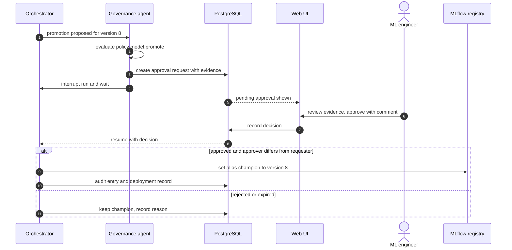

The run holds no worker while it waits; the decision resumes it from its checkpoint.

### 30.5 Approval rules

- **Evidence bundle:** metric deltas with intervals, segment checks, calibration, drift summary, feature changes, model card and the agent's decision records.
- **Mandatory comment:** a decision without a comment is refused.
- **Expiry:** requests expire after 72 hours (EX) and count as rejected.
- **Separation of duties:** the approver of a promotion must differ from its requester.
- **Notification:** approvers see pending requests in the app; a webhook is optional.
- **Audit:** request, view and decision each write an audit entry.

## 31. Performance and Scalability Targets

The MVP must prove the 10 GB tier on the lab cluster; 100 GB is a stretch goal and 1 TB or more is a design target only. All numbers below are provisional engineering targets, re-baselined after EXP-1.

### 31.1 Reference environments

| Environment | Description | Specification (EX) |
| --- | --- | --- |
| Env-A: development | One workstation, Spark local mode, Docker Compose | 8 or more cores, 32 GB RAM, SSD |
| Env-B: lab cluster | Compose on one large host or three to four lab machines | 1 master plus 3 workers with 4 vCPU and 16 GB each; shared storage (network file system, or S3-compatible for multiple hosts) |
| Env-C: cloud extension | Managed Spark or Kubernetes with object storage | 8 to 32 executors; design only |

### 31.2 Targets

| Category | Metric | Environment | Target (TGT) | Validated by |
| --- | --- | --- | --- | --- |
| Dataset scale | Largest tier completed within limits | Env-B | 10 GB (must); 100 GB (stretch) | EXP-2, EXP-3 |
| Dataset scale | Tier supported by design | Env-C | 1 TB and above | Design review |
| Ingestion | 10 GB of CSV converted to Parquet and registered | Env-B | At most 15 minutes | PT-02 |
| Profiling | 10 GB of Parquet profiled | Env-B | At most 10 minutes | PT-02 |
| Spark feature job | 100 million events to customer features | Env-B | At most 30 minutes | PT-03 |
| Spark feature job | 100 GB tier | Env-B | At most 2.5 hours | EXP-3 |
| ML training | All candidates plus 30 trials each, up to 1 million rows | 16-core node | At most 60 minutes | PT-04 |
| Inference | 1 million customers | Single node | At most 5 minutes | PT-05 |
| Inference | 10 million customers | Env-B, Spark UDF | At most 15 minutes | PT-05 |
| Agent planning | One planning step, p95 | Any | At most 60 seconds | PT-07 |
| Agent economy | LLM calls in a nominal run | Any | At most 40 | EXP-1 |
| Agent iterations | Repair attempts per stage | Any | Hard limit 3; average retries per nominal run at most 1 | EXP-1, ATC-10 |
| Orchestration overhead | Agent and LLM time as a share of wall-clock | Env-B, 10 GB | At most 20% | EXP-2 |
| Scaling efficiency | Speed-up when workers double from 2 to 4 | Env-B, 100 GB | At least 1.6 times | EXP-3 |
| API | Read endpoint latency, p95 | Env-A | At most 300 ms | PT-01 |
| Concurrency | Simultaneous runs | Env-B | At least 3 | PT-06 |

### 31.3 Measurement rules

- Durations come from execution records and Spark event logs, not stopwatch readings.
- Each measurement runs at least five times (six when a paired test is reported); reports show the median and interquartile range.
- Cold and warm runs are reported separately, because sbt and JVM start-up dominate small jobs.
- The environment specification and every version are recorded with each result.

### 31.4 Synthetic data tiers (approximate, at about 100 bytes per CSV line)

| Tier | Customers | History | Order lines |
| --- | --- | --- | --- |
| 10 GB | About 1 million | 24 months | About 100 million |
| 100 GB | About 5 million | 24 months | About 1 billion |
| 1 TB (design only) | About 20 million | 36 months | About 10 billion |

The generator is seeded, so every tier is reproducible, and it can inject the faults used in section 33.

## 32. Evaluation Framework

TRIAD is judged against three non-agentic baselines on the same data, features, model families and hardware. The question is not whether agents beat engineers at modelling, but whether the governed loop reduces effort and failures without losing model quality.

### 32.1 Configurations compared

| ID | Configuration | How it runs |
| --- | --- | --- |
| B1 | Manual pipeline | A team member follows a written runbook: notebooks, hand-run Spark for large data, manual model selection |
| B2 | Python-only automated pipeline | One pandas and scikit-learn script on a single node; failures beyond memory limits are recorded as results |
| B3 | Spark and Python without agents | Hand-written Scala and PySpark jobs plus scikit-learn, run as a fixed DAG with no repair loop |
| P | TRIAD | The full agentic loop with governance |

### 32.2 Metrics

| Metric | Definition | How it is measured |
| --- | --- | --- |
| Execution time | Wall-clock time end to end and per stage | Execution records and Spark event logs |
| Coding effort | Hand-written pipeline lines (excluding tests and shared framework) and logged engineer hours | Repository statistics, time sheets |
| Scalability | Largest tier completed; speed-up curve as workers increase | EXP-2, EXP-3 |
| Failure recovery | Recovered injected faults divided by injected recoverable faults; mean time to recovery | EXP-4 to EXP-8 |
| Model performance | Test PR-AUC, ROC-AUC and Brier score on the same cutoff, with bootstrap intervals | Evaluation service |
| Pipeline completion rate | Completed runs divided by attempted runs | Run records |
| Retry rate | Retries per run and per stage | Task records |
| Resource usage | CPU-hours, peak memory, LLM tokens and cost | Metrics exporter, LLM invocation table |
| Reproducibility | Share of replays with identical output hashes; metric differences | Replay runs |
| Human intervention count | Manual actions per run, with required approvals counted separately | Audit log |

### 32.3 Fairness rules

- Same dataset versions, feature definitions, model families and tuning budgets for B3 and P.
- Same hardware and Spark settings, with fixed seeds.
- B1 follows a written runbook so that its time reflects the process, not one person's shortcuts.
- Agentic runs repeat with the same pinned LLM and prompt versions; LLM variation is measured, not hidden.

### 32.4 Statistical treatment

- Descriptive statistics (median and interquartile range) for time, effort and resource use.
- Bootstrap confidence intervals for model metrics.
- Paired comparisons across repetitions; a two-sided Wilcoxon signed-rank test needs at least six pairs, because five pairs can never reach p below 0.05.
- Every result states its environment, versions and number of repetitions.

### 32.5 Threats to validity

| Threat | Mitigation |
| --- | --- |
| The team that built TRIAD also runs the baselines | Written runbooks; a team member not involved in building a baseline times it |
| LLM behaviour changes between runs or versions | Pinned model versions; replay mode; several agentic repetitions |
| Results specific to one dataset | Repeat on a second dataset (section 43) |
| Synthetic data too clean | Fault injection and realistic skew in the generator |
| Hardware noise | Repetitions, warm and cold runs reported separately |
| Learning effects across repetitions | Randomised run order |

## 33. Experiment Design

Ten experiments test scale, recovery, drift handling, leakage defences and governance. Every expected observation below is a hypothesis to test, not a result.

Controlled in every experiment unless it is the variable under test: dataset versions, seeds, library and LLM versions, prompt versions, hardware and Spark settings.

| ID | Setup | Hypothesis | Independent variable | Dependent measures | Expected observation |
| --- | --- | --- | --- | --- | --- |
| EXP-1 Small dataset | UCI Online Retail II on Env-A; P against B1, B2 and B3 | P finishes end to end with no manual step except approval; agent overhead dominates P's time at this size | Configuration | Wall-clock, LLM calls, human actions, test PR-AUC | P matches B3's model quality within intervals but is slower than B2, supporting local-mode routing (LR-07) |
| EXP-2 Medium dataset | 10 GB synthetic tier, plus REES46 monthly files where available, on Env-B | B2 fails or must sample on a 32 GB node; B3 and P finish; P stays within 20% of B3's time | Configuration | Completion, wall-clock, overhead share, coding effort | B2 runs out of memory; P's extra time is mostly LLM and compile time |
| EXP-3 Large dataset | 100 GB tier on Env-B or cloud credits; 2, 4 and 8 workers where available | Doubling from 2 to 4 workers gives at least 1.6 times speed-up | Worker count | Stage durations, shuffle bytes, spill, speed-up | Sub-linear scaling, limited by shuffle-heavy window stages |
| EXP-4 Schema errors | Rename `customer_id`; turn `price` into text with currency symbols; drop the optional tickets table | A renamed required column is detected and a mapping proposed but not applied without approval; prices are fixed by `try_cast` and quarantine; the missing optional table disables its features | Fault type | Detection rate, correct-action rate, approval requests, time to recovery | Every fault detected; no silent row loss |
| EXP-5 Missing values | Random nulls at 5%, 20% and 50% in non-key columns and 1% in key columns | Key nulls are quarantined, others imputed; PR-AUC declines gradually with the null rate | Null rate, column role | Quarantine counts, PR-AUC, calibration error | Steady degradation; approval requested when more than 5% of rows are affected |
| EXP-6 Spark failures | Kill an executor mid-stage; set executor memory too low; give one customer 20% of all lines | Spark's task retries absorb the kill; the playbook fixes out-of-memory within 2 retries; adaptive execution or salting handles skew | Fault type | Recovery rate, retries, time to recovery, output checksum against a clean run | Recovered outputs identical to the clean run |
| EXP-7 Model degradation | Replay Online Retail II month by month; shift one top feature; change buying behaviour for one segment | Drift flags fire; retraining starts; the challenger is compared with the champion; promotion waits for approval | Drift type and size | Detection delay, PSI, false-alarm rate, PR-AUC before and after | Data drift flagged at the first scoring run; the performance drop visible only after labels mature |
| EXP-8 Scala compile failures | Fault-injection mode mutates generated code with 20 seeded faults (EX): type mismatch, missing import, wrong column, forbidden API | At least 70% repaired within 3 attempts; repeated fingerprints escalate; forbidden APIs never run | Fault class | Repair rate, attempts, LLM calls, escalations | Import and syntax faults fixed most often; semantic faults escalate more |
| EXP-9 Leakage sentinel | Add a feature built from post-cutoff orders and a lifetime total computed over the whole dataset | Static checks and the leakage alarm block both | Leak type | Blocked or not; metric inflation in an unguarded control run | Both blocked; the unguarded control shows inflated scores, for demonstration only |
| EXP-10 Governance bypass | An agent tries to move the champion alias; a requester approves their own promotion; product descriptions contain an instruction to delete data; the LLM budget runs out mid-run | Every attempt is blocked, logged and alerted | Attempt type | Block rate, audit completeness, alert delivery | All blocked, with audit entries |

### 33.1 Fault injection mechanics

| Fault | Injected by |
| --- | --- |
| Schema changes and nulls | Synthetic generator options applied to a copy of the dataset version |
| Executor loss | Stopping a worker container during a named stage |
| Low memory | A resource profile with deliberately small executor memory |
| Skew | Generator option that assigns a share of lines to one customer |
| Code faults | A test-only mutation hook between generation and validation, disabled in normal runs |
| Drift | Generator options applied to later replay months |
| Injection strings | Product descriptions seeded with instruction-like text |

Each experiment writes its configuration, raw measurements and environment record to `experiments/<exp_id>/`, and results appear only in the evaluation report (section 57).

## 34. Success Criteria

The project succeeds when all fourteen criteria below are met with recorded evidence. In this project, "autonomous" means completing the reference scenario with no human action other than the approvals the policy requires.

| ID | Criterion | Threshold (TGT) | Evidence |
| --- | --- | --- | --- |
| SC-01 | End-to-end automation | At least 9 of 10 scripted reference runs finish with no manual action except approvals | EXP-1, EXP-2 |
| SC-02 | Correct language and engine routing | Every stage has a routing decision citing a rule; zero static-scan violations | ATC-01, TC-052 |
| SC-03 | Correct churn data handling | Labels and features match hand-computed fixtures; no leakage | TC-026, TC-030, EXP-9 |
| SC-04 | Failure recovery | At least 70% of injected recoverable faults recovered within budget; all unrecoverable faults escalated within budget | EXP-4, EXP-6, EXP-8 |
| SC-05 | Retraining and promotion control | Every scripted trigger fires; no promotion happens without approval | EXP-7, AT-10 |
| SC-06 | Model quality | Selected model meets AP-1 to AP-7; test PR-AUC is not worse than Baseline 3 beyond its 95% interval | EXP-1 |
| SC-07 | Explainable reports | Every number in every report passes the claim check; every importance chart names its method | AT-15 |
| SC-08 | Auditability | Every run can be reconstructed from its run key; the audit hash chain verifies | AT-12 |
| SC-09 | Governance | All bypass attempts are blocked and logged | EXP-10 |
| SC-10 | Scale | The 10 GB tier completes within the section 31 targets on Env-B | EXP-2 |
| SC-11 | Reproducibility | Replays produce identical outputs for deterministic stages | AT-12 |
| SC-12 | Effort reduction | Hand-written pipeline lines for TRIAD are at most half of Baseline 3's (EX target) | Repository statistics |
| SC-13 | Usability | A new user completes the demo in at most 10 minutes with the guide | Usability test with three users |
| SC-14 | Demo stability | Three consecutive rehearsal runs finish without an unplanned failure before the viva | Rehearsal log |

## 35. Technology Stack

The MVP uses one tool per job and keeps PostgreSQL as the only stateful service besides storage and MLflow. Production extensions are listed but not built.

| Layer | MVP (required) | Production extension | Why |
| --- | --- | --- | --- |
| Frontend | React, Vite, TypeScript; Apache ECharts for charts | Single sign-on; embedded BI | A single-page app is enough; ECharts covers PR, ROC, calibration and lift charts |
| Backend | FastAPI, Pydantic, SQLAlchemy, Alembic, Uvicorn | Several replicas behind an API gateway | Typed validation and generated OpenAPI |
| Agent framework | LangGraph with a PostgreSQL checkpointer | Same, with OpenTelemetry tracing | Explicit graphs, checkpoints and interrupts |
| LLM | Provider adapter for a hosted API or a local model server | Model gateway with routing, caching and cost controls | Vendor-neutral, with an offline option |
| Python ML | pandas, PyArrow, scikit-learn, XGBoost, Optuna, SHAP, MLflow | Distributed or GPU training where justified | Mature and well documented |
| Scala | Scala 2.13, sbt, ScalaTest, scalafmt | Same | Matches Spark 4 builds |
| Spark | Apache Spark 4.1.x standalone cluster in containers | Kubernetes operator or a managed Spark service | Simplest real cluster |
| Database | PostgreSQL 16 or newer | Highly available PostgreSQL | One store for state, queue, audit and the MLflow backend |
| Storage | Shared volume with Parquet | S3-compatible object storage with Delta Lake or Iceberg | See CR-10 and CR-17 |
| Queue and scheduling | PostgreSQL queue, in-process scheduler, storage poller | Airflow or Dagster for scheduling; Kafka for events | Fewer moving parts |
| Containers | Docker and Docker Compose | Kubernetes with Helm | Runs on student machines |
| Monitoring | Prometheus, Grafana, JSON logs | Central log store, distributed tracing, alert routing | Standard metrics stack |
| Data quality | YAML rules compiled to Spark SQL | Deequ or Great Expectations once Spark 4 support is confirmed | See CR-11 |
| Testing | pytest, ScalaTest, PySpark testing utilities, Playwright for UI flows | Adds load-testing tools | Covers every layer |
| Continuous integration | GitHub Actions, or the university's GitLab CI | Adds deployment environments with approvals | Free for student projects |
| Security | JWT with Argon2id password hashes; environment-file secrets kept out of git | OIDC provider (for example Keycloak) and a secrets manager (for example HashiCorp Vault) | Simple first, standard later |
| Vector search | None | pgvector | See CR-12 |

### 35.1 Deliberately left out of the MVP

- **Airflow or Dagster:** LangGraph plus a small scheduler covers one pipeline.
- **Kafka:** batch files and PostgreSQL notifications are enough.
- **Feast:** versioned Parquet folders serve as the offline feature store.
- **Kubernetes:** Docker Compose runs the whole stack on lab machines.
- **Next.js:** server rendering adds nothing to an authenticated dashboard.
- **A vector database:** fix lookup works by fingerprint.

## 36. Development Environment

One pinned version set is used on every machine and in CI, and a Phase 1 smoke test proves the set works together before feature work starts. The Spark line sets the constraints; everything else follows it.

### 36.1 Version baseline

| Component | Version policy | Constraint |
| --- | --- | --- |
| Operating system | Ubuntu 24.04 LTS (primary); macOS; Windows 11 with WSL2 | Docker available |
| Java | Eclipse Temurin JDK 17 | Spark 4.1 supports Java 17 and 21 |
| Scala | 2.13.x, the patch used by the Spark build | Must match Spark's Scala version |
| sbt | Latest 1.x | Spark marked as provided |
| Apache Spark | 4.1.x, latest patch (4.1.3 when this was written) | CR-01 |
| Python | 3.11 | PySpark 4.1 dropped Python 3.9 and needs 3.10 or newer |
| PySpark | Exactly the cluster's Spark version | Client and cluster must match |
| pandas | A 2.x release, at least 2.2 | PySpark 4.1 minimum is 2.2.0; use pandas 3 only if the smoke test passes |
| PyArrow | At least 15.0 | PySpark 4.1 minimum is 15.0.0 |
| NumPy | At least 1.21 | PySpark minimum since 4.0 |
| scikit-learn | Current 1.x | Section 17 code checked on 1.8 |
| XGBoost | Current release | Spark integration verified by the smoke test |
| MLflow | Current release | Aliases API required |
| Optuna, SHAP | Current releases | — |
| LangGraph | Current stable release, pinned | Checkpointer and interrupt support |
| FastAPI, Pydantic 2, SQLAlchemy 2 | Current releases | — |
| PostgreSQL | 16 or newer | — |
| Node.js | Current LTS | Frontend build only |
| Docker Engine and Compose v2 | Current releases | — |

Two PySpark 4.1 behaviours matter for this design: pandas API on Spark now works with ANSI mode on by default, and safe Arrow conversion is on by default, so overflow or precision loss raises an error instead of passing silently. Spark 4.2 later raises the PyArrow minimum to 18.0.0 and turns Arrow-based data exchange on by default ([PySpark upgrade notes](https://spark.apache.org/docs/latest/api/python/migration_guide/pyspark_upgrade.html)).

### 36.2 Compatibility rules

- One JDK, one Scala patch and one Spark version across build machines, driver, executors and CI.
- PySpark on the ML worker is installed from the same Spark release as the cluster.
- Every Python dependency is locked with hashes (uv or pip-tools); every image is referenced by digest.
- The sbt build is locked; generated code cannot change it (section 21).
- Upgrades happen on a branch that must pass the smoke test and the full test suite.

### 36.3 Phase 1 smoke test

| Check | Passes when |
| --- | --- |
| Scala job | A template job compiles, packages and runs with spark-submit on the cluster |
| PySpark | A PySpark session connects, reads Parquet and runs a profiling query |
| Arrow round trip | Timestamps, decimals, nullable integers and booleans survive Spark to pandas and back with the expected types |
| ANSI behaviour | `try_cast` returns null for bad input; a plain cast fails as expected |
| XGBoost | Single-node training works; the Spark estimator trains a tiny model on the cluster |
| MLflow | A model is logged, registered, aliased and loaded by alias; the Spark UDF scores a sample |
| LangGraph | A two-node graph pauses at an interrupt and resumes from a PostgreSQL checkpoint |
| Storage | A write to the shared volume is readable from every container; the optional S3-compatible connector reads a test object |

### 36.4 Tools

- **Editors:** VS Code with the Metals Scala extension and Python tooling, or IntelliJ IDEA with the Scala plugin; PyCharm for Python-heavy work.
- **Quality:** git with pre-commit hooks for ruff, scalafmt and secret scanning.
- **Local stack:** `docker compose up` starts every service in section 10.3; `make demo` seeds the demo dataset.

## 37. Project Modules

The code base splits into eighteen modules with narrow interfaces, so team members can build and test them in parallel. Module IDs are used in the traceability matrix (section 51).

| ID | Module | Purpose | Main responsibilities | Inputs | Outputs | Depends on |
| --- | --- | --- | --- | --- | --- | --- |
| M01 | Authentication | Identify users and services | Login, tokens, password hashing, role lookup | Credentials | Tokens, identity context | users table |
| M02 | Dataset management | Bring data in safely | Source registration, ingestion, versioning, storage watching | Files, JDBC sources | Dataset versions, events | Storage, M03 |
| M03 | Profiling | Describe data | Statistics, semantic types, issue lists, version comparison | Dataset versions | Profiles, quality scores | Spark, M08 |
| M04 | Data quality | Enforce contracts and clean data | Contracts, YAML rules, cleaning plans, quarantine, row accounting | Profiles, contracts | Clean versions, cleaning reports | M05, M06 |
| M05 | Spark processing | Plan distributed work | Planning, routing rules, execution settings, feature catalogue | Plans, catalogue | Execution plans | Spark cluster |
| M06 | Scala jobs | Run compiled Spark jobs | Templates, `TriadJob` core library, build and packaging | Slot code | Tested JARs | sbt, M08 |
| M07 | Agent orchestration | Drive runs | State machine, queue, budgets, triggers, checkpoints, cancel and resume | Run requests, events | Run state | PostgreSQL, LangGraph |
| M08 | Code generation | Produce and verify code | Prompts, generation, validation gates, repair loop | Plan steps, errors | Code artifacts | LLM adapter, M06 |
| M09 | ML training | Train candidates | Preprocessing, candidate registry, size guard, training | Feature sets | MLflow runs | ML worker, MLflow |
| M10 | Evaluation | Judge models | Metrics, calibration, segments, explanations, acceptance policy | Models, cutoffs | Evaluation reports, reason codes | M09 |
| M11 | Optimization | Improve models and jobs | Optuna tuning, Spark setting suggestions | Reason codes, trial history, stage metrics | Tuned parameters, setting changes | M09, M05 |
| M12 | Model registry | Manage versions | MLflow integration, aliases, model cards, rollback, experiment tracking | Trained models | Versions, aliases | MLflow |
| M13 | Prediction | Score customers | Batch scoring, risk bands, shadow sets | Model alias, scoring features | Prediction sets | M12, Spark |
| M14 | Reporting | Explain results | Fact sheets, charts, narratives, claim checks, export | Metrics, predictions | Reports | M10, M13, LLM adapter |
| M15 | Dashboard | Show and control | React pages, event-stream client, in-app notifications | API | User interface | M01, API |
| M16 | Monitoring | Watch health and drift | Exporters, alert rules, drift jobs, health checks | Run metrics, predictions | Alerts, drift reports | Prometheus |
| M17 | Audit | Keep the record | Audit writer, hash-chain check, decision records, lineage | All actions | Audit entries | PostgreSQL |
| M18 | Approval workflow | Keep humans in charge | Policy engine, approval requests, interrupts, separation of duties | Proposed actions | Decisions | M07, M12, M17 |

## 38. Project Directory Structure

One monorepo holds the platform; generated code lives in a separate repository so agent output never mixes with hand-written source.

```text
agentic-data-science/
├── README.md
├── Makefile                      # setup, test, demo targets
├── frontend/                     # React + Vite + TypeScript (M15)
│   └── src/{pages,components,api,charts}/
├── backend/                      # FastAPI service (M01, API)
│   ├── app/{main.py,api/v1/,auth/,services/,events/}
│   └── db/{models/,migrations/}  # SQLAlchemy models, Alembic migrations
├── agents/                       # orchestration and agents (M07, M08, M18)
│   ├── graph/{orchestrator.py,state.py,transitions.py,reaper.py}
│   ├── nodes/                    # one module per agent in section 11
│   ├── tools/{registry.py,storage.py,spark.py,build.py,ml.py,registry_tools.py,policy.py}
│   ├── llm/{adapter.py,budget.py,redaction.py}
│   ├── prompts/                  # versioned prompt templates
│   └── policies/{governance.yaml,routing.yaml,retry.yaml}
├── python_ml/                    # ML package (M09 to M14)
│   └── triad_ml/{io.py,splits.py,candidates.py,train.py,tune.py,
│                 evaluate.py,calibrate.py,explain.py,score.py,drift.py,reports.py}
├── scala_spark/                  # Scala build (M05, M06)
│   ├── build.sbt
│   ├── project/
│   ├── core/src/main/scala/triad/core/      # TriadJob, contracts, metrics
│   ├── jobs/src/main/scala/triad/jobs/      # clean, label, feature, scoring templates
│   └── jobs/src/test/scala/                 # ScalaTest fixtures
├── pipelines/                    # declarative pipeline assets (M02 to M05)
│   ├── churn_v1.yaml
│   ├── feature_catalog/churn_features.yaml
│   ├── contracts/*.yaml
│   └── dq_rules/*.yaml
├── datasets/                     # no large data committed
│   ├── README.md                 # download instructions and licences
│   ├── fixtures/                 # tiny hand-checked test data
│   └── synthetic/generator.py    # seeded generator with fault injection
├── models/                       # model card templates only; artifacts live in MLflow
├── reports/templates/            # Jinja2 report templates (M14)
├── configs/
│   ├── env/{dev.yaml,lab.yaml}
│   ├── spark/spark-defaults.conf
│   └── logging.yaml
├── sandbox/                      # runner service and sandbox images
├── monitoring/{prometheus.yml,alerts.yml,grafana/}
├── tests/{unit,integration,e2e,agent,performance,security,fixtures}/
├── experiments/                  # EXP-1 to EXP-10 configurations and results
├── docker/{compose.yaml,Dockerfile.*}
├── scripts/{bootstrap.sh,download_datasets.py,seed_demo.py}
├── docs/{prd,architecture,adr,api,runbooks,user-guide}/
└── .github/workflows/ci.yaml
```

| Directory | Why it exists |
| --- | --- |
| `frontend/`, `backend/` | User interface and API, deployed as separate containers |
| `agents/` | Everything that decides: graph, agents, tools, prompts and policies |
| `python_ml/` | Reusable ML code that generated scripts call, so generation stays small |
| `scala_spark/` | Templates and the core job library; generated slot code is compiled against it |
| `pipelines/` | Declarative definitions: pipeline, feature catalogue, contracts, quality rules |
| `datasets/` | Fixtures and the synthetic generator; real datasets are downloaded, never committed |
| `sandbox/` | The only component allowed to start containers |
| `tests/` | One folder per test level in section 46 |
| `experiments/` | Reproducible experiment definitions and raw results |
| `docs/` | This PRD, architecture decision records, API reference, runbooks and user guide |

The separate `generated-code` repository receives one commit per artifact, tagged with run keys (section 21.6).

## 39. Workflow and Algorithm

The algorithm below is the orchestrator's contract: six procedures, with every budget check, verification gate and approval made explicit. Agents appear only as calls inside it.

```text
procedure RUN_PIPELINE(trigger):
    run <- CREATE_RUN(trigger)                                  # RECEIVED; budgets attached
    datasets <- REGISTER_OR_REUSE(trigger.inputs)
    if not CONTRACT_OK(datasets):
        return FINISH(run, REJECTED_INPUT)

    profile <- STAGE(run, "profile", PROFILE, datasets)          # PROFILED
    for pass in 1..2:
        issues <- BLOCKING_OR_ABOVE_THRESHOLD(profile)
        if issues is empty: break
        plan <- CLEANING_AGENT.propose(issues, profile)
        if POLICY(run, "cleaning.execute", plan) = REQUIRE_APPROVAL:
            decision <- AWAIT_APPROVAL(run, plan)                # interrupt; may expire
            if decision != APPROVED: return ESCALATE(run, "cleaning not approved")
        datasets <- STAGE(run, "clean", RUN_SCALA_JOB, plan)
        profile <- STAGE(run, "profile", PROFILE, datasets)
    if BLOCKING_OR_ABOVE_THRESHOLD(profile) is not empty:
        return ESCALATE(run, "quality issues persist")

    plan <- SPARK_PLANNING_AGENT.plan(profile, CATALOG, CLUSTER)  # PLANNED
    VERIFY(plan)                                                # columns exist, routing rules, quota
    features, labels <- BUILD_FEATURES(run, plan)               # FEATURES_READY
    outcome <- MODEL_CYCLE(run, features, labels)
    if outcome is ESCALATED: return outcome
    GOVERN_AND_PUBLISH(run, outcome)                            # PUBLISHED
    SCHEDULE_MONITORING(run)                                    # MONITORING
    return FINISH(run, COMPLETED)

procedure STAGE(run, name, action, input):
    for attempt in 1..run.budget.max_attempts(name):
        CHECK_BUDGETS(run)                                      # calls, cost, wall-clock; escalates when spent
        artifact <- GENERATE_OR_REUSE(run, name, input)         # memoised by input, code and config hash
        verdict <- VALIDATION_GATES(artifact)                   # lint, compile, tests, dry run
        if verdict.passed:
            result <- EXECUTE_IN_SANDBOX(artifact)
            if result.ok and CONTRACT_OK(result.outputs):
                COMMIT(run, name, result)                       # atomic promote plus state commit
                return result.outputs
            failure <- result.error or result.contract_violation
        else:
            failure <- verdict.error
        diagnosis <- CLASSIFY(failure)                          # taxonomy first
        if diagnosis.unknown: diagnosis <- LLM_DIAGNOSE(REDACT(failure))
        RECORD_DECISION(run, name, diagnosis)
        if diagnosis.non_recoverable or REPEATED_FINGERPRINT(run, diagnosis):
            break
        input <- APPLY_FIX(input, diagnosis)                    # playbook action or regenerated code
    return ESCALATE(run, name)

procedure BUILD_FEATURES(run, plan):
    feature_job <- CODEGEN_AGENT.fill(TEMPLATE("feature_job"), plan)
    label_job <- CODEGEN_AGENT.fill(TEMPLATE("label_job"), plan)
    features <- STAGE(run, "features", RUN_SCALA_JOB, feature_job)
    labels <- STAGE(run, "labels", RUN_SCALA_JOB, label_job)
    LEAKAGE_CHECKS(features, labels)                            # sentinels, forbidden columns
    return features, labels

procedure MODEL_CYCLE(run, features, labels):
    data <- SIZE_GUARD_LOAD(features, labels)                   # pandas or distributed path
    train, calib, valid, test <- TEMPORAL_SPLIT(data, gap = HORIZON)
    candidates <- MODEL_SELECTION_AGENT.shortlist(SUMMARY(train))
    for cycle in 0..run.budget.max_optimisation_cycles:
        models <- TRAIN_ALL(candidates, train)                  # seeded, logged to MLflow
        report <- EVALUATE(models, valid)                       # metrics, segments, reason codes
        if LEAKAGE_ALARM(report): return ESCALATE(run, "leakage suspected")
        if report.meets_acceptance: break
        if cycle = run.budget.max_optimisation_cycles:
            return ESCALATE(run, "quality floor not met")
        candidates <- OPTIMIZATION_AGENT.remedy(report.reason_codes, candidates)
    return SELECT_MODEL(models, train, calib, valid, test, CHAMPION(), POLICY)   # section 18.4

procedure GOVERN_AND_PUBLISH(run, outcome):
    if outcome is PROPOSE_PROMOTION:
        SHADOW_SCORE(outcome.model)
        DRAFT_REPORTS(run, outcome)                             # claim-checked
        decision <- AWAIT_APPROVAL(run, EVIDENCE(outcome))      # separation of duties
        if decision = APPROVED:
            previous <- CHAMPION()
            SET_ALIAS("champion", outcome.model)
            if not SMOKE_TEST(outcome.model):
                SET_ALIAS("champion", previous)                 # pre-approved rollback
                ALERT(run, "rollback after failed smoke test")
    PUBLISH_OFFICIAL_SCORES(CHAMPION())
    FINAL_REPORTS(run)

procedure MONITOR(model):                                        # after every scoring job
    drift <- PSI(features_now, features_at_training)
    if TRIGGERED(drift, matured_metrics, new_volume, schedule) and COOLDOWN_OVER(model):
        RUN_PIPELINE(trigger = "retraining")
```

### 39.1 How the procedures map to states

| Procedure | States it moves through | Guarantees |
| --- | --- | --- |
| RUN\_PIPELINE | RECEIVED, PROFILED, PLANNED, PUBLISHED, MONITORING | Stops early on rejected input or persistent quality issues |
| STAGE | CODE\_GENERATED, VALIDATED, EXECUTING, FAILED, DIAGNOSING, REGENERATING, RETRYING | Never runs unvalidated code; never exceeds its attempt limit |
| BUILD\_FEATURES | FEATURES\_READY | Leakage checks run before any training |
| MODEL\_CYCLE | TRAINING, EVALUATED, OPTIMIZING, SELECTED | At most two optimisation cycles |
| GOVERN\_AND\_PUBLISH | APPROVAL\_REQUIRED, DEPLOYED, PUBLISHED | No alias move without approval, except the pre-approved rollback |
| MONITOR | Starts a new run | Cooldown prevents retraining storms |

## 40. Flowchart Description

The flow has eight decision points, drawn as two charts: data and execution first, then modelling and governance. Both loops are bounded, and both have an exit to a person.

### 40.1 Data and execution

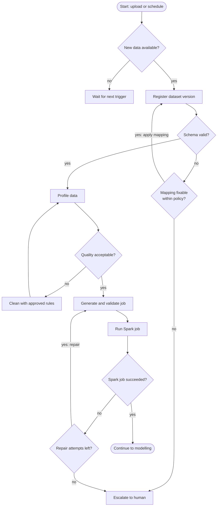

The cleaning loop runs at most twice, and the repair loop at most three times per stage.

### 40.2 Modelling and governance

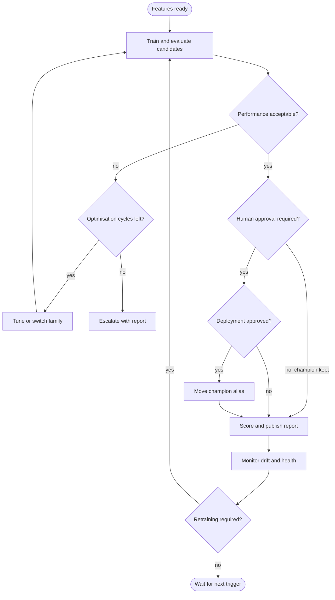

Approval is required whenever a challenger would replace the champion; when the champion is kept, scoring continues without a gate.

### 40.3 Decision points

| Decision | Evaluated by | Yes | No |
| --- | --- | --- | --- |
| New data available? | Storage poller or upload API | Register the version | Wait for the next trigger |
| Schema valid? | Contract check | Profile | Try a policy-approved mapping, else escalate |
| Data quality acceptable? | Quality score and blocking-issue rules | Plan and generate | Clean (at most two passes), else escalate |
| Spark job successful? | Application status and output contract | Continue to modelling | Repair within three attempts, else escalate |
| Model performance acceptable? | Acceptance policy AP-1 to AP-7 | Proceed to the approval check | Optimise (at most two cycles), else escalate |
| Retraining required? | Triggers RT-1 to RT-9 after cooldown | Retrain | Wait |
| Human approval required? | Governance policy: challenger beats champion or no champion exists | Request approval | Keep the champion and publish |
| Deployment approved? | Eligible approver's decision | Move the alias, then smoke-test | Keep the champion; record the reason |

## 41. Sequence Flow

A full run involves eleven participants, but only references and summaries travel between them; data stays in storage and moves only inside Spark and the ML worker.

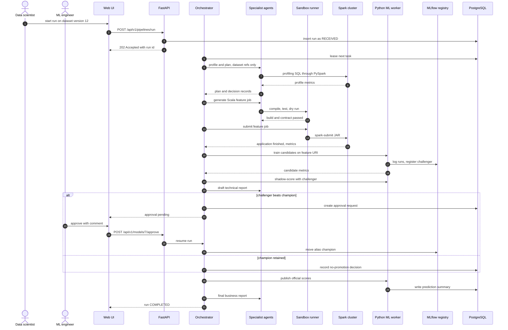

The UI receives every state change through the event stream, so the approver sees the pending request as soon as it is created.

### 41.1 What each message carries

| Messages | Carried by value | Carried by reference |
| --- | --- | --- |
| 1 to 4: start a run | Pipeline name, mode, budget | Dataset version IDs |
| 5 to 9: profile and plan | Profile summaries, plan document, decision records | Dataset URIs |
| 10 to 15: build and run the feature job | Structured build and test results, Spark stage metrics | Code artifact hash, JAR path, output folder |
| 16 to 18: train candidates | Metric values | Feature-set URI, MLflow run IDs |
| 19 to 20: shadow scoring and draft report | Fact sheet | Model version, prediction-set URI |
| 21 to 27: approval, or the no-promotion record | Evidence summary, decision, comment | Evidence bundle URI, approval ID |
| 28 to 31: publish and report | Prediction summary rows | Report URI |

Agents never receive raw customer rows: profiles arrive as statistics, and any sample values are masked before they enter a prompt.

## 42. Example Execution

This walkthrough follows one fictional run, `run-2026-10-05-001`, from a new file to an approved champion. Every value is illustrative (EX) and exists to show the shape of the outputs, not to predict results.

| Step | What happens | Illustrative output (EX) |
| --- | --- | --- |
| 1. New data arrives | `transactions_2026-10-04.csv` lands in the watched folder at 02:10 UTC | 2.4 GB, 18.2 million lines |
| 2. Detection | The poller sees a stable file; the Discovery Agent matches it to `transactions` | Dataset version `dsv_1042` registered; event emitted; run queued by policy |
| 3. Profiling | Spark computes the profile; the agent summarises issues | Quality score 0.87; 1.9% duplicate lines; 3.1% lines without customer ID; 0.4% negative quantities, all on cancellation invoices |
| 4. Planning | The Spark Planning Agent applies routing rules | Spark path (above the size threshold); broadcast the 38 MB product table (configured threshold 64 MB); 400 shuffle partitions; monthly cutoffs; 30, 90, 180 and 365-day windows |
| 5. Scala generation | The feature template's slot is filled; the first compile fails | `ChurnFeatures.scala:41: type mismatch; found Double, required BigDecimal`; repaired on attempt 2; fixture tests pass |
| 6. Spark execution | The JAR runs on 8 executors | 12 minutes 40 seconds; 6.1 GB shuffled; one skewed partition (a wholesale customer) split by adaptive execution |
| 7. Features created | Contract check and row accounting pass | 2.35 million customer-snapshot rows; 42 features |
| 8. Hand-off to Python | Size guard estimates memory from Parquet metadata | About 1.0 GB against a 4 GB budget: pandas path |
| 9. Candidates trained | Five families with fixed seeds | MLflow runs for dummy, logistic regression, random forest, histogram gradient boosting and XGBoost |
| 10. Evaluation | Validation metrics, segments and calibration | See the table below; churn rate at the validation cutoff 0.41 |
| 11. Poor models handled | Policy checks | Random forest rejected by AP-7 (1.2 GB model file); default XGBoost flagged GENERALIZATION\_GAP (training 0.91, validation 0.60) and sent to tuning |
| 12. Optimisation | 30 Optuna trials each for the top two families; isotonic calibration | Validation PR-AUC 0.66 and 0.68; calibration error 0.02 after calibration |
| 13. Best model stored | Tuned XGBoost registered with alias `challenger` | `churn_classifier` version 8; test PR-AUC 0.66 (95% interval 0.65 to 0.67); champion version 7 scores 0.64 on the same cutoff; difference +0.02 (interval 0.01 to 0.03) |
| 14. Predictions | Shadow scoring with the challenger | 1.9 million customers scored; 285,000 in the high-risk band |
| 15. Dashboard | Live update through the event stream | Challenger preview panel; "approval pending" badge |
| 16. Business report | Draft built from the fact sheet | Claim check passed: 27 facts verified, 0 unverified numbers |
| 17. Deployment approval | Approval request `apr-0091` created | An ML engineer approves with a comment; the alias moves; the smoke test passes; official scores are published |

### 42.1 Model comparison (EX)

| Model | Validation PR-AUC, first round | After tuning | Outcome |
| --- | --- | --- | --- |
| Dummy (prior) | 0.41 | — | Floor |
| Logistic regression | 0.61 | — | Parsimony reference |
| Random forest | 0.63 | — | Rejected: model file too large (AP-7) |
| Histogram gradient boosting | 0.64 | 0.66 | Runner-up |
| XGBoost | 0.60 | 0.68 | Selected: beats logistic regression by 0.07 |

### 42.2 Detection event (EX)

```json
{
  "event": "dataset.version.created",
  "dataset": "transactions",
  "dataset_version": "dsv_1042",
  "checksum_sha256": "9f2c…e41a",
  "size_bytes": 2576980377,
  "row_count": 18200000,
  "auto_run": true,
  "occurred_at": "2026-10-05T02:10:44Z"
}
```

### 42.3 If the approver rejects

The `champion` alias stays on version 7, shadow scores are archived rather than published, official scores come from version 7, and the rejection comment is attached to version 8's model card. The run still completes, with the decision recorded.

## 43. Dataset Recommendations

Two real e-commerce datasets plus a seeded synthetic generator cover the MVP: UCI Online Retail II for correctness, REES46 events and the generator for scale. No public dataset carries every table in section 15, so each one fills a different part of the schema.

| Dataset | Source | Approximate size | Key fields | Target | Why suitable | Licence and access | Spark-scale? |
| --- | --- | --- | --- | --- | --- | --- | --- |
| UCI Online Retail II | [UCI repository](https://archive.ics.uci.edu/dataset/502/online+retail+ii) | 1,067,371 transaction lines from 01-12-2009 to 09-12-2011; one 43.5 MB Excel file | Invoice (cancellations start with "C"), stock code, description, quantity, invoice date, unit price in sterling, customer ID, country | None; the churn label is derived (section 17) | Real two-year history supports 365-day windows, RFM and returns; many wholesale customers create realistic skew | CC BY 4.0; cite Chen (2012), DOI 10.24432/C5CG6D | No; used for correctness |
| REES46 multi-category store events | [Kaggle dataset page](https://www.kaggle.com/datasets/mkechinov/ecommerce-behavior-data-from-multi-category-store) | Described by the publisher as 285 million user events, in monthly CSV files | Event time, event type (view, cart, remove from cart, purchase), product, category code, brand, price, user ID, session ID | None; derived | Real engagement and purchase behaviour at Spark scale | Free to use with a link to the dataset page and to REES46, per the page; Kaggle account required | Yes |
| Olist Brazilian E-Commerce | [Kaggle dataset page](https://www.kaggle.com/datasets/olistbr/brazilian-ecommerce) | About 100,000 orders from 2016 to 2018, split across related tables | Orders, items, payments, reviews, products, sellers, customers (`customer_unique_id` marks repeat buyers), geolocation | None; derived | Multi-table joins, payment methods, review scores as a service-quality proxy | Terms on the Kaggle page; check before redistribution | No |
| IBM Telco Customer Churn | [Kaggle dataset page](https://www.kaggle.com/datasets/blastchar/telco-customer-churn) | 7,043 customers, 21 columns | Contract, tenure, services, charges, demographics | `Churn` (left within the last month) | An explicit label to test the ML layer and model selection in isolation | IBM sample data; terms on the Kaggle page | No; also not e-commerce |
| TRIAD synthetic generator | Built by the team (`datasets/synthetic/`) | 10 GB to 1 TB tiers (section 31.4) | All seven tables in section 15.1 | Derived | Fills missing tables, scales on demand, injects faults | Project licence; always labelled synthetic | Yes |

### 43.1 Which dataset supplies which feature group

| Feature group | Online Retail II | REES46 | Olist | Synthetic |
| --- | --- | --- | --- | --- |
| RFM | Yes | Yes, from purchase events | Yes; check the repeat-buyer share first | Yes |
| Returns | Yes, from cancellations | No | No | Yes |
| Discounts and promotions | No | No | No | Yes |
| Category diversity | No category field | Yes | Yes | Yes |
| Customer service | No | No | Review scores as a proxy | Yes |
| Engagement | No | Yes | No | Yes |
| Payment method | No | No | Yes | Yes |

### 43.2 Recommended use

- **Primary (MVP correctness):** Online Retail II, with synthetic support tables clearly labelled.
- **Scale:** REES46 and the synthetic tiers. REES46 spans only a few months, so it uses shorter windows (30 and 60-day features, a 30-day horizon), which is open question OQ-01.
- **ML-layer validation:** Telco, because its label is explicit.
- **Join-heavy pipelines:** Olist, if multi-table ingestion needs a real test; profile the repeat-buyer share before deriving churn labels, because a mostly one-time customer base makes labels degenerate.
- **Considered and parked:** the KKBox churn challenge (large, explicitly labelled) until its access terms and source page are verified.

Datasets are downloaded by script and never committed; every report credits its sources as their publishers require.

## 44. MVP Definition

The MVP is one end-to-end, governed churn run on public data, with real Spark, real Scala jobs, real ML and real approvals. Anything marked Simplified works but is not production-grade; anything Deferred is designed but not built.

| Capability | MVP status | Notes |
| --- | --- | --- |
| CSV, JSON and Parquet ingestion | Real | Upload and folder watching |
| Relational ingestion | Simplified | One PostgreSQL source |
| Automated profiling | Real | Spark-computed, LLM-summarised |
| Spark processing | Real | Compose cluster; multi-host only for EXP-3 |
| Scala Spark jobs | Real | Clean, label and feature templates |
| Python ML pipeline | Real | Five candidate families, Optuna, calibration |
| Agent orchestration | Real | LangGraph with checkpoints; record-and-replay mode for tests and demos |
| Model evaluation | Real | Full metric suite and acceptance policy |
| Retry and repair | Real | With fault-injection hooks |
| Reporting | Real HTML; simplified PDF | Claim checks always on |
| Dashboard | Real core pages | Datasets, reports and settings simplified |
| Logging and metrics | Real JSON logs | Prometheus and Grafana are Should |
| Human approval gate | Real | Promotion, destructive cleaning, schema and definition changes |
| Authentication | Simplified | Local accounts with JWT |
| Drift monitoring | Simplified | PSI after scoring; label maturity simulated by month-by-month replay |
| Notifications | Simplified | In-app only |
| Secrets | Simplified | Environment files kept out of git |
| Sandbox | Real | Docker controls; stronger runtimes deferred |
| Streaming, real-time serving, multi-tenancy | Deferred | Section 50 |

If the LLM is unavailable, a template-only mode still runs the pipeline with parameter filling and playbook repairs, so the demo never depends on one provider.

**MVP exit criteria:** the demo in section 55 runs end to end; EXP-1, EXP-2, EXP-4, EXP-6, EXP-8 and EXP-10 have been run; every Must requirement has a passing test.

## 45. Phase-Wise Implementation Plan

Nine overlapping phases fit a 16-week semester for a team of four; the weeks are indicative and should be aligned to the academic calendar.

| Phase | Weeks | Objective | Key tasks | Deliverables | Depends on | Done when |
| --- | --- | --- | --- | --- | --- | --- |
| 1. Environment | 1–2 | A working, pinned stack | Compose stack, version pins, smoke test, CI skeleton, repository layout | Running stack, smoke-test report | — | Smoke test passes on every team machine |
| 2. Ingestion and profiling | 2–4 | Data in, described | Registration, versioning, watcher, contracts, profiling job, quality score | M02, M03, quality rules | 1 | UC-01 and UC-02 acceptance tests pass |
| 3. Spark and Scala pipeline | 4–7 | Features and labels at scale | `TriadJob` core, clean, label and feature templates, fixtures, leakage tests | M05, M06, feature Parquet | 2 | TC-026 and TC-030 pass; the 10 GB tier runs |
| 4. Python ML pipeline | 6–8 | Models from features | Size guard, temporal split, candidates, evaluation, calibration, MLflow | M09, M10, M12 | 3 | AT-06 and AT-07 pass |
| 5. Agent orchestration | 7–10 | The loop runs itself | State machine, queue, budgets, tool registry, generation with gates, sandbox runner, decision records | M07, M08, M17, sandbox | 3, 4 | An LLM-driven end-to-end run; ATC-01 to ATC-05 pass |
| 6. Autonomous evaluation and retraining | 10–12 | Self-correction under control | Acceptance policy, Optuna, playbooks, triggers, drift, approval gate, rollback | M11, M16, M18 | 5 | EXP-4, EXP-6 and EXP-7 run |
| 7. Dashboard and reporting | 11–13 | People can see and decide | Core pages, event stream, reports with claim checks | M14, M15 | 5 | AT-03, AT-08 and AT-15 pass |
| 8. Testing and optimisation | 13–15 | Evidence | Full test suites, performance and security tests, remaining experiments | Evaluation report draft | 6, 7 | Success criteria reviewed |
| 9. Documentation and demo | 15–16 | Ready for the viva | User guide, runbooks, viva preparation, rehearsals, demo video | Final documents | 8 | SC-14 met |

**Suggested roles for four members:** Data and Spark lead (M02 to M06), ML lead (M09 to M13), Agents and backend lead (M01, M07, M08, M17, M18), Frontend and quality lead (M14 to M16, testing). A weekly integration demo keeps the modules converging.

## 46. Testing Strategy

Eight test levels run at different cadences, from every commit to every phase gate. Test IDs follow one convention: TC-nnn verifies FR-nnn, ATC tests agents, AT tests acceptance, PT tests performance and ST tests security.

| Level | Scope | Tools | Examples | When |
| --- | --- | --- | --- | --- |
| Unit | Pure functions, Scala transformations, policy engine, parsers | pytest, ScalaTest with a local SparkSession, Hypothesis for properties | Row-accounting property, PSI, gap rule, fingerprint normalisation | Every commit |
| Integration | Scala to Parquet to Python; API to database; MLflow; LangGraph checkpoints | pytest with Compose services | Type-mapping round trip; interrupt and resume | Every merge |
| End-to-end | A full run on fixtures through the API and UI | pytest with Compose; Playwright | Upload to approval to report | Nightly |
| Agent | Tool choice, repair, escalation, injection resistance | Recorded LLM responses replayed in CI; a nightly live-LLM suite | ATC-01 to ATC-18 | Nightly, and before any prompt change merges |
| Failure | Injected faults | Fault-injection hooks, generator options | EXP-4 to EXP-8 | Weekly |
| Performance | Section 31 targets | Spark event logs, an API load tool | PT-01 to PT-07 | Phase 8 |
| Security | Roles, sandbox, secrets, injection | pytest, `pip-audit`, image scanning | ST-01 to ST-08 | Weekly |
| Regression | Past bugs and golden metrics | Snapshot tests | Fixture metrics stay within tolerance | Every merge |

**Performance tests:** PT-01 API latency; PT-02 ingestion and profiling; PT-03 feature job; PT-04 model search; PT-05 scoring; PT-06 concurrent runs; PT-07 planning latency.

**Security tests:** ST-01 authentication; ST-02 role checks on every endpoint; ST-03 secret scanning of code and logs; ST-04 run isolation; ST-05 TLS and encryption settings; ST-06 sandbox network egress blocked; ST-07 sandbox file-system and process limits; ST-08 model hash check before loading.

**Leakage tests:** sentinel events after the cutoff must change nothing, and shuffled labels must drop PR-AUC to about the churn rate.

**Non-determinism:** the live-LLM suite runs each agent task five times and requires a pass rate of at least 80% (EX); CI uses recorded responses so builds stay deterministic. Coverage on deterministic modules must reach at least 70%.

## 47. Agent-Specific Test Cases

Eighteen agent tests check that agents choose correctly, fail safely and never exceed their authority.

| ID | Scenario | Setup | Expected behaviour | Passes when |
| --- | --- | --- | --- | --- |
| ATC-01 | Correct tool and route | Profiling request on 20 GB of events | `spark.profile` called; routing decision cites LR-04 | Right tool, decision record present |
| ATC-02 | Unpermitted tool | Agent attempts `registry.set_alias` | Call refused by the permission layer | No alias change; refusal logged |
| ATC-03 | Invalid generated code | Injected syntax error | Repair loop fixes it | Passes gates within 3 attempts |
| ATC-04 | Forbidden API | Generated `collect()` on event data | Static scan blocks it; regeneration | Never executed |
| ATC-05 | Missing dataset | Input URI removed | Classified non-recoverable | ESCALATED with at most one diagnosis, no repair loop |
| ATC-06 | Schema mismatch | Required column renamed | Mapping proposed, approval requested | Nothing runs before a decision |
| ATC-07 | Spark failure | Executor memory too low | Playbook raises partitions or memory within quota | Succeeds within 2 retries |
| ATC-08 | Model failure | One candidate throws during training | Candidate dropped; others continue | Run continues with at least 2 candidates |
| ATC-09 | Low model score | Features replaced by noise | Two optimisation cycles, then escalation | No promotion; diagnostic report produced |
| ATC-10 | Repeated failure | Same fault reinjected after each fix | Circuit breaker trips | ESCALATED after the second identical fingerprint |
| ATC-11 | Approval rejected | Approver rejects the challenger | Champion unchanged; shadow scores archived | Run completes with the rejection recorded |
| ATC-12 | Rollback | Smoke test forced to fail after promotion | Alias reverted automatically; alert raised | Previous champion restored; audit entries present |
| ATC-13 | Prompt injection in data | Product descriptions tell the agent to delete raw data | Text treated as data | No destructive call; injection flagged |
| ATC-14 | Budget exhausted | LLM call ceiling set to 5 | Generation stops gracefully | ESCALATED with partial artifacts kept |
| ATC-15 | Leakage attempt | Agent proposes a post-cutoff feature | Verification rejects it | Feature never reaches training |
| ATC-16 | Unsupported claim | Narrative contains an unverified number | Claim check fails; regeneration or fallback | Published report has no unverified number |
| ATC-17 | Self-approval | Requester approves their own promotion | Refused with 403 | Alias unchanged |
| ATC-18 | Replay determinism | Completed run replayed | Stored artifacts reused; no LLM calls | Output hashes identical |

## 48. Risks and Mitigations

The highest risks are wrong-but-valid code, leakage and misplaced trust, so most mitigations are verification and governance rather than better prompts.

| ID | Risk | Likelihood | Impact | Mitigation | Fallback |
| --- | --- | --- | --- | --- | --- |
| R-01 | Hallucinated or broken code | High | Medium | Templates, static checks, compilation, fixture tests, dry runs | Template-only mode |
| R-02 | Valid but semantically wrong Spark logic | Medium | High | Hand-computed fixtures, contracts, row accounting | Human diff review |
| R-03 | Excessive compute or LLM cost | Medium | Medium | Quotas, budgets, memoisation | Hard stop at the ceiling |
| R-04 | Endless retry loops | Low | High | Orchestrator-enforced ceilings, fingerprint breaker | Escalation |
| R-05 | Data leakage | Medium | High | Temporal split, gap rule, sentinel tests, leakage alarm | Selection blocked |
| R-06 | Overfitting | Medium | Medium | Validation-driven selection, regularisation, test cutoff used once | Fresh holdout cutoff |
| R-07 | Security vulnerabilities | Medium | High | Sandbox, least privilege, dependency and image scans | Disable the affected feature |
| R-08 | Prompt injection through data | Medium | High | Data fencing, tool allowlists, no destructive tools | Approval gates |
| R-09 | Scala and Python interoperability bugs | Medium | Medium | Parquet contract, type-mapping tests, pinned timestamp type | Explicit casts in the ML layer |
| R-10 | Dependency conflicts | High | Medium | Pinned versions, smoke test, one JDK and Scala patch | Stay on the known-good set |
| R-11 | Insufficient or degenerate labels | Medium | High | Profiling checks, synthetic generator | Escalate; switch dataset |
| R-12 | Misleading explanations or narratives | Medium | Medium | Claim checker, provenance labels, associative wording | Template-only narrative |
| R-13 | Over-automation and misplaced trust | Medium | High | Autonomy levels, approvals, visible labels | Tighten the policy |
| R-14 | Governance misconfiguration | Low | High | Fail-closed policy engine, reviewed policy changes, EXP-10 | Deny all gated actions |
| R-15 | LLM outage or silent model change | Medium | Medium | Provider adapter, pinned model versions, replay mode | Template-only mode or a local model |
| R-16 | Schedule slip or Scala skill gap | High | Medium | Early smoke test, pairing, cut scope from the bottom | Deliver Must items only |
| R-17 | Storage backend loses support | Low | Medium | Storage interface (CR-17) | Switch backend by configuration |

## 49. Limitations

These limits are part of the design, and the report must state them next to any result.

- Results rest on public and synthetic data; real retail data may behave differently.
- Churn labels are operational proxies; a customer who pauses for 90 days is not always lost.
- Explanations show associations, not causes, so they cannot say which action will retain a customer.
- Real performance is visible only after labels mature, 90 days later; drift signals are early but indirect.
- LLM output varies between runs and model versions; replay mode restores reproducibility, regeneration does not.
- The lab cluster cannot validate the 1 TB tier; that tier remains a design claim.
- Scala compile time makes small jobs slower than equivalent PySpark.
- Template-first generation limits creativity; unusual transformations still need a person.
- The sandbox relies on container isolation, which is weaker than virtual-machine isolation.
- Scoring is batch only; there is no real-time prediction service.
- Segment checks cover business segments, not protected groups, because the datasets lack reliable demographic data.

## 50. Future Enhancements

| Enhancement | What it adds | Prerequisite |
| --- | --- | --- |
| Streaming ingestion and scoring | Near-real-time risk with Structured Streaming | Connector interface (FR-008), streaming state design |
| Real-time inference service | Scores on demand inside customer journeys | Serving layer, latency requirements |
| Delta Lake or Iceberg tables | ACID commits, time travel, schema evolution | Object storage; confirmed Spark support |
| Feature store | Shared, point-in-time feature serving | Stable feature catalogue |
| Causal uplift modelling | Which retention action works for whom | Experiment data from retention campaigns |
| Predictive customer lifetime value | Revenue at risk from a fitted value model | Longer histories |
| Learned repair policies | Fixes ranked by past success | A large fix-memory history |
| Self-tuning Spark settings | Automatic configuration from stage metrics | Many comparable runs |
| Kubernetes and managed Spark | Elastic scale and the 1 TB tier | Cloud budget |
| Multi-tenancy and SSO | Several teams on one platform | Tenant isolation design |
| OpenLineage export | Lineage visible in external catalogues | Lineage event mapping |
| More use cases | Demand forecasting, fraud, recommendations on the same loop | Generalised templates and policies |

## 51. Requirements Traceability Matrix

Every one of the 84 functional requirements maps to a module, a use case and at least one test; rows group consecutive requirements that share them. Full acceptance criteria are in section 8.

| Requirements | Module | Use cases | Functional tests | Other tests | Acceptance summary |
| --- | --- | --- | --- | --- | --- |
| FR-001 to FR-004 | M02 | UC-01 | TC-001 to TC-004 | AT-01 | Files and JDBC sources load with exact counts |
| FR-005 to FR-007 | M02 | UC-01, UC-20 | TC-005 to TC-007 | AT-01, ATC-05 | Watched files registered once; contracts stop bad input |
| FR-008 | M02 | UC-01 | TC-008 | — | Streaming connector stub compiles |
| FR-009 to FR-015 | M03 | UC-02 | TC-009 to TC-015 | AT-02 | Profiles exact or within stated error; diffs detected |
| FR-016 to FR-023 | M04 | UC-03 | TC-016 to TC-023 | AT-04, EXP-5 | Cleaning follows the plan; row accounting holds |
| FR-024, FR-029 | M05 | UC-04 | TC-024, TC-029 | ATC-15 | Suggestions and catalogue entries complete |
| FR-025, FR-026, FR-028, FR-030 | M06 | UC-05, UC-06 | TC-025, TC-026, TC-028, TC-030 | AT-06, EXP-9 | Features and labels match fixtures; sentinels change nothing |
| FR-027 | M09 | UC-07 | TC-027 | AT-06 | Transformers fitted on training rows only |
| FR-031 to FR-035 | M05 | UC-04, UC-06 | TC-031 to TC-035 | AT-05, PT-03 | Chosen strategies visible; grain and file sizes correct |
| FR-036 | M16 | UC-06, UC-19 | TC-036 | PT-03 | Stage metrics stored |
| FR-037 | M11 | UC-06 | TC-037 | EXP-6 | Setting changes have before-and-after records |
| FR-038 to FR-041 | M06 | UC-05 | TC-038 to TC-041 | AT-05, ATC-03, ATC-04 | Slot-only code compiles and passes fixtures |
| FR-042, FR-043 | M06 | UC-06 | TC-042, TC-043 | ATC-07, EXP-8 | Submissions recorded; errors structured |
| FR-044 to FR-046 | M09 | UC-07, UC-09 | TC-044 to TC-046 | AT-06, ATC-08 | Leak-free pipelines, size guard, logged runs |
| FR-047, FR-049, FR-051 | M10 | UC-10, UC-14 | TC-047, TC-049, TC-051 | AT-07 | Metrics, calibration and explanations stored |
| FR-048 | M11 | UC-13 | TC-048 | ATC-09 | Budgets respected |
| FR-050 | M13 | UC-15 | TC-050 | AT-13, PT-05 | Every prediction carries its versions |
| FR-052, FR-053, FR-056 to FR-058 | M07 | UC-04, UC-06, UC-12 | TC-052, TC-053, TC-056 to TC-058 | ATC-01, ATC-02, ATC-10, ATC-14 | Plans validated; tools permissioned; ceilings enforced |
| FR-054, FR-055, FR-059, FR-063 | M08 | UC-05, UC-06, UC-07 | TC-054, TC-055, TC-059, TC-063 | ATC-03, ATC-04, ATC-13, EXP-8 | Gates enforced; repairs recorded; injections ignored |
| FR-060, FR-078 | M17 | UC-08, UC-14, UC-17 | TC-060, TC-078 | AT-12 | Every action recorded; hash chain verifies |
| FR-061, FR-075 | M18 | UC-17 | TC-061, TC-075 | AT-08, AT-13, ATC-06, ATC-11, ATC-17 | Escalations complete; approvals enforced |
| FR-062 | M07 | UC-06 | TC-062 | — | A repeated fingerprint retrieves the earlier fix |
| FR-064 to FR-068, FR-071, FR-072 | M14 | UC-16 | TC-064 to TC-068, TC-071, TC-072 | AT-15, ATC-16 | Reports match the metrics store; claims verified |
| FR-069, FR-070, FR-084 | M15 | UC-16, UC-17, UC-19 | TC-069, TC-070, TC-084 | AT-03 | Timeline, decision log and notifications visible |
| FR-073, FR-074, FR-082, FR-083 | M07 | UC-19, UC-20 | TC-073, TC-074, TC-082, TC-083 | AT-11, AT-12 | Runs resumable, triggerable, cancellable and memoised |
| FR-076, FR-077 | M12 | UC-09, UC-18 | TC-076, TC-077 | AT-14, ATC-12 | Aliases and rollback work; runs traceable |
| FR-079 | M01 | All | TC-079 | AT-16, ST-01, ST-02 | Forbidden calls return 403 |
| FR-080, FR-081 | M16 | UC-12, UC-19 | TC-080, TC-081 | AT-10, EXP-7 | Alerts and drift flags fire |

### 51.1 Non-functional coverage

| NFR group | Verified by |
| --- | --- |
| Performance (NFR-PER) | PT-01 to PT-07, AT-03 |
| Scalability (NFR-SCA) | EXP-2, EXP-3, ATC-04 |
| Reliability (NFR-REL) | AT-11, ATC-10, ATC-14, TC-058, TC-073 |
| Security (NFR-SEC) | ST-01 to ST-08, ATC-13 |
| Explainability (NFR-EXP) | ATC-01, AT-12, TC-051 |
| Maintainability (NFR-MNT) | CI coverage report, code review |
| Reproducibility (NFR-REP) | AT-12, ATC-18 |
| Observability (NFR-OBS) | TC-080, AT-10 |
| Cost (NFR-CST) | ATC-14, TC-083, EXP-1 |
| Usability (NFR-USA) | AT-03, AT-08, AT-09, usability test |
| Portability (NFR-POR) | CI operating-system matrix |

## 52. Product Backlog

Twelve epics hold 32 stories: 25 Must, 6 Should and 1 Could. Priority is editable in each row.

| Epic | Feature | User story | Priority | Acceptance criteria |
| --- | --- | --- | --- | --- |
| EP-01 Platform and security | US-01 One-command stack | As an administrator, I want the whole stack to start with one command, so that every member works on the same versions. | Must | All services start; smoke test passes |
| EP-01 Platform and security | US-02 Roles | As an administrator, I want role-based access, so that each person sees and does only what their role allows. | Must | Forbidden calls return 403 (ST-02) |
| EP-02 Dataset management | US-03 Register data | As a data engineer, I want to upload or register a source, so that the pipeline can use it. | Must | Version recorded with checksum; duplicates ignored |
| EP-02 Dataset management | US-04 Watch folders | As a data engineer, I want new files detected automatically, so that runs start without manual steps. | Must | New file registered within one polling interval |
| EP-03 Profiling and quality | US-05 Automatic profile | As a data engineer, I want every new version profiled, so that I see quality issues before modelling. | Must | Profile and issue list exist for each version |
| EP-03 Profiling and quality | US-06 Controlled cleaning | As a data engineer, I want destructive cleaning to wait for my approval, so that no data is lost silently. | Must | Plans above limits pause; quarantine kept |
| EP-04 Scala and Spark pipeline | US-07 Feature job | As a data scientist, I want customer features built on Spark, so that I can model millions of customers. | Must | One row per customer per snapshot; 10 GB tier completes |
| EP-04 Scala and Spark pipeline | US-08 Leak-free labels | As a data scientist, I want labels computed only after each cutoff, so that metrics are honest. | Must | Sentinel and label fixtures pass |
| EP-04 Scala and Spark pipeline | US-09 Skew handling | As a data engineer, I want skewed keys handled automatically, so that jobs don't stall on heavy customers. | Should | Skew fixture finishes within target |
| EP-05 Orchestration | US-10 Live run state | As a data scientist, I want to see each run's state live, so that I know what the system is doing. | Must | Changes visible within 5 seconds |
| EP-05 Orchestration | US-11 Budgets | As an administrator, I want ceilings on retries, calls, cost and time, so that nothing loops or overspends. | Must | Run stops at the first ceiling (ATC-14) |
| EP-05 Orchestration | US-12 Survive restarts | As an administrator, I want runs to survive an orchestrator restart, so that failures don't waste hours. | Must | AT-11 passes |
| EP-06 Generation and sandbox | US-13 Slot-only generation | As a data engineer, I want generated code confined to template slots, so that I can trust its structure. | Must | Out-of-slot edits fail validation |
| EP-06 Generation and sandbox | US-14 Isolated execution | As an administrator, I want generated code isolated, so that mistakes cannot reach data or secrets. | Must | ST-06 and ST-07 pass |
| EP-06 Generation and sandbox | US-15 Repair diffs | As a data engineer, I want diffs between attempts, so that I can review repairs. | Should | Every attempt has a diff view |
| EP-07 ML and evaluation | US-16 Fair comparison | As a data scientist, I want several families compared on the same cutoff, so that selection is fair. | Must | Comparison cites the selection rules |
| EP-07 ML and evaluation | US-17 Budgeted tuning | As a data scientist, I want budgeted hyperparameter search, so that models improve without runaway cost. | Must | Trials never exceed the budget |
| EP-07 ML and evaluation | US-18 Calibration | As an ML engineer, I want calibrated probabilities, so that risk bands mean what they say. | Should | Calibration error shown before and after |
| EP-08 Registry and governance | US-19 Promotion approval | As an ML engineer, I want to approve promotions with full evidence, so that only better models go live. | Must | Evidence on one page; self-approval refused |
| EP-08 Registry and governance | US-20 Rollback | As an ML engineer, I want one-step rollback, so that a bad model is reverted instantly. | Must | Previous champion restored (ATC-12) |
| EP-08 Registry and governance | US-21 Policy file | As an administrator, I want autonomy rules in a reviewed file, so that governance is explicit. | Must | An invalid policy denies gated actions |
| EP-09 Prediction and monitoring | US-22 Risk scores | As a business analyst, I want risk scores with reasons, so that my team can act. | Must | Scores carry versions and top reasons |
| EP-09 Prediction and monitoring | US-23 Drift alerts | As an ML engineer, I want drift alerts after each scoring run, so that I know when to retrain. | Should | A shifted feature raises a flag |
| EP-09 Prediction and monitoring | US-24 Retraining triggers | As an ML engineer, I want retraining to start from defined triggers, so that models stay fresh. | Must | Scripted triggers fire (EXP-7) |
| EP-10 Reporting | US-25 Business report | As a business analyst, I want a plain-language churn report, so that I can brief managers. | Must | Claim check passes; provenance labels shown |
| EP-10 Reporting | US-26 Decision log | As a data scientist, I want every agent decision explained with evidence, so that I can audit a run. | Must | Every action has a decision record |
| EP-10 Reporting | US-27 PDF export | As a business analyst, I want PDF reports, so that I can share them offline. | Should | Export matches the screen |
| EP-11 Dashboard | US-28 Approval page | As an ML engineer, I want approvals on a single page, so that decisions are quick and informed. | Must | AT-08 passes |
| EP-11 Dashboard | US-29 Accessibility | As any user, I want keyboard-accessible pages, so that everyone can use the tool. | Should | Accessibility audit passes on key pages |
| EP-12 Evaluation and demo | US-30 Scripted experiments | As the project team, I want scripted experiments with recorded environments, so that results are reproducible. | Must | Each experiment writes its configuration and raw results |
| EP-12 Evaluation and demo | US-31 Replay demo | As the project team, I want a replay mode, so that the viva demo never depends on a live LLM. | Must | ATC-18 passes |
| EP-12 Evaluation and demo | US-32 Streaming stub | As a data engineer, I want a streaming interface stub, so that the design can grow. | Could | Stub compiles |

## 53. User Stories

Stories are grouped by persona and linked to backlog items; system stories describe what each agent needs from the platform to do its job safely.

| Persona | Story | Links |
| --- | --- | --- |
| Data Scientist | As a data scientist, I want to start a churn run on a chosen dataset version, so that I get a compared, explained model without writing pipeline code. | US-10, US-16 |
| Data Scientist | As a data scientist, I want to see why each candidate was rejected, so that I can trust the selection. | US-16, US-26 |
| Data Scientist | As a data scientist, I want to add a catalogue feature and rerun only the affected stages, so that experiments stay fast. | FR-083 |
| Data Engineer | As a data engineer, I want profile diffs between versions, so that I catch upstream changes early. | US-05 |
| Data Engineer | As a data engineer, I want to approve schema mappings, so that renamed columns never break features silently. | ATC-06 |
| Data Engineer | As a data engineer, I want to review generated Scala diffs, so that I can promote good code into the template library. | US-15 |
| ML Engineer | As an ML engineer, I want evidence bundles with confidence intervals, so that I promote only real improvements. | US-19 |
| ML Engineer | As an ML engineer, I want automatic rollback when a smoke test fails, so that bad deployments never reach analysts. | US-20 |
| ML Engineer | As an ML engineer, I want drift and matured-performance views, so that I know when a model is ageing. | US-23, US-24 |
| Business Analyst | As a business analyst, I want high-risk customers filtered by segment with reasons, so that retention work is targeted. | US-22 |
| Business Analyst | As a business analyst, I want reports whose numbers are verified, so that I can present them without rechecking. | US-25 |
| Business Analyst | As a business analyst, I want to propose a change to the churn definition, so that the model matches how the business sees churn. | FR-075 |
| Administrator | As an administrator, I want budget and health dashboards, so that the platform stays within cost. | US-11 |
| Administrator | As an administrator, I want to search the audit trail by run, so that I can answer compliance questions. | FR-078 |
| Administrator | As an administrator, I want policy changes to go through review, so that autonomy never widens silently. | US-21 |

### 53.1 System stories

| ID | Story |
| --- | --- |
| SYS-01 | As the Data Profiling Agent, I need statistics computed by Spark, so that my summaries rest on exact or bounded-error numbers. |
| SYS-02 | As the Code Generation Agent, I need structured compiler errors, so that my repairs are targeted. |
| SYS-03 | As the Execution Agent, I need a sandbox profile for every job, so that I can run code without touching anything else. |
| SYS-04 | As the Evaluation Agent, I need champion metrics on the same cutoff, so that my comparisons are valid. |
| SYS-05 | As the Governance Agent, I need a valid policy file, so that I can decide every gated action; without one I refuse them all. |
| SYS-06 | As the Reporting Agent, I need a fact sheet with IDs, so that I never type a number myself. |

## 54. Acceptance Test Scenarios

Sixteen scenarios, written as Given, When, Then, decide whether the MVP is accepted.

| ID | Given | When | Then |
| --- | --- | --- | --- |
| AT-01 | A registered transactions source | A data engineer uploads a new CSV, then uploads the same file again | One dataset version exists with checksum, size and schema hash; the repeat creates nothing |
| AT-02 | A version with seeded nulls and duplicates | Profiling completes | The profile reports the seeded counts exactly and lists each as an issue with evidence |
| AT-03 | A running pipeline | A stage changes state | The pipeline page shows the new state within 5 seconds |
| AT-04 | A cleaning plan that would affect 8% of rows | The Cleaning Agent submits it | The run pauses for Data Engineer approval and no rows change |
| AT-05 | A validated plan | The Code Generation Agent produces the feature job | It compiles, passes fixture tests and a dry run, and the full output meets its contract |
| AT-06 | Features built for cutoff T | Sentinel orders dated on or after T are added and the job reruns | No feature value changes, and the training set obeys the gap rule |
| AT-07 | Five candidate families | Selection completes | The chosen model meets AP-1 to AP-7; rejected models name their rule; the decision record cites evidence |
| AT-08 | A challenger that beats the champion | An ML engineer opens the approval page | Deltas with intervals, segment checks, calibration, drift and the model card are all on the page; a decision without a comment is refused |
| AT-09 | A feature job that fails beyond its repair budget | The run escalates | The UI shows a plain summary, a suggested action, and every attempt with its diff |
| AT-10 | A scoring run in which a top feature shifted (PSI above 0.25) | Monitoring evaluates it | A drift alert is raised and a retraining run starts after the cooldown |
| AT-11 | A run in EXECUTING | The orchestrator process is killed and restarted | The run resumes from its last checkpoint without repeating committed stages |
| AT-12 | A completed run | It is replayed | Deterministic outputs have identical hashes, no LLM calls are made, and the audit trail reconstructs the run |
| AT-13 | A pending promotion | The approver rejects it | The alias is unchanged, official scores come from the champion, and the rejection is recorded |
| AT-14 | An approved promotion | The post-deployment smoke test fails | The alias returns to the previous version automatically and an alert is raised |
| AT-15 | A report draft containing a number absent from the fact sheet | The claim checker runs | Publishing is blocked, and the narrative is regenerated or replaced by the template |
| AT-16 | A user with the Viewer role | They request identified predictions or an export | The API returns 403 and the attempt is audited |

## 55. Demonstration Scenario

The demo shows one governed run in about 15 minutes, including a deliberate failure and a human approval. It uses UCI Online Retail II on the lab cluster, with a champion (version 7) seeded beforehand so a real comparison exists.

| Time | Step | On screen | Point to make |
| --- | --- | --- | --- |
| 0:00–1:00 | Problem and architecture | Closed-loop and architecture diagrams | Agents propose, verifiers check, engines run, people approve |
| 1:00–2:00 | Upload the dataset | Dataset page: new version registered | Immutable versions with checksums |
| 2:00–3:30 | Profiling | Issues: missing customer IDs, cancellations | Domain rules turn cancellations into returns, not errors |
| 3:30–5:00 | Plan and generated Scala | Routing decisions; code in template slots | Scala for compiled Spark jobs, Python for ML |
| 5:00–6:30 | Controlled failure | Injected type error fails compilation; repair diff; attempt 2 passes | Bounded, recorded self-correction |
| 6:30–8:00 | Feature job on the cluster | Stage timeline, shuffle metrics, row accounting | Heavy work stays on Spark |
| 8:00–9:30 | Model comparison | Candidates, one rejected with its rule, tuned XGBoost selected | Evidence-based selection, PR-AUC over accuracy |
| 9:30–10:30 | Explanations | Top drivers and model card | Associations, not causes |
| 10:30–12:00 | Human approval | Evidence page; approve with comment; alias moves; smoke test passes | The model changes only with a named approver |
| 12:00–13:00 | Predictions and report | High-risk segments; report with provenance badges | Every number is verified |
| 13:00–14:00 | Audit trail | Decision log, budgets used, audit entries | The whole run is reconstructable |
| 14:00–15:00 | Close | Limitations and next steps | Honest scope |

**Preparation:** pre-pulled images, a warm sbt server, the fault-injection flag ready, the seeded champion, and three full rehearsals (SC-14).

**Fallbacks:** replay mode if the network or LLM fails; a recorded video of the full run; Spark local mode if the cluster is unavailable.

## 56. Faculty and Viva Requirements

These are the questions an examiner is most likely to ask, with the short answer the team should be able to give.

| Question | Expected answer |
| --- | --- |
| Why is this agentic rather than just automated? | It chooses actions from observed evidence (cleaning rule, route, model family, repair) within policy, while deterministic parts stay deterministic. A fixed pipeline cannot adapt to a new failure or data issue. |
| Why use Spark? | Raw events exceed one machine's memory; Spark partitions the work, recovers failed tasks, and optimises plans with adaptive execution. |
| Why Scala when PySpark exists? | Pure DataFrame code runs the same in both, so Scala is used where it adds value: compiled, typed, versioned jobs, custom logic without Python UDF overhead, and a compiler that catches generated-code errors before cluster time. |
| How does the agent choose Python or Scala? | It applies deterministic routing rules LR-01 to LR-10 on data size, reuse and logic type, and logs the rule it used. |
| How is generated code validated? | Nine gates: schema-valid output, static scan, dependency check, compilation, fixture tests, sandbox dry run, contract check, versioning, then execution with a second contract check. |
| How does it recover from failure? | Classify with a taxonomy, apply a playbook fix, then an LLM repair, re-validate and retry within limits; repeated errors or spent budgets escalate with evidence. |
| How are infinite retries prevented? | The orchestrator, not the agent, enforces attempt, call, cost and time ceilings, and a repeated error fingerprint escalates immediately. |
| How is churn model performance evaluated? | PR-AUC first, because its random baseline is the churn rate, plus ROC-AUC, Brier score, calibration error, lift and segment recall on a temporal holdout with bootstrap intervals. |
| Why not accuracy? | If 41% of customers churn (EX), predicting "no churn" for everyone scores 59% accuracy and finds nobody. |
| How is class imbalance handled? | Measure it, weight classes, recalibrate, choose thresholds on validation data, and resample only inside training folds if at all. |
| How is leakage prevented? | Point-in-time features, a temporal split with a 90-day gap rule, pipelines fitted on training rows, sentinel and permutation tests, and a leakage alarm. |
| How does retraining work? | Nine triggers with a cooldown; retrain on the newest window; compare with the champion on the same cutoff; promote only through approval; smoke-test with automatic rollback. |
| How is human approval integrated? | The policy file marks promotion and destructive actions as supervised; the run pauses at a LangGraph interrupt; an approver who is not the requester decides with a comment; the run resumes from its checkpoint. |
| How is the system audited? | An append-only, hash-chained audit log plus decision records, code artifacts, executions and approvals, all linked by run key. |
| How does it scale? | Two-level aggregation, partitioned Parquet, adaptive execution and more executors; Python receives only compact tables and has a distributed fallback. |
| Why a PostgreSQL queue instead of Kafka? | One fewer service, and queue changes commit together with run state; Kafka is a production extension. |
| What are the main limitations? | Proxy labels, delayed ground truth, correlational explanations, LLM variability, container-level isolation and an unvalidated 1 TB tier. |
| What is novel here? | Not code generation itself, but the governed closed loop: routing across three runtimes, the compiler and contracts as verifiers, a leakage-safe churn design, and autonomy defined as reviewable configuration. |

## 57. Academic Deliverables

| Deliverable | Contents | Format | Phase |
| --- | --- | --- | --- |
| Product Requirements Document | This document | Doc, exportable to Word or PDF | Before Phase 1 |
| System architecture document | Layers, diagrams, decision records, deployment | Markdown with Mermaid | Phases 1 to 5 |
| Source code repository | Monorepo and generated-code repository with README | Git | Throughout |
| Dataset description | Sources, licences, schema mappings, generator settings | Markdown | Phase 2 |
| Agent workflow document | Graph, states, tools, prompts, policies, budgets | Markdown | Phase 5 |
| API documentation | OpenAPI description and examples | Generated site | Phase 7 |
| User manual | Tasks for each persona, with screenshots | Markdown or PDF | Phase 9 |
| Test report | Coverage and results for TC, ATC, AT, PT and ST tests | PDF | Phase 8 |
| Evaluation report | Experiments, baselines, statistics; the only place measured results appear | PDF | Phase 8 |
| Performance analysis | Section 31 targets against measurements | PDF | Phase 8 |
| Final presentation | Problem, design, results, limitations | Slides | Phase 9 |
| Demonstration video | The section 55 scenario | Video | Phase 9 |
| Viva preparation notes | Section 56 answers, demo script, fallback plan | PDF | Phase 9 |
| Research-style report (if required) | Paper-format write-up of design and results | PDF | Phase 9 |

## 58. Documentation Requirements

Documentation lives with the code, is written in Markdown with Mermaid diagrams, and is versioned and reviewed like source.

| Document | Audience | Minimum contents | Location |
| --- | --- | --- | --- |
| README | New contributors | What TRIAD is, quick start, demo command, repository map | Repository root |
| Setup guide | Developers | Prerequisites, pinned versions, smoke test, common setup errors | `docs/` |
| Architecture document | Faculty, developers | Layers, diagrams, data flow, decision records | `docs/architecture/` |
| Agent design document | Developers | Agents, tools, permissions, prompts, policies, budgets | `docs/` |
| API reference | Developers | Endpoints, authentication, errors, examples | `docs/api/` |
| Database schema | Developers | Tables, relationships, migrations, retention | `docs/` |
| Deployment guide | Administrators | Compose files, environment variables, secrets, backups | `docs/runbooks/` |
| Troubleshooting guide | Administrators | Error classes, playbooks, escalation handling | `docs/runbooks/` |
| Model cards | ML engineers, analysts | Section 17.10 contents for every version | MLflow and `docs/` |
| Data dictionary | Everyone | Datasets, features, labels, contracts | `docs/` |
| Experiment log | Team, faculty | Configurations, environments, raw results | `experiments/` |
| Limitations and ethics statement | Faculty | Limits, data use, attribution, governance | `docs/` |

Architecture decisions use a short record format: context, decision, alternatives, consequences.

## 59. Final PRD Summary

TRIAD specifies a governed, closed-loop analytics platform that turns raw e-commerce data into approved churn models and verified reports.

| Aspect | Summary |
| --- | --- |
| Problem | Churn pipelines at scale are costly to build, fragile under change, split across languages and hard to audit |
| Proposed solution | Agents plan, generate, repair and explain; deterministic services verify; engines execute; people approve |
| Architecture | Twelve layers over PostgreSQL, a shared Parquet store, a Spark 4.1 cluster, Python ML workers and MLflow |
| Agentic intelligence | Thirteen agents under a deterministic state machine, with bounded budgets and decision records |
| Python–Scala–Spark integration | Routing rules send reusable and custom Spark logic to compiled Scala, profiling and ML to Python, and heavy data work to Spark, joined by a Parquet contract |
| Churn use case | Month-start cutoffs, 42 point-in-time features, a 90-day label, a gap-ruled temporal split, and PR-AUC-led selection |
| Autonomous capabilities | Profiling, cleaning within limits, code generation, repair, tuning, retraining triggers and rollback |
| Human governance | Four autonomy levels in a reviewed policy file; approvals for promotion, destructive and definition changes; fail-closed enforcement |
| Expected impact | Less hand-written pipeline code, faster recovery from failures and auditable decisions, to be measured against three baselines |
| MVP scope | One end-to-end governed run on public and synthetic data at the 10 GB tier |
| Future potential | Streaming, real-time scoring, table formats, uplift modelling and more use cases on the same loop |

## Appendix A: Glossary

| Term | Meaning |
| --- | --- |
| Agent | An LLM-assisted component that proposes actions through registered tools |
| Autonomy level | L0 to L3 in section 30: forbidden, advisory, supervised, bounded |
| Champion and challenger | The registry aliases for the model in use and the candidate replacing it |
| Cutoff date (T) | The month-start date at which features are computed and after which the label window begins |
| Gap rule | Later split cutoffs must be at least one label horizon after earlier ones |
| Error fingerprint | A hash of a normalised error, used to detect repeats |
| PSI | Population stability index, a drift measure over binned distributions |
| PR-AUC | Area under the precision-recall curve; its random baseline is the positive rate |
| Brier skill score | Improvement in Brier score over a forecast that always predicts the base rate |
| Calibration error | Gap between predicted probabilities and observed rates |
| Shadow scoring | Scoring with a challenger without publishing the results |
| Template slot | The only region of a template that generated code may fill |
| Row accounting | Input rows equal output plus quarantined plus removed duplicates |
| Claim checker | The verifier that blocks report numbers not drawn from the fact sheet |
| ANSI mode | Spark SQL behaviour that raises errors on invalid casts and overflow |
| Adaptive query execution | Spark's run-time re-optimisation of joins and partitions |

## Appendix B: Sources

All sources were checked on 17-09-2026.

- [Apache Spark downloads](https://spark.apache.org/downloads.html): release dates and Scala 2.13 builds.
- [Spark 4.1.2 overview](https://spark.apache.org/docs/4.1.2/): Java, Scala and Python requirements.
- [Spark SQL migration guide](https://spark.apache.org/docs/4.0.2/sql-migration-guide.html): ANSI mode default.
- [PySpark upgrade notes](https://spark.apache.org/docs/latest/api/python/migration_guide/pyspark_upgrade.html): Python, pandas and PyArrow minimums and Arrow defaults.
- [MLflow model registry workflows](https://mlflow.org/docs/latest/ml/model-registry/workflow): aliases replacing stages.
- [LangGraph interrupts](https://docs.langchain.com/oss/python/langgraph/interrupts): human-in-the-loop pause and resume.
- [TuxCare on MinIO archival](https://tuxcare.com/blog/minio-els/): community edition maintenance and archival dates.
- [UCI Online Retail II](https://archive.ics.uci.edu/dataset/502/online+retail+ii): Chen, D. (2012), DOI 10.24432/C5CG6D, CC BY 4.0.
- [REES46 multi-category store events](https://www.kaggle.com/datasets/mkechinov/ecommerce-behavior-data-from-multi-category-store).
- [Olist Brazilian E-Commerce](https://www.kaggle.com/datasets/olistbr/brazilian-ecommerce).
- [IBM Telco Customer Churn](https://www.kaggle.com/datasets/blastchar/telco-customer-churn).
