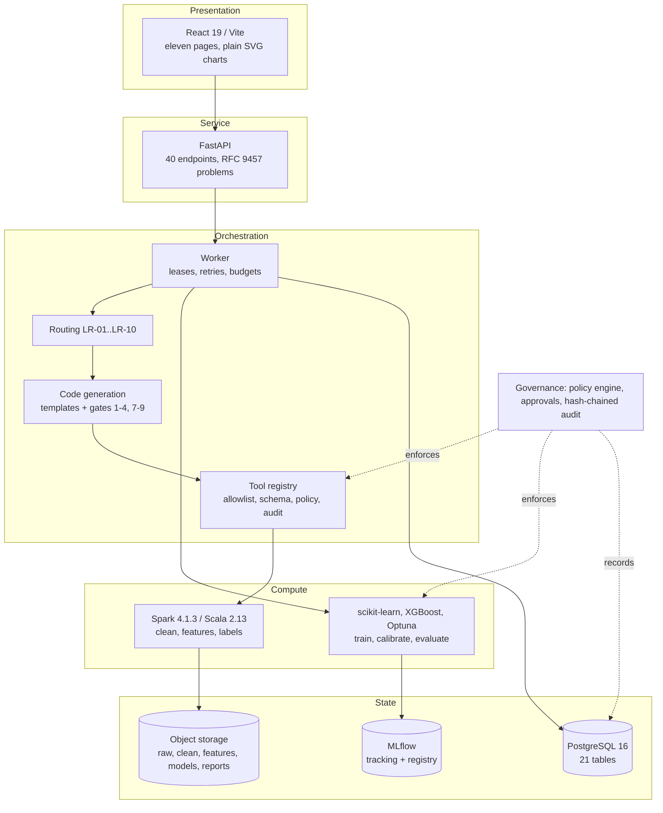
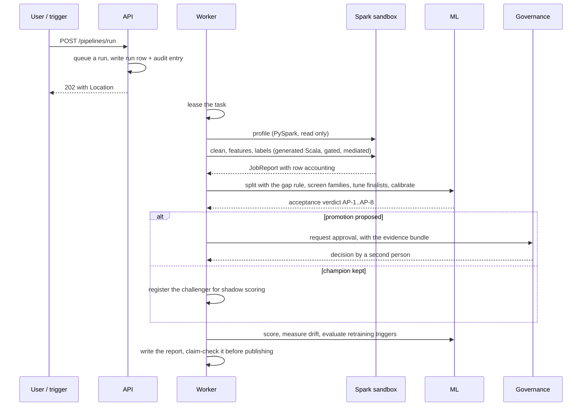

# Architecture

For developers and reviewers who need to know where a decision is made and what stops it being
made somewhere else.

## The one-sentence version

Five layers, each with one job, and a governance layer that cuts across all of them: raw data is
ingested and profiled, transformed by generated Spark jobs, turned into point-in-time features
and labels, modelled in Python, and published only through an approval — with every decision,
execution and artifact recorded as a row.

## Layers



## Where each decision is made

| Decision | Made by | Written down as |
| --- | --- | --- |
| Which engine and language a stage runs on | `agents/routing.py`, rules LR-01..LR-10, deterministic | a `routing` decision record with the rule id and the evidence |
| Whether a generated job may run | `agents/codegen/gates.py`; seven of the nine gates run (5 and 6 do not — see the agent design document) | `code_artifacts.gate_results` and the stage's gate reports |
| Whether a tool call is allowed | `agents/tools/registry.py` — agent allowlist, argument schema, policy action | an `audit_logs` entry on the run's chain |
| Whether an action needs a person | `triad_core/policy.py` against `agents/policies/governance.yaml` | a `policy` decision record with the verdict and rule ids |
| Whether a model may be promoted | the acceptance policy AP-1..AP-8 in `python_ml/triad_ml/train.py` | an `acceptance` decision record with its evidence and rule ids |
| Whether a run should be retried, repaired or escalated | `triad_core/errors.py` taxonomy and playbook | `agent_tasks.error_class`, `error_fingerprint` |
| Whether retraining should start | `agents/retraining.py`, triggers RT-1..RT-9 | an alert, and a queued run when it fires |

**The LLM appears in none of those rows.** It is not in the routing path, the policy path, the
promotion path or the audit path. Where it is used at all — proposing a slot's contents for a
generated job — its output passes the same gates as anything else, and this environment
configures no provider (ADR-0003), so the template path is what runs.

## Data flow, one run



## The things that are enforced structurally

Some rules are enforced by making the wrong thing impossible rather than by checking for it:

- **No alias-moving tool exists.** ATC-02 ("an agent cannot promote a model") holds because the
  registry has no tool to register. `agents/tools/pipeline_tools.py` ends with a comment saying
  so, because the absence is the mechanism and absence is easy to delete by accident.
- **A governed tool with no policy engine is refused, not allowed.** The registry is a module
  singleton, so the policy and the audit sink travel per call; a call arriving without them
  fails closed.
- **The audit chain is appended under `pg_advisory_xact_lock`.** Two writers reading the same
  chain head is how the chain forked once; the lock makes the read-append-commit atomic.
- **Transformers are fitted inside the model pipeline**, so a scaler cannot see the validation
  fold. A shuffled-label test asserts the resulting model is no better than chance.
- **Segment attributes are joined for evaluation only** and recorded on the split as
  `evaluation_only_cols`, because three separate call sites derive their own feature list and
  forgetting one turns a demographic attribute into a model input. That is not hypothetical: it
  happened, and it moved every family's PR-AUC.

## Storage layout

```
/data/triad/
  raw/<dataset>/v=<n>/           immutable, checksummed on registration
  clean/<dataset>/v=<n>/         Spark output, committed through the tool registry
  quarantine/<dataset>/v=<n>/run=<id>/
  features/<feature_set>/fsv=<v>/
  labels/<label_def>/v=<n>/
  training_sets/<run_key>/
  artifacts/code/<content_hash>/  generated Scala, addressed by content
  reports/<run_key>/              run_state.json, evaluation.json, the business report
  profiles/<run_key>_<dataset>.json
  sandbox/<run_key>/              staging, per stage
  monitoring/references/mv=<id>/  the training reference a drift report compares against
```

A content hash over a data directory is the **multiset of its rows**, not the bytes of its
files: Spark puts a per-job UUID in every part-file name and assigns rows to files by
scheduling, so the same data written twice is never the same bytes. That definition is what
makes ATC-18 (replay with no LLM calls and identical outputs) satisfiable at all; the cost is a
read-back on commit, and the reasoning is recorded in `triad_core/ids.py`.

## Decision records

Architecture decisions are in [`docs/adr/`](../adr/), in context-decision-alternatives-consequences
form. The three that shape most of what is above:

- **ADR-0001** — one toolchain image on Python 3.11, so the environment cannot drift between
  the service and the jobs.
- **ADR-0002** — Env-A-mini: 8 cores and a 5.27 GB Docker VM, with containers clamped to 3 GB.
  This is why the 10 GB and 100 GB performance tiers are reported as *not run* rather than
  estimated.
- **ADR-0003** — no LLM provider is configured. The template path is the default and is fully
  implemented; every measurement that would depend on live LLM behaviour is recorded as not
  measured, with the reason.

Implementation-level decisions, DEC-01 to DEC-19, are in
[`docs/implementation/DECISIONS.md`](../implementation/DECISIONS.md).
