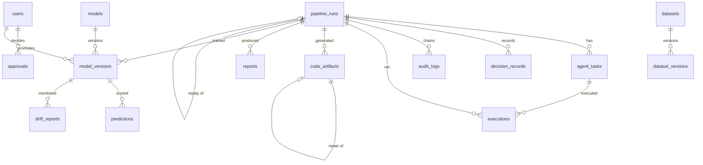

# Database schema

For developers. PostgreSQL 16, twenty-one tables, managed by Alembic. Nothing writes to it
except through SQLAlchemy models in `triad_core/models.py`; the sandbox that runs Spark jobs has
no database access at all.

## Migrations

```bash
docker compose -f docker/compose.yaml --profile tools run --rm -T dev alembic upgrade head
docker compose -f docker/compose.yaml --profile tools run --rm -T dev alembic current
```

| Revision | What it does |
| --- | --- |
| `244c0cc68301` | The initial schema: all twenty-one tables |
| `b1f2a3c4d5e6` | Adds `executions.stage`, so a run's stages can be reconstructed from executions when it predates task rows |

A migration is written by hand and reviewed, not autogenerated and applied. `alembic upgrade
head` runs at container start for the API; the worker assumes the schema is already current.

## The tables, grouped by what they are for

### Identity and governance

| Table | Rows are | Notable columns |
| --- | --- | --- |
| `users` | One account | `role` is constrained to the seven roles; `password_hash` is argon2 and never leaves the database |
| `approvals` | One decision a person must make | `requested_by` / `decided_by` are separate on purpose — separation of duties is a database-level fact, not only a service check. `expires_at` makes a stale approval unusable |
| `audit_logs` | One appended, hash-chained event | `prev_hash` / `entry_hash` form one chain per `run_id`, plus a `system` chain for rows with no run. Appended under `pg_advisory_xact_lock` |
| `decision_records` | One decision an agent made | `decision_type` is `routing`, `policy`, `acceptance` or `selection`; `policy_rule_ids` and `evidence_refs` are what make it reviewable |

### Data

| Table | Rows are | Notable columns |
| --- | --- | --- |
| `datasets` | A registered source | `contract_yaml` holds the contract this dataset's versions are checked against |
| `dataset_versions` | An immutable version of one dataset | `checksum_sha256` is what makes re-registering identical bytes a no-op; `profile_uri` and `quality_score` are written by the profiling stage |

### Runs

| Table | Rows are | Notable columns |
| --- | --- | --- |
| `pipeline_runs` | One run | `run_key` is the human-readable id; `input_versions` records the exact versions read, which is what makes a replay read the same bytes; `budget_json` persists the ceilings and what has been spent |
| `agent_tasks` | One unit of work inside a run | `lease_owner` / `lease_expires_at` are how a crashed worker's task is re-queued rather than stranded; `error_fingerprint` drives the circuit breaker |
| `executions` | One job that actually ran | `spark_app_id`, `image_digest`, `resources_json`, `duration_ms`, `metrics_json` |
| `code_artifacts` | One generated program | `content_hash` addresses it in storage; `gate_results` records all nine gates; `parent_artifact_id` links a repair to what it repaired |
| `events` | One thing to tell a listener about | Drains to the SSE stream |
| `llm_invocations` | One model call | `redacted_prompt_uri`, token counts, cost. Empty in this environment (ADR-0003) |
| `fix_memory` | A remedy that worked before | Keyed by `error_fingerprint`, with a `success_count` |

### Models and results

| Table | Rows are | Notable columns |
| --- | --- | --- |
| `models` | A logical model | `champion_version_id` is the only place an alias lives in this database |
| `model_versions` | One trained version | `governance_status`, `threshold`, `artifact_sha256`, `promoted_by`, `promoted_at` |
| `experiments` | One MLflow experiment per run | `split_spec_json` is the split, stored so the run can be reproduced |
| `metrics` | One measurement | `scope` + `ref_id` point at a run, model version or dataset; `ci_low` / `ci_high` carry the bootstrap interval; `segment` carries per-segment values |
| `predictions` | One scored customer | `prediction_set` separates `official` from `shadow`, which is what stops a shadow model's scores being read as production output |
| `drift_reports` | One comparison against a training reference | `psi_json` per feature, `flagged_features` |
| `alerts` | Something someone should look at | `severity`, `status`, `acknowledged_by` |
| `reports` | One generated document | `claim_check_status` and `claim_check_json`: what the check verified and what it refused |

## Relationships worth knowing



`metrics` has no foreign key on purpose: `scope` and `ref_id` let one table hold measurements
about runs, model versions and datasets without three near-identical tables. The cost is that
nothing at the database level stops a dangling `ref_id`, and the lookup index
(`ref_id, metric_name, split, segment`) is what makes it usable.

## Retention

Nothing is deleted automatically, and `data.delete` is an L0-forbidden action for agents: it is a
manual administrator procedure. For a deployment that needs retention limits:

- `audit_logs` must not be pruned by row — the chain would break and `verify_chain` would
  correctly report tampering. Archive whole chains, oldest runs first, and record what was
  archived in the system chain.
- `predictions` is the table that grows fastest, at one row per customer per scoring run. It is
  safe to partition or archive by `score_date`.
- `events` is drained by the SSE stream and can be pruned by `created_at` once `consumed`.
- `llm_invocations` holds redacted prompts by URI, not content; deleting the stored prompt makes
  a run less reproducible but breaks nothing.

## Two facts about this schema that came from failures

- **`metrics.ci_low`, `metrics.ci_high` and `metrics.segment` were columns nothing filled.** The
  bootstrap intervals were computed and dropped on the way to the database, so "comparison with
  confidence intervals" had no intervals. Similarly `dataset_versions.profile_uri` and
  `.quality_score` were NULL on all 130 rows, which made the one endpoint that serves a profile
  incapable of answering.
- **`pipeline_runs.run_key` used to be numbered from a row count**, so two concurrent creators
  produced the same key. It is now allocated so that a collision cannot happen.
